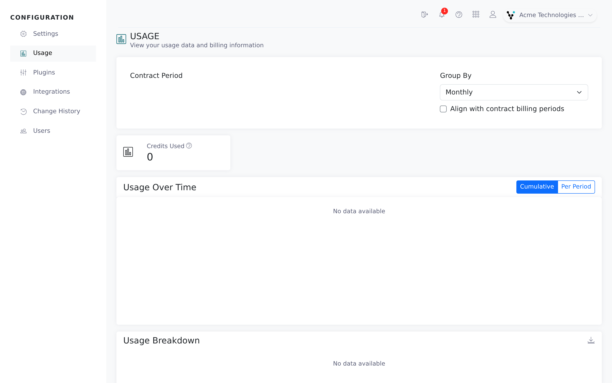

The **Usage** page shows how much of your contract your firm has used: credits bought, credits used, what's left, and how usage spread over time. Plan and contract changes are handled by the Vitay team.

<Note>
  You need the root recruiter role. Sub-accounts whose billing rolls up into a parent account don't have a **Usage** page; open it on the parent account instead.
</Note>

## Open the Usage page

<Steps>
  <Step title="Open the Configuration area">
    Click **Configuration** in the left navigation.
  </Step>
  <Step title="Select Usage">
    Click **Usage**, below **Settings**. It opens on your current contract period.

    
  </Step>
</Steps>

## What counts as usage

One credit is used per candidate, the first time a reference, pre-screening or feedback form is completed for them.

- Adding candidates and sending requests cost nothing.
- A candidate counts once. Later completed references don't add to the count.
- The credit is dated on the day that first form was completed.

## Read the numbers

| Card | What it means |
|---|---|
| **Contract Credits** | Total candidates purchased in your contract. |
| **Credits Used** | Usage during the selected date range, with the percentage of your contract beside it. |
| **Remaining Credits** | Credits left in your contract. |
| **Overages** | Usage beyond your contract credits. |

**Contract Credits**, **Remaining Credits** and **Overages** only show when your contract credits are recorded in Vitay.

## Change what you are looking at

| Control | What it does |
|---|---|
| **Contract Period** | The contract term to report on. Its dates show underneath. |
| **Group By** | **Daily**, **Weekly**, **Monthly** (default) or **Annual** buckets for the chart and table. |
| **Align with contract billing periods** | Shown with **Monthly**. Groups by your contract's billing periods instead of calendar months, so rows match your invoices. |
| **Include subaccounts** | Shown on a parent account. Adds the sub-accounts' usage to the totals. |

The **Usage Over Time** chart shows either **Cumulative** (a running total) or **Per Period** (usage in each bucket).

**Usage Breakdown** shows the same data as a table: **Period**, **Usage**, **Cumulative Usage** and **Overages**. With **Include subaccounts** on, you can expand a row to see which account the usage came from. The download button in the table header (tooltip **Download CSV**) exports the table.

## Get alerted before you run out

Usage alerts are set on the **Notifications** tab in Settings, in the **Usage Notifications** card. New accounts start with it on, alerting at 80%, 90% and 100% to every root user. You can pick thresholds from 70% to 110% and add extra addresses. See [Notification settings](/account-configuration/notification-settings#usage-notifications).

Each threshold sends one email per contract term. The email has the subject **Usage Alert: N% threshold reached**, summarises your usage and overage, and has a **View Usage Details** button. Alerts always count sub-account usage, whatever the **Include subaccounts** checkbox says.

Alerts need an active contract in Vitay with a start date and a candidate limit. If your contract details aren't in Vitay yet, nothing is sent; contact [hello@vitay.io](mailto:hello@vitay.io).

## Monthly usage report email

Vitay can also send a **Monthly Usage Update** email with how many candidates received references this contract period, your limit and the percentage used. There is no switch for it in the app. Ask [hello@vitay.io](mailto:hello@vitay.io) to turn it on and set the recipients.

## Changing your plan

Credits, contract dates and limits come from your Vitay contract and can't be edited in the app. To add credits, change your plan or ask about an overage, contact [hello@vitay.io](mailto:hello@vitay.io).

## Troubleshooting

<AccordionGroup>
  <Accordion title="I can't find the Usage page">
    Sub-accounts whose billing is combined with a parent account don't show **Usage**. Switch to the parent account, open **Usage** and turn on **Include subaccounts**.
  </Accordion>
  <Accordion title="The contract cards are missing">
    They only show when contract credits are recorded for the account. **Credits Used** always shows. If your contract should be on file, contact [hello@vitay.io](mailto:hello@vitay.io).
  </Accordion>
  <Accordion title="Our usage is lower than the number of candidates we added">
    Only candidates with at least one completed reference, pre-screening or feedback form count.
  </Accordion>
  <Accordion title="We passed 90% but nobody got an email">
    Check that **Usage Notifications** is on, 90% is ticked, and either **Notify Administrators** is on or there is at least one **Additional Email Recipients** address. Also check whether the 90% alert already went out earlier in the same contract term.
  </Accordion>
</AccordionGroup>

## Related articles

<CardGroup cols={2}>
  <Card title="Notification settings" icon="bell" href="/account-configuration/notification-settings" />
  <Card title="Manage users" icon="users" href="/account-configuration/manage-users" />
  <Card title="Firm configuration and security settings" icon="gear" href="/account-configuration/firm-configuration" />
  <Card title="Download reports" icon="download" href="/reports-lead-generation/download-reports" />
</CardGroup>

{/* source: app projects/configuration protected/usage/usage.component.{ts,html}; shared/components/navbar/navbar.component.ts; protected/settings/notifications/settings.notifications.component.ts (availableThresholds); api app/services/usage_service/creator.rb, app/services/usage_notification_service.rb, app/mailers/usage_notification_mailer.rb, app/models/setting.rb (enable_usage_notifications), lib/tasks/client_reports.rake */}
