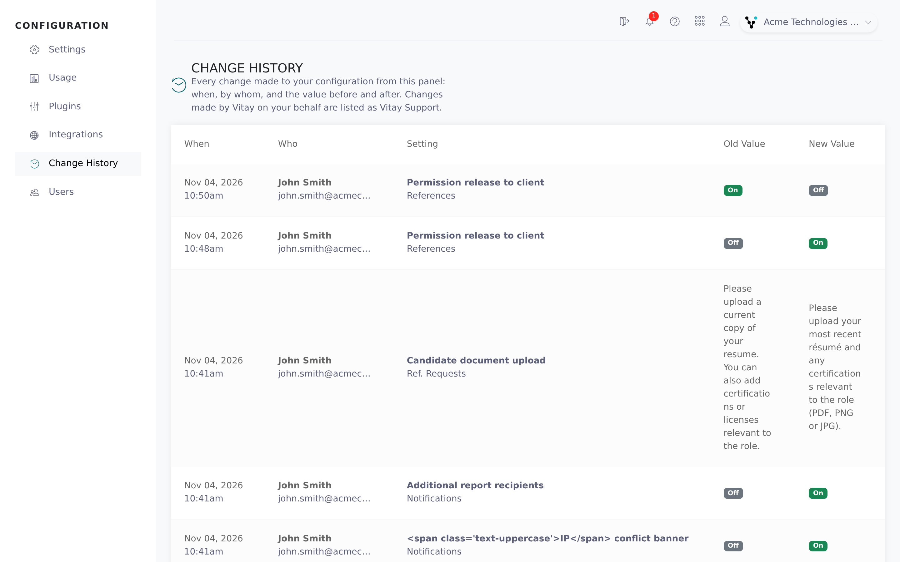

The **Change history** page shows who changed your firm's configuration and when. It lists changes made in the Configuration area (settings, templates, relationships, jobs, notifications, users and integrations) with the old and new value side by side.

<Note>
  Only root recruiters can see Change history. It lists changes from the day the page was introduced; earlier changes aren't included.
</Note>

## Open the change history

<Steps>
  <Step title="Open the Configuration area">
    Click **Configuration** in the left navigation.
  </Step>
  <Step title="Select Change history">
    Click **Change history**, below **Integrations**. The newest changes are at the top; use the page numbers at the bottom to go back further.

    
  </Step>
  <Step title="Go to the setting">
    When a row names a setting, the name is a link. Click it to open that Settings tab with the setting highlighted.
  </Step>
</Steps>

## Read a row

| Column | What it shows |
|---|---|
| **When** | The date of the change. Hover it for the time. |
| **Who** | The person who made the change. Changes by the Vitay team show as **Vitay Support**, with "on behalf of *name*" when acting for one of your users. Removed users show as **Former user**. |
| **Setting** | What changed, with its tab or page underneath. Added or deleted records, such as a relationship or a user, have an **Added** or **Removed** badge. |
| **Old value** / **New value** | The value before and after. Switches show **On** or **Off** and empty values show **—**. Long text has a **Show more** link. Sensitive values, such as integration credentials, show **Hidden (sensitive)**. |

A single save can change several values, for example a switch and the field under it. Each value gets its own row.

## What isn't listed

- Changes Vitay makes automatically, such as integrations syncing data.
- Changes to candidates, references and other day-to-day records. Those are in the [Activities log](/reports-lead-generation/activities-log).

## Troubleshooting

<AccordionGroup>
  <Accordion title="I can't see Change history in the navigation">
    It's only shown to root recruiters. Opening its address without that role shows "Only root users can view the configuration change history." See [Manage users](/account-configuration/manage-users).
  </Accordion>
  <Accordion title="The page says No changes recorded yet">
    Nobody has changed your configuration in the Configuration area since the page was introduced. New changes appear as soon as they're saved.
  </Accordion>
  <Accordion title="A setting changed but there's no row for it">
    The change was probably made automatically rather than by a person in the Configuration area. Contact **hello@vitay.io** if you need details about a specific change.
  </Accordion>
  <Accordion title="I'm looking at the wrong account's history">
    The page shows the account you're in. Switch accounts from the top bar (see [Switch firms](/getting-started/switch-firms)).
  </Accordion>
</AccordionGroup>

## Related articles

<CardGroup cols={2}>
  <Card title="Find and change settings" icon="magnifying-glass" href="/account-configuration/find-and-change-settings" />
  <Card title="Firm configuration and security settings" icon="sliders" href="/account-configuration/firm-configuration" />
  <Card title="Manage users" icon="users" href="/account-configuration/manage-users" />
  <Card title="Activities log" icon="list" href="/reports-lead-generation/activities-log" />
</CardGroup>

{/* source: app projects/configuration protected/change-history/change-history.{component.html,component.ts,labels.ts}, shared/components/navbar/navbar.component.ts; api app/controllers/api/v3/configuration_changes_controller.rb, app/models/concerns/tracks_configuration_changes.rb */}
