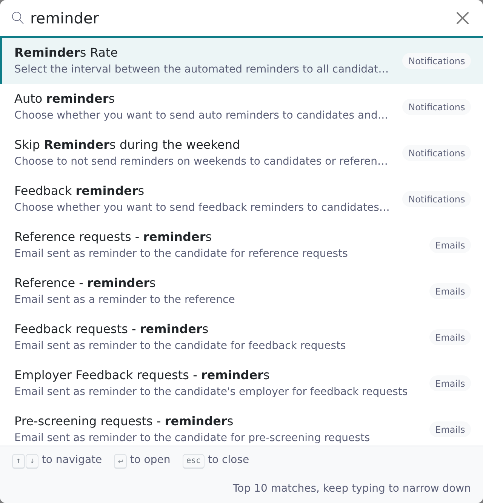

Your firm's settings live under **Settings** in the Configuration area, split across tabs. You can browse the tabs or search for a setting by name. Changes save on their own, so there are no Save buttons.

<Note>
  You need the root recruiter role to open the Configuration area.
</Note>

## Search for a setting

<Steps>
  <Step title="Open Settings">
    Click **Configuration** in the left navigation, then **Settings**.
  </Step>
  <Step title="Open the search">
    Click the **Search settings…** bar above the tabs, or press **Ctrl K** (**⌘K** on a Mac) anywhere in Settings.

    
  </Step>
  <Step title="Type what you are looking for">
    Type part of a setting's name or description, for example `reminder` or `personal email`. Each result shows the setting's name, its description and its tab. Vitay lists the top 10 matches, so keep typing to narrow them down.
  </Step>
  <Step title="Pick a result">
    Click a result, or move to it with **↑** / **↓** and press **Enter**. Vitay opens the tab, scrolls to the setting and briefly highlights its card. Press **Esc** to close the search without choosing.
  </Step>
</Steps>

The search matches setting names and descriptions in the language you use Vitay in. It only lists settings you can see. A setting on a tab your account doesn't have, or one that only appears when another switch is on (for example **Maximum end date age**, which appears once **Restrict reference end date** is on), stays out of the results until it shows on its tab.

## Share a link to a setting

When you open a setting from the search, the address in your browser points at its card, for example `…/settings/references#is_reference_dates_enabled`. Send that address to a colleague. When they open it as a root recruiter on the same account, Vitay opens the tab and scrolls to the card.

## How changes are saved

| Kind of setting | How it saves |
|---|---|
| Switches, dropdowns and checkboxes | As soon as you change them. A message such as **Settings updated** appears. |
| Text and number fields, and the email, text and page editors | Shortly after you stop typing, or when you click away. The status under the field shows **Saving…**, then **Saved**. |

If the status shows **Not saved**, the value was rejected, for example a number outside the allowed range or a text message over its character limit. An error message explains why. Correct the value and it saves again.

Buttons such as **Restore default**, **Send test** and **Preview** still appear where they apply.

## Which tabs you see

The tabs run down the left of the Settings page: **General**, **Configuration**, **Plugins**, **Relationships**, **Ref. Requests**, **References**, **Jobs**, **Documents**, **Notifications**, **Leads**, **Pages**, **Emails**, **Texts** and **Developers**.

Some tabs stay hidden until Vitay turns on the matching plugin or feature for your account:

| Tab | Appears when |
|---|---|
| **Feedback** | The Candidate Feedback plugin is on. See [Plugins and the marketplace](/account-configuration/plugins). |
| **Data Retention** | The Data retention plugin is on. See [Data retention](/security-it/data-retention). |
| **White Label** | The White label plugin is on. See [Branding and white label](/account-configuration/branding-white-label). |
| **SSO** | Single sign-on has been set up for your account. See [SSO with SAML](/security-it/sso-saml). |

On a demo account, most tabs are greyed out until the account is upgraded.

Other Configuration pages sit next to **Settings** in the left navigation: **Usage** (see [Usage and billing](/account-configuration/billing-and-usage)), **Plugins**, **Integrations**, **Change history** (see [Change history](/account-configuration/change-history)) and **Users**.

## Troubleshooting

<AccordionGroup>
  <Accordion title="Ctrl K doesn't open the search">
    The shortcut only works on a **Settings** page. If the cursor is in the browser's address bar, click inside the page first, or click the **Search settings…** bar.
  </Accordion>
  <Accordion title="The search can't find a setting I know exists">
    Check that the setting shows on its tab. Settings that only appear under another switch, or on a tab your account doesn't have, are left out of the results. Try a word from the setting's description instead.
  </Accordion>
  <Accordion title="A tab I used before is missing">
    Plugin tabs are hidden when the plugin isn't on for the account you are in. If you work across several accounts, check which one you are in (see [Switch firms](/getting-started/switch-firms)). Billing details are on the **Usage** page in the left navigation.
  </Accordion>
  <Accordion title="A field keeps showing Not saved">
    The value is being rejected. Read the error message, fix the value (for example, bring a number back within its range) and it saves on its own. If the message doesn't help, contact **hello@vitay.io**.
  </Accordion>
</AccordionGroup>

## Related articles

<CardGroup cols={2}>
  <Card title="Firm configuration and security settings" icon="sliders" href="/account-configuration/firm-configuration" />
  <Card title="Reference request settings" icon="list-check" href="/account-configuration/reference-request-settings" />
  <Card title="Reference settings" icon="user-check" href="/account-configuration/reference-settings" />
  <Card title="Change history" icon="clock-rotate-left" href="/account-configuration/change-history" />
  <Card title="Plugins and the marketplace" icon="puzzle-piece" href="/account-configuration/plugins" />
  <Card title="Switch firms" icon="arrows-rotate" href="/getting-started/switch-firms" />
</CardGroup>

{/* source: app projects/configuration protected/settings/settings.component.{ts,html}; shared/components/modals/settings-search/; shared/settings-search/settings-search.{service,registry}.ts; shared/settings-search/settings-anchor.service.ts; shared/auto-save/; shared/components/navbar/navbar.component.ts; projects/references shared/components/navbar/navbar.component.ts (Configuration link root only) */}
