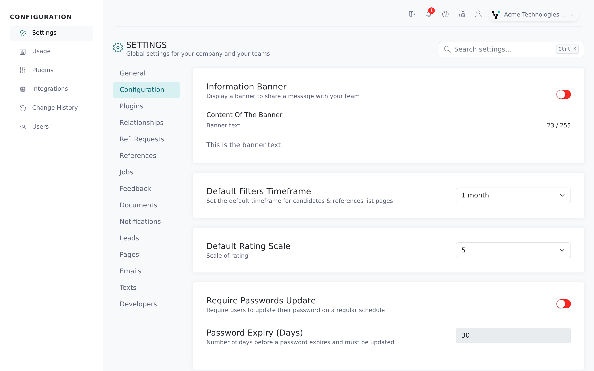
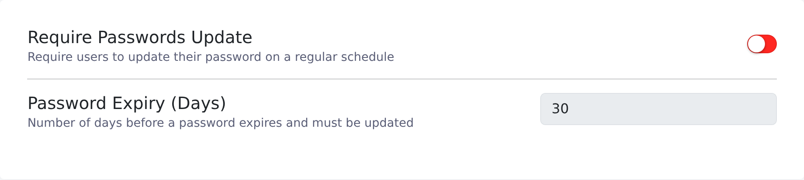

The **Configuration** tab holds firm-wide settings: session and password rules, what your team sees by default, which candidate details are mandatory, and how account emails are addressed. The security settings come first, for IT reviewers.

<Note>
  You need the root recruiter role to open the Configuration area. Switches save as soon as you flip them. Text and number fields save shortly after you stop typing and show **Saving…**, then **Saved**. If a field shows **Not saved**, the value was rejected; correct it and it saves again.
</Note>

## Open the tab

<Steps>
  <Step title="Open Settings">
    Click **Configuration** in the left navigation, then **Settings**.
  </Step>
  <Step title="Select Configuration">
    Click the **Configuration** tab in the list on the left.

    
  </Step>
</Steps>

## Security settings

| Setting | What it does | Default |
|---|---|---|
| **IDLE** | Logs users out after a period of inactivity. Set the minutes in **IDLE timeout** (1 to 1440). | Off; 15 minutes |
| **Require passwords update** | Makes users change their password on a schedule. Set **Password expiry (days)** (1 to 365). Users who sign in with SSO are not affected. | Off; 30 days |
| **Lock inactive users** | Once a month, locks every non-root user who hasn't signed in for a month. | Off |
| **Metadata collection** | Records browser, operating system and IP address when people submit the public forms. Turning it off limits fraud checks such as [IP conflict alerts](/candidates-reference-requests/ip-conflicts-and-reference-edits). | On |

A locked user sees "Account locked. Please contact your company's Admin User" when they try to sign in. Unlock them from **Users** in the Configuration area (see [Manage users](/account-configuration/manage-users)).

Multi-factor authentication is turned on per user, not on this tab (see [MFA and login options](/getting-started/mfa-and-login-options)). To require MFA for your whole team, contact Vitay support. Once it is on, every member with an authenticator app or a phone number on file is asked for a code at sign-in; members with neither can still sign in. Single sign-on has its own **SSO** tab (see [SSO with SAML](/security-it/sso-saml)).

## Team-wide defaults

| Setting | What it does | Default |
|---|---|---|
| **Information banner** | Shows a message bar at the top of the app for everyone in your account. Type up to 255 characters in **Content of the banner**. | Off |
| **Default filters timeframe** | The date range list pages open with: **1 month**, **3 months** or **6 months**. | 1 month |
| **Default rating scale** | Whether rating questions use a **5** or **10** point scale. Applies to reference forms opened after the change. | 5 |
| **Display Everyone / Myself toggle** | Lets every recruiter switch list pages between **Everyone** and **Myself**. When off, recruiters see only their own candidates; root recruiters and supervisors still see everyone's. | Off |
| **Allow users to update the assigned user** | Shows the assigned recruiter field in the candidate form to every user. When off, only root recruiters can reassign a candidate. | Off |
| **Status change comment prompt** | Opens a **Change candidate status** dialog with an optional comment whenever someone changes a candidate's status. The comment is added to the candidate's comments. | Off |

## Contact details and data quality

| Setting | What it does | Default |
|---|---|---|
| **Candidate email required** | Makes the candidate's email mandatory when adding a candidate or sending a quick request. | On |
| **Phone numbers validity** | Checks candidate, reference and employer phone numbers when they are saved and rejects numbers that can't be dialled ("is not a valid phone number"). | On |

Reference contact settings (**Reference email required**, work and mobile phone rules, **Allow duplicate references**) are on the **References** tab. See [Reference settings](/account-configuration/reference-settings).

## Email routing

| Setting | What it does | Default |
|---|---|---|
| **Email Sender Identity** | The From address and name on candidate and reference emails. See [Email sender settings](/account-configuration/email-sender-settings). | Recruiter's email / Recruiter's name |
| **Reply-To** (on the **Email Sender Identity** card) | Where replies to candidate and reference emails land: the candidate's assigned recruiter, or one custom address and name. See [Email sender settings](/account-configuration/email-sender-settings#where-replies-go). | Assigned recruiter |
| **New Recruiters - Compliance Statement** | Text added in bold to the welcome email new recruiters receive. Leave it empty to send the standard email. | Empty |

## Troubleshooting

<AccordionGroup>
  <Accordion title="Users are being logged out unexpectedly">
    Check the **IDLE** switch and the **IDLE timeout** value. The timeout counts minutes without clicks, scrolls or key presses in Vitay, so a tab left open in the background logs out once it runs out.
  </Accordion>
  <Accordion title="A recruiter says their account is locked">
    Either they hit the failed sign-in limit, or **Lock inactive users** locked them after a month without signing in. A root recruiter can unlock them from **Users** in the Configuration area.
  </Accordion>
  <Accordion title="I typed a banner message but nobody sees it">
    The banner only shows while the **Information banner** switch is on. Check that the status under **Content of the banner** says **Saved**. Text over 255 characters isn't saved (the counter turns red), so shorten it.
  </Accordion>
  <Accordion title="A valid-looking phone number is rejected">
    **Phone numbers validity** rejects numbers that can't be dialled, for example missing digits or a wrong country code. Correct the number, or turn the check off if you need to store numbers that can't be validated.
  </Accordion>
</AccordionGroup>

## Related articles

<CardGroup cols={2}>
  <Card title="Manage users" icon="users" href="/account-configuration/manage-users" />
  <Card title="Email sender settings" icon="envelope" href="/account-configuration/email-sender-settings" />
  <Card title="MFA and login options" icon="shield" href="/getting-started/mfa-and-login-options" />
  <Card title="SSO with SAML" icon="key" href="/security-it/sso-saml" />
  <Card title="Reference settings" icon="user-check" href="/account-configuration/reference-settings" />
  <Card title="Candidate statuses and comments" icon="comment" href="/candidates-reference-requests/candidate-statuses-and-comments" />
</CardGroup>

{/* source: app projects/configuration protected/settings/configuration/settings.configuration.component.{ts,html}; src/app/shared/services/idle.service.ts; src/app/shared/components/modals/candidates/modals.candidates.component.html; api db/schema.rb (settings defaults), app/models/setting.rb, app/models/user.rb (mfa_method, firm_requires_mfa?), app/models/concerns/has_secure_tokens.rb, lib/tasks/users.rake + config/schedule.rb, app/controllers/api/v3/oauth_controller.rb, app/controllers/api/v3/candidates_controller.rb, app/models/candidate.rb + reference.rb + employer.rb (phone lookup), app/models/recruiter.rb (welcome email) */}
