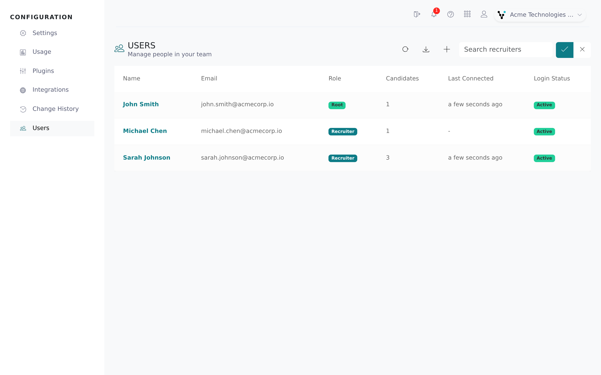

Users are the people on your team who sign in to Vitay. As an Admin you can add colleagues, give each one a role, and remove access when someone leaves.

<Note>
  You need the Admin role, or a role with **Manage users** (and **Manage roles** to change roles). See [Roles and permissions](/account-configuration/roles-and-permissions).
</Note>

## Add a user

<Steps>
  <Step title="Open Users">
    Click **Configuration** in the left navigation, then **Users**.

    
  </Step>
  <Step title="Click Add recruiter">
    Click the **+** button (tooltip **Add recruiter**). The **Add user** form opens.
  </Step>
  <Step title="Enter the user's details">
    Fill in **First name**, **Last name**, **Email** and, if you like, a phone number. The email address is their username.

    Pick their **Role**. It starts on **Recruiter**.

    Leave **Send email to user** ticked to email them their login details. If you untick it, no email is sent and you need to give them access another way, for example with **Reset password** on their user page.
  </Step>
  <Step title="Submit">
    Click **Submit**. To change their role later, see [Change a user's role](#change-a-users-role).

    
  </Step>
</Steps>

If the email address already belongs to a Vitay user, that person is added to your account with their existing login, and no welcome email is sent.

### What the new user receives

With **Send email to user** ticked, a new user gets a welcome email (subject "Reference checking. Simplified.") that says who added them, gives their username and a temporary password, and has a **Log in** button. It also links to an explainer video and a user guide: Vitay's by default, or your own if you set custom links on the **White Label** tab (see [Branding and white label](/account-configuration/branding-white-label)).

If you filled in **New Recruiters - Compliance Statement** on the **Configuration** tab in Settings, that text appears in bold in the welcome email.

### Download the user list

Click the download button on the **Users** page (tooltip **Download report**). Vitay downloads a CSV with each user's first name, last name, email and whether they are active.

## Roles

Every user has one role: **Admin**, **Supervisor**, **Recruiter**, **View only**, or a custom role your firm created. See [Roles and permissions](/account-configuration/roles-and-permissions) for what each one can do.

Each account has one default account user, your main point of contact. They are always an Admin and can't be deactivated. To move that designation to someone else, contact Vitay support.

## Edit a user's details

<Steps>
  <Step title="Open the user's page">
    On the **Users** page, click the person's row.
  </Step>
  <Step title="Open Edit user">
    Click the pencil button (tooltip **Edit recruiter**). The **Edit user** form opens.
  </Step>
  <Step title="Change details">
    Change the name, email or phone number, then click **Submit**.
  </Step>
</Steps>

## Change a user's role

<Steps>
  <Step title="Open Edit user">
    On the **Users** page, click the person's row, then the pencil button.
  </Step>
  <Step title="Pick the role">
    Choose the new role in **Role**. The change saves straight away and **Role saved** appears.

    
  </Step>
</Steps>

The **Role** dropdown is locked, with a note explaining why, when:

- you edit your own account (another Admin has to change your role);
- the user is the default account user, who is always an Admin;
- in a sub-account, the user is an Admin of the main account (change their role on the main account).

A role marked "This role holds permissions you do not have" can't be picked, because you can't hand out permissions you don't hold.

### Send someone every team notification

There is no per-person "always notify" switch. Each team notification has its own row in the **Team notifications** table on the **Notifications** tab in Settings. Tick **Admin users** on a row to include every Admin, or add the person's address under **Additional emails**. See [Notification settings](/account-configuration/notification-settings).

## Deactivate (remove) a user

Deactivating a user removes their access but keeps their candidates and references.

<Steps>
  <Step title="Open the user's page">
    On the **Users** page, click the person's row.
  </Step>
  <Step title="Deactivate">
    Click the red trash button, then confirm with **Delete**.
  </Step>
</Steps>

Admins can't be deactivated. For an Admin, the trash button is shown locked, and hovering it says "Admins can't be deactivated. Change this user's role first." Change their role, then deactivate them.

The user loses access straight away. If they are signed in, they are signed out at their next action. They can't sign in again and stop receiving team notification emails. If they also belong to another account in your firm family, their access there is not affected.

Their past work stays in reports and activity logs under their name. To restore access, filter the **Users** page to **Inactive** (the cross button), open their page and click **Reactivar**.

Deactivating a user doesn't reassign their candidates, and emails for the assigned recruiter skip deactivated users. Reassign the candidates if someone else should hear about them (see [Change the assigned recruiter for a candidate](#change-the-assigned-recruiter-for-a-candidate)).

## Unlock a user

A user is locked after too many failed sign-in attempts, or by **Lock inactive users** on the **Configuration** tab (off by default), which locks non-root users who haven't signed in for a month. Locked users show **Locked** in the **Login status** column and on their user page.

To unlock someone, open their page and do one of these:

- Click **Unlock and Reset password**. They get a password reset email and are unlocked once they set a new password. The link works once and expires after 1 hour; click the button again to send a new one.
- Click the pencil button, then **Unlock account** in the **Edit user** form. They are unlocked straight away and keep their current password.

Users can also unlock themselves with **Forgot password** on the login page (see [Logging in](/getting-started/logging-in)).

## Change the assigned recruiter for a candidate

Every candidate has an **Assigned user**: the recruiter who owns the record and, with the default [notification settings](/account-configuration/notification-settings), gets its notifications. Root recruiters can always change it. Other users can only change it when **Allow users to update the assigned user** is on in the **Configuration** tab (off by default).

<Steps>
  <Step title="Reassign one candidate">
    Open the candidate, click the pencil button, and pick the new recruiter in **Assigned user** at the top of the form. Click **Submit**.
  </Step>
  <Step title="Reassign several candidates at once">
    On the **Candidates** list, tick the candidates and choose **Assign to recruiter** from the bulk actions. Select the recruiter and confirm. This action isn't offered while the list shows **All Sub Accounts**; pick one account first.
  </Step>
</Steps>

## Manage sub-accounts

Sub-accounts are separate accounts under your main one, for branches, teams or client companies. Each has its own candidates, references and users, and usage rolls up to the parent for billing. If sub-accounts are enabled for your firm, **Accounts** appears in the Configuration navigation.

<Steps>
  <Step title="Open Accounts">
    Click **Accounts** in the Configuration navigation. The table lists each sub-account's **ID**, name, brand name, root user and creation date. The brand name is what the sub-account's candidates and references see: its own, or yours when it has none (see [Branding and white label](/account-configuration/branding-white-label)). The **ID** is the Branch ID used when [bulk-uploading candidates](/reports-lead-generation/bulk-candidate-upload) into a sub-account.
  </Step>
  <Step title="Click Add sub account">
    Click the **+** button (tooltip **Add sub account**). The button is disabled inside a sub-account; create sub-accounts from the parent.
  </Step>
  <Step title="Enter the sub-account and its root user">
    Fill in the sub-account's **Name**, then the **First name**, **Last name** and **Email** of the person who will manage it. They become its default root user.

    Leave **Send email to user** ticked to email them their login details.
  </Step>
  <Step title="Submit">
    Click **Submit**. The parent account's root users are added to the new sub-account as root users, so they can manage it and switch into it. Recruiters and deactivated users are not carried over.
  </Step>
</Steps>

To add more users to a sub-account, switch into it and follow [Add a user](#add-a-user). If the email you enter already belongs to a Vitay user, that person gets access to the sub-account with their existing login and no welcome email is sent.

A user who belongs to several accounts switches between them from the top bar (see [Switch firms](/getting-started/switch-firms)). Root users of the parent account can see combined usage on the **Sub accounts overview** dashboard and the usage pages (see [Billing and usage](/account-configuration/billing-and-usage)).

## Troubleshooting

<AccordionGroup>
  <Accordion title="The new user didn't receive their login email">
    Check that **Send email to user** was ticked when you added them; if not, no email was sent. Ask them to check spam. To send new login details, open their page and click **Reset password** (or **Unlock and Reset password** if they are locked). The reset link expires after 1 hour.
  </Accordion>
  <Accordion title="I can't change the role for a user">
    The **Role** dropdown is locked when you edit your own account, when the user is the default account user, and in a sub-account when the user is an Admin of the main account. Ask another Admin to change your role. To move the default account designation, contact Vitay support. If you don't see **Role** at all, your role doesn't include **Manage roles**.
  </Accordion>
  <Accordion title="The trash button on a user's page is locked">
    The user is an Admin. Change their role in **Edit user**, then deactivate them.
  </Accordion>
  <Accordion title="A user was locked but never entered a wrong password">
    **Lock inactive users** is on and they hadn't signed in for a month. Unlock them from their user page, or turn the setting off on the **Configuration** tab.
  </Accordion>
  <Accordion title="I can't see the Assigned user field when editing a candidate">
    The field shows for root recruiters, or for everyone once **Allow users to update the assigned user** is on. Ask a root recruiter to reassign the candidate or turn on the setting.
  </Accordion>
  <Accordion title="I can't find Users">
    Users is in the Configuration area, which only roles with **Open Configuration** can open. Ask an Admin in your account to change your role.
  </Accordion>
</AccordionGroup>

## Related articles

<CardGroup cols={2}>
  <Card title="Roles and permissions" icon="id-badge" href="/account-configuration/roles-and-permissions" />
  <Card title="Email sender settings" icon="envelope" href="/account-configuration/email-sender-settings" />
  <Card title="Notification settings" icon="bell" href="/account-configuration/notification-settings" />
  <Card title="Question sets and templates" icon="list-check" href="/account-configuration/question-sets-and-templates" />
  <Card title="Branding and white label" icon="palette" href="/account-configuration/branding-white-label" />
  <Card title="Firm configuration" icon="sliders" href="/account-configuration/firm-configuration" />
  <Card title="Billing and usage" icon="credit-card" href="/account-configuration/billing-and-usage" />
</CardGroup>

{/* source: app.vitay.io projects/configuration MODALS.USERS (Add user / Edit user, IS_SEND_EMAIL_ENABLED), MODALS.USERS.SUPERVISOR, src/app/shared/components/modals/users (role select gated on team:roles, MODALS.USERS.ROLE / CANNOT_GRANT, ROLES_LOCKED.SELF / IS_DEFAULT / INHERITED lock reason), USERS.SHOW.DEACTIVATE_LOCKED_TOOLTIP (app #2213), NAVBAR.USERS, NAVBAR.ACCOUNTS, USERS show page (Reset password / Unlock and Reset password, USERS.SHOW.LOCKED badge), users.list.component (download → documents csv type recruiters), accounts.list.component (cols seq_id ID/name/public_name brand/default_root/created_at; add disabled when isSubAccount) + shared/components/modals/accounts (name, first/last name, email, is_send_email_enabled, MODALS.ACCOUNTS.WARNING), SETTINGS.CONFIGURATION.is_disable_inactive_users_enabled / is_candidate_ownership_updatable / new_recruiters_security_statement labels; projects/references shared/components/modals/candidates (added_by_id Assigned user field gated by isRoot || is_candidate_ownership_updatable), candidates.list.component + assign-to-recruiter-modal (CANDIDATES.BULK_ACTIONS.ASSIGN_TO_RECRUITER, withheld under scope:all_sub_accounts), DASHBOARD.SUB_ACCOUNTS; api app/models/user.rb, app/models/recruiter.rb (send_welcome email: subject, username/password, explainer_video_link, user_guide_link, new_recruiters_security_statement), app/models/role.rb, app/models/hiring_firm.rb (seq_id per parent), lib/tasks/users.rake (disable_inactive: non-root, last_connected_at > 1 month → is_locked), app/controllers/api/v3/candidates/bulk_controller.rb (bulk_assign_to_recruiter), app/controllers/api/v3/documents/csv_controller.rb (recruiters export fields first_name last_name email is_active), app/controllers/concerns/authorization.rb (inactive user or recruiter → 401, token revoked) + User#revoke_all_tokens! / Recruiter#revoke_session_tokens! after deactivation (VIT-1347; sibling-firm sessions kept), app/models/user.rb PASSWORD_RESET_KEY_TTL = 1.hour + clear_password_reset_key (single use), app/services/notifications/recipient_resolver.rb (active recruiter + active user only); app.vitay.io projects/configuration shared/components/always-notified-recruiters (recruiter.notifications) */}
