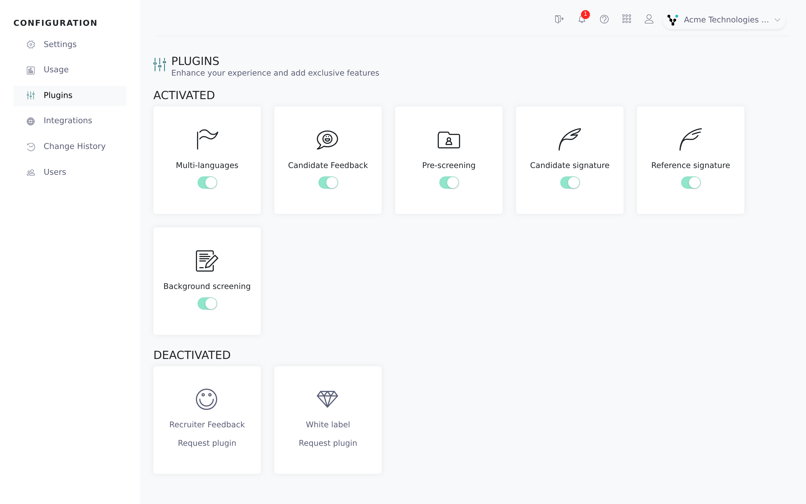
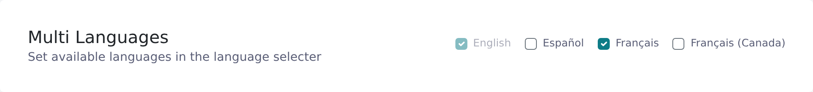

Plugins are optional features the Vitay team turns on for your account, such as pre-screening, feedback, signatures, multiple languages and white label. The **Plugins** page in the Configuration area shows which are on and lets you request the rest.

<Note>
  You need the root recruiter role. Vitay turns plugins on and off for you; the switches on the page only show the current state.
</Note>

## See your plugins and request one

<Steps>
  <Step title="Open Plugins">
    Click **Configuration** in the left navigation, then **Plugins**.
  </Step>
  <Step title="Check what's on">
    **Activated** lists the plugins on your account. **Deactivated** lists the rest.

    
  </Step>
  <Step title="Request a plugin">
    On a card under **Deactivated**, click **Request plugin**. This opens an email to **hello@vitay.io** with the subject *Vitay.io - Request … plugin*. To turn a plugin off, email hello@vitay.io too.
  </Step>
</Steps>

## The plugin cards

| Card | What it adds | Read more |
|---|---|---|
| **Multi-languages** | Offer Vitay to candidates and references in several languages, with templates per language. | [Settings Plugins tab](#the-settings-plugins-tab), [Email, text and page templates](/account-configuration/email-text-and-page-templates) |
| **Candidate Feedback** | Get feedback from candidates about your recruiting process. | [Candidate feedback](/feedback/candidate-feedback) |
| **Recruiter Feedback** | Ask candidates to rate the recruiters on your team. | [Candidate feedback](/feedback/candidate-feedback) |
| **Pre-screening** | Send pre-screening questionnaires to candidates. | [Pre-screening questionnaires](/candidates-reference-requests/pre-screening) |
| **Candidate signature** | Ask the candidate to sign the reference request form. | [Signatures](/account-configuration/signatures) |
| **Reference signature** | Ask the reference to sign the reference form. | [Signatures](/account-configuration/signatures) |
| **Background screening** | Order background checks through Mintz Global Screening. | [Background screening requests](/candidates-reference-requests/background-screening) |
| **White label** | Run Vitay under your own domain, links and branding. | [Branding and white label](/account-configuration/branding-white-label) |

**Candidate signature** and **Reference signature** are on by default. The others are off until requested.

Two more plugins are set up by Vitay and have no card. Email **hello@vitay.io** to ask about them:

- **Validity Screening** adds Validity Screening Solutions (United States) as a background screening partner. See [Background screening requests](/candidates-reference-requests/background-screening).
- **Data retention** adds the **Data Retention** settings tab and the **Scheduled deletion** page. See [Data retention](/security-it/data-retention).

## The Settings Plugins tab

Some plugins have their own settings, on the **Plugins** tab in Settings.

- Without **Multi-languages**, the tab shows **Plugins not selected** with a **Go to marketplace** link.
- With **Multi-languages**, the **Multi languages** card has a checkbox per language: **English**, **Español**, **Français** and **Français (Canada)**. English can't be unticked. Ticking a language saves right away and adds that language's email, text and page templates.

## What each plugin unlocks

Screens that belong to a plugin stay hidden until it's on, including the **Feedback**, **White Label** and **Data Retention** tabs in Settings.

- **Pre-screening**: **Pre-screening** in the main navigation, a **Pre-screening** tab on candidate pages and in request forms, a **Pre-screening** type for question sets, pre-screening templates, and the **Pre-screening completed** notification row.
- **Candidate Feedback** and **Recruiter Feedback**: **Feedback** in the main navigation, a **Feedback** tab on candidate pages, a **Feedback** type for question sets, feedback templates, and the **Feedback completed** notification row. Candidate Feedback also adds the **Feedback** tab in Settings. Recruiter Feedback adds a feedback section to each user's page under **Users**.
- **Background screening** and **Validity Screening**: a **Background screening** tab on candidate pages.
- **Candidate signature** and **Reference signature**: a signature section on the public forms, side panels and PDF reports.
- **Multi-languages**: the language card above, and language pickers on the Emails, Texts, Pages and Leads tabs and on question sets.
- **White label**: the **White Label** tab in Settings.
- **Data retention**: the **Data Retention** tab in Settings and **Scheduled deletion** in the Configuration navigation.

A greyed-out navigation item with the tooltip **Feature locked** is not a missing plugin. Demo accounts see it on items such as **Question sets** until they upgrade.

## Troubleshooting

<AccordionGroup>
  <Accordion title="The switches on the Plugins page don't move">
    That's expected. They only show the current state. Use **Request plugin** or email hello@vitay.io.
  </Accordion>
  <Accordion title="I requested a plugin but nothing changed">
    The Vitay team turns plugins on, so wait for their reply. Once it's on, sign out and back in.
  </Accordion>
  <Accordion title="I can't find the Plugins page">
    Only root recruiters can open the Configuration area. Ask a root recruiter in your account to check or to change your role.
  </Accordion>
  <Accordion title="A plugin shows as Activated but I don't see its screens">
    Refresh the app, or sign out and back in.
  </Accordion>
</AccordionGroup>

## Related articles

<CardGroup cols={2}>
  <Card title="Manage users" icon="users" href="/account-configuration/manage-users" />
  <Card title="Firm configuration" icon="gear" href="/account-configuration/firm-configuration" />
  <Card title="Email, text and page templates" icon="envelope" href="/account-configuration/email-text-and-page-templates" />
  <Card title="Branding and white label" icon="palette" href="/account-configuration/branding-white-label" />
</CardGroup>

{/* source: app projects/configuration protected/plugins/plugins.component.{ts,html}, protected/settings/plugins/settings.plugins.component.html, shared/settings-search/settings-search.registry.ts, shared/components/notification-matrix/notification-matrix.rows.ts, shared/components/navbar/navbar.component.ts; projects/references shared/components/navbar/navbar.component.ts; api db/schema.rb (is_plugins_* defaults), app/models/setting.rb (PLUGINS validity_screening, data_retention) */}
