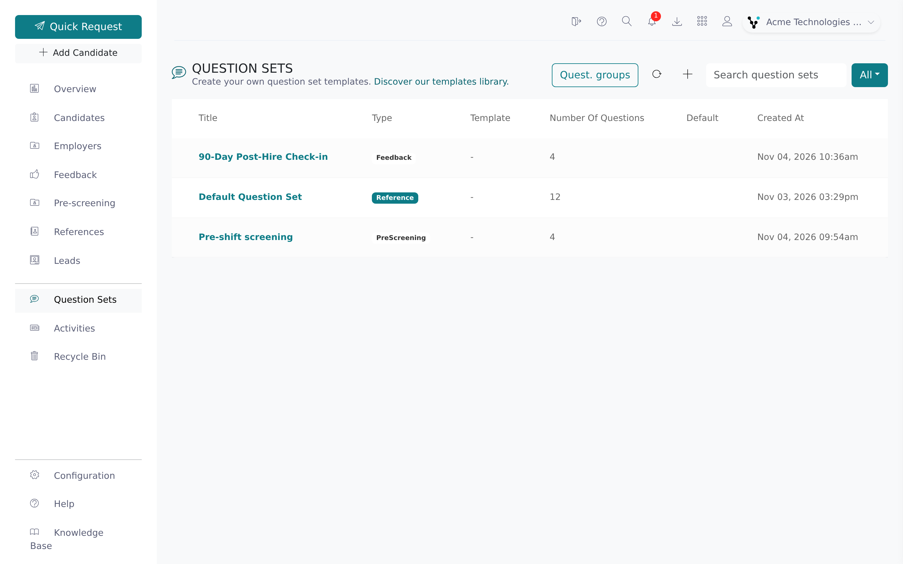
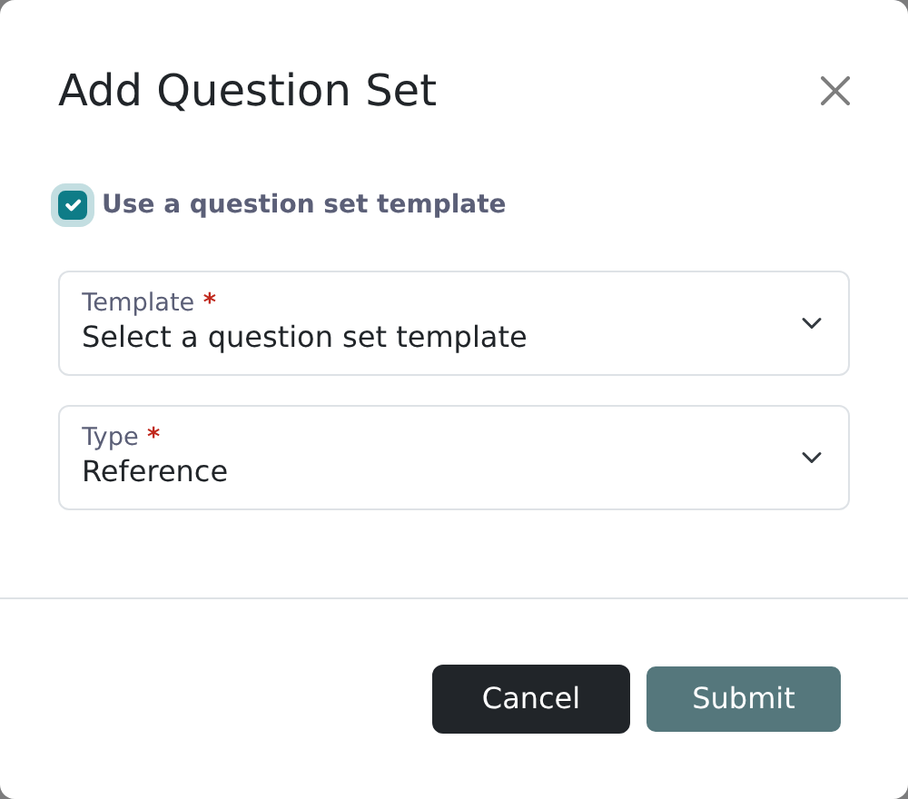

A question set is the list of questions a reference answers. You can keep several, for example one for executive roles and one for entry-level roles, and pick one when you send a reference request.

<Note>
  You need the root recruiter or supervisor recruiter role to create, edit or delete question sets. Other recruiters can pick from existing sets.
</Note>

## Create a question set

<Steps>
  <Step title="Open Question sets">
    Click **Question sets** in the left navigation of the main app.

    
  </Step>
  <Step title="Click Add question set">
    Click the **+** button (tooltip **Add question set**). The **Add question set** form opens.
  </Step>
  <Step title="Name the set">
    Type a name in **Label**, for example "Standard Reference Check". Recruiters pick sets by this name. To start from one of Vitay's sets instead, see [Use question set templates](#use-question-set-templates).
  </Step>
  <Step title="Choose the type">
    If a feedback or pre-screening plugin is on, pick the **Type**: **Reference**, **Feedback** or **Pre-screening**. The type decides where the set can be used; a Feedback set is never offered for a reference request.
  </Step>
  <Step title="Choose a language">
    If your account has the Multi-languages plugin, pick the **Language**.
  </Step>
  <Step title="Add questions">
    Click **Submit**, then click the new set in the list to open it. Click the **+** button (tooltip **Add question**). Write the question in **Sentence** and pick a **Type** (see [Question types](#question-types)). Click **Preview** at the top of the form to see the question as the reference will.
  </Step>
  <Step title="Group questions (optional)">
    Pick a **Question group** for each question. The group's label shows as a small heading above its questions on the reference form. See [Question groups](#question-groups).
  </Step>
</Steps>

## Edit a question set

Open **Question sets** and click the set. Add questions with the **+** button, click a question to edit it, and drag questions to reorder them. Use the pencil button to rename the set. Each change saves when you submit its form. Changes only affect future requests; answers already submitted don't change.

## Set a default question set

Click the star on a set's row in the **Question sets** list (tooltip **Highlight**) to make it the default. It's then pre-selected when a recruiter sends a reference request. Click the star again to remove it. Only one set can be the default; starring another set moves the default to it. Duplicates never inherit the star.

The star is separate from **Default question set** on the **Ref. Requests** tab in Settings, which the form previews use. See [Reference request settings](/account-configuration/reference-request-settings).

## Duplicate or delete a question set

To copy a set, click the duplicate button on its row in the list (tooltip **Duplicate**), or in the toolbar on the set's page, and confirm. Edit the copy as you like.

If your account has sub-accounts, choose **Duplicate in this subaccount** or **Duplicate to another subaccount** and pick the sub-account. Copying into another sub-account needs the root recruiter role on that sub-account. If a copy can't be made, a message tells you why and the dialog stays open.

To delete a set, open it, click the red trash button and confirm in **Delete question set?**. References already collected with it are kept, but recruiters can't pick it any more.

<Warning>
  A deleted question set can't be restored from the app. If you delete one by mistake, contact **hello@vitay.io**.
</Warning>

## Use question set templates

Vitay provides ready-made question sets you can start from.

<Steps>
  <Step title="Open Add question set">
    On the **Question sets** list, click the **+** button.
  </Step>
  <Step title="Tick the template checkbox">
    Tick **Use a question set template**. A **Template** dropdown appears.
  </Step>
  <Step title="Pick a template">
    Choose a template and click **Submit**. Vitay creates a new set with the template's questions, ready to edit. The template itself doesn't change.

    
  </Step>
</Steps>

Vitay manages the templates. To have one added or changed, contact **hello@vitay.io**.

## Question types

Only **Rating** and **Matrix/Rating Scale** answers count toward the reference's score (see [Read a completed reference](/candidates-reference-requests/read-a-completed-reference)).

| Type | What the reference sees | Extra fields | Scored |
|---|---|---|---|
| **Text** | A free-text box | None | No |
| **Rating** | A row of numbered buttons, red at the low end to green at the high end | **Context labels** | Yes |
| **Dropdown** | A single-choice dropdown | **Options** | No |
| **Radio** | A single-choice list | **Options** | No |
| **Checkbox** | A multiple-choice list | **Options** | No |
| **Matrix/Rating Scale** | A grid with one row per option and one column per rating | **Options** (rows) and **Columns** (up to 5) | Yes |
| **Slider** | A slider | None | No |
| **Ranking** | A list to put in order | **Options** | No |
| **Date** | A date picker | None | No |
| **Date Range** | A start and end date | **Year and month only (no day)** | No |

### Options and columns

**Options** are the choices on Dropdown, Radio, Checkbox and Ranking questions, and the rows on a Matrix question. Drag them to reorder. They carry no score.

**Columns** exist only on Matrix questions and form the rating scale. A new Matrix question starts with five; you can remove some, but not add a sixth (**Maximum of 5 columns allowed**). Put the weakest rating first and the strongest last, since the columns are rated "higher is better". Every Matrix row also gets an **N/A** choice that doesn't count toward the score.

### Comments

Every type except **Text** can be marked **Commentable**, which adds a comment box under the question. Tick **Comment required** to make the reference fill it in.

Rating questions also open an optional comment box, "(Optional) Why is it so low?", when the answer is 2 or less on a 5-point scale or 4 or less on a 10-point scale.

### Context labels (Rating only)

**Context labels** put a word at each end of the rating row: **Lowest/Highest** (default), **Poor/Great**, **Never/Always**, **Dissatisfied/Satisfied**, **Disagree/Agree** or **Unsatisfactory/Outstanding**. The number of buttons (5 or 10) comes from **Default rating scale** on the **Configuration** tab in Settings.

### Questions in more than one language

With the Multi-languages plugin, a set can hold its questions in several languages. Use the language dropdown on the set's page to switch, then add or edit the questions for that language. A set is only offered for a request in a language once every question has a translation in it.

## Question groups

Question groups are labels such as "Leadership" or "Technical skills" that group related questions on the reference form. Click **Quest. groups** at the top of the **Question sets** list to add, rename or remove them. Each group has a **Label**. Groups are shared by all question sets in your account.

## Troubleshooting

<AccordionGroup>
  <Accordion title="I can't select a question set when sending a reference request">
    Open **Question sets** and check that at least one set of type Reference exists. If the list is empty, create one.
  </Accordion>
  <Accordion title="A question set doesn't appear for one of my languages">
    A set is only offered for a language once every question has a translation in it. Open the set, switch the language dropdown and fill in the missing questions.
  </Accordion>
  <Accordion title="I want different question sets for different relationship types">
    You can give each relationship type its own question set on the **Relationships** tab in Settings. See [Relationships and jobs](/account-configuration/relationships-and-jobs).
  </Accordion>
</AccordionGroup>

## Related articles

<CardGroup cols={2}>
  <Card title="Send a reference request" icon="paper-plane" href="/candidates-reference-requests/send-a-reference-request" />
  <Card title="Manage users" icon="users" href="/account-configuration/manage-users" />
  <Card title="Notification settings" icon="bell" href="/account-configuration/notification-settings" />
  <Card title="Read a completed reference" icon="clipboard-check" href="/candidates-reference-requests/read-a-completed-reference" />
</CardGroup>

{/* source: app projects/references protected/question-sets/{list,show}/*, shared/components/navbar/navbar.component.ts, assets/i18n/en.json (QUESTION_SETS.*, PLACEHOLDERS.QUESTION_SETS.USE); src/app/shared/components/modals/{question-sets,questions}/*; src/app/shared/enums/question.enum.ts; api app/controllers/api/v1/question_sets_controller.rb (duplicate), app/models/question_set.rb, app/models/reference.rb#score */}
