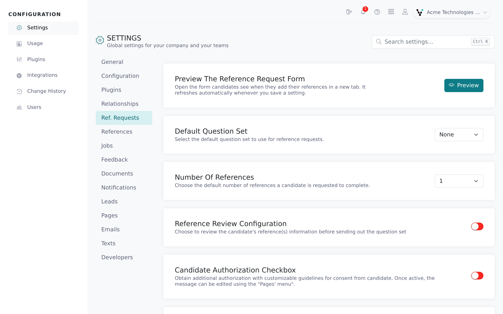
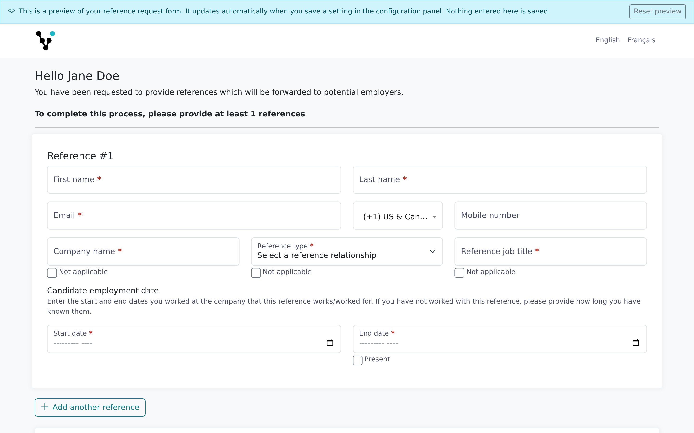

The **Ref. Requests** tab controls the request your candidate receives: how many references they're asked for, what they must agree to, whether you review their references before Vitay contacts them, and whether they can upload documents. You can also preview the candidate's form.

Settings about the reference itself, such as required contact details and what a reference can do on their form, are on the **References** tab. See [Reference settings](/account-configuration/reference-settings).

<Note>
  You need the root recruiter role. Each switch and dropdown saves as soon as you change it and applies to requests sent afterwards. Forms already open pick up the change when they next load.
</Note>

## Open the tab

<Steps>
  <Step title="Open Settings">
    In the Configuration area, click **Settings**.
  </Step>
  <Step title="Select Ref. Requests">
    Click the **Ref. Requests** tab in the list on the left.

    
  </Step>
</Steps>

## Preview the reference request form

The **Preview the reference request form** card opens the page a candidate sees when they add their references, so you can check settings, wording and branding.

<Steps>
  <Step title="Click Preview">
    Click **Preview**. The form opens in a new tab, built from your current settings in your account's default language.
  </Step>
  <Step title="Change settings">
    Keep the preview tab open. Each time you save a change in Settings, including the **Pages** texts, the preview reloads. Clicking **Preview** again reuses the same tab.
  </Step>
  <Step title="Try the form">
    You can fill in and submit the preview. A banner at the top says it's a preview: nothing is saved or sent. Click **Reset preview** to start again.

    
  </Step>
</Steps>

To preview the reference's form, use **Preview the reference form** on the **References** tab (see [Reference settings](/account-configuration/reference-settings#preview-the-reference-form)).

## Question set and number of references

| Setting | What it does | Default |
|---|---|---|
| **Default question set** | Your firm's default question set, or **None**. The form previews use it. It's separate from the starred set on the **Question sets** list, which is what the reference request form pre-selects (see [Question sets and templates](/account-configuration/question-sets-and-templates#set-a-default-question-set)). | None |
| **Number of references** | How many references a candidate is asked for by default, from **0** to **6**. Pre-fills the number in the reference request form and the `{{nb_min_references}}` merge field. | 1 |
| **Allow candidate to add additional references** | Shows an **Add another reference** button so candidates can list more than requested. | On |
| **Managers only default** | Ticks **Managers only** by default when you send a request. The candidate's form then says "Please only provide direct or non direct managers contact details." | Off |

## What the candidate must do

| Setting | What it does | Default |
|---|---|---|
| **Candidate authorization checkbox** | Adds a checkbox the candidate must tick before submitting. Edit its wording in the **Candidate authorization** card on the **Pages** tab. | Off |
| **Candidate document upload** | Lets candidates attach documents such as a resume. See [Candidate documents](/candidates-reference-requests/candidate-documents). | Off |

## Review references before sending

**Reference review configuration** (off by default) holds each new reference as **Pending user approval** instead of emailing it. The question set is only sent when someone opens the reference and clicks **Approve reference**. Who is told that a reference is waiting is set by the **Reference awaiting your review** row on the **Notifications** tab (see [Notification settings](/account-configuration/notification-settings)).

## Ownership

**Reassign user upon reference request** (off by default) adds a **Set yourself as the assigned user** checkbox, ticked by default, when you send a request. Untick it to send the request without taking over the candidate.

## Settings on the References tab

These are on the **References** tab (see [Reference settings](/account-configuration/reference-settings)):

- **Reference dates**, **Allow personal email addresses**, **Specialty required**, **Reference address**, **Candidate position held** and **Reference authorization checkbox**
- **Ask for references consent to share results**, **References can decline the request** and **Call me instead**
- **Show reference score**

## Troubleshooting

<AccordionGroup>
  <Accordion title="A reference says they never received the question set">
    Check whether **Reference review configuration** is on. If it is, the reference waits in **Pending user approval** until someone clicks **Approve reference**.
  </Accordion>
  <Accordion title="Nothing happens when I click Preview">
    The preview opens in a new tab. If your browser blocks pop-ups for the Configuration site, allow them and click **Preview** again.
  </Accordion>
  <Accordion title="The preview says Preview unavailable">
    The preview only works while you're signed in to the Configuration area. Sign in again and open it with the **Preview** button rather than a saved link.
  </Accordion>
  <Accordion title="The Ref. Requests tab is greyed out">
    The tab is disabled on demo accounts. Contact **hello@vitay.io** to upgrade.
  </Accordion>
</AccordionGroup>

## Related articles

<CardGroup cols={2}>
  <Card title="Reference settings" icon="user-check" href="/account-configuration/reference-settings" />
  <Card title="Send a reference request" icon="paper-plane" href="/candidates-reference-requests/send-a-reference-request" />
  <Card title="Customize emails, text messages, and pages" icon="envelope" href="/account-configuration/email-text-and-page-templates" />
  <Card title="Question sets and templates" icon="list-check" href="/account-configuration/question-sets-and-templates" />
  <Card title="Candidate documents" icon="file" href="/candidates-reference-requests/candidate-documents" />
  <Card title="Notification settings" icon="bell" href="/account-configuration/notification-settings" />
</CardGroup>

{/* source: app projects/configuration protected/settings/requests/settings.requests.component.{ts,html}, shared/services/form-preview.service.ts; projects/references assets/i18n/en.json (REFERENCE_REQUESTS.PREVIEW.*, REFERENCE.ALERTS.PENDING_REVIEW.*, SETTINGS.REQUESTS.ASSIGNED_USER); api db/schema.rb + app/models/setting.rb (defaults), app/controllers/api/v1/reference_requests_controller.rb#preview */}
