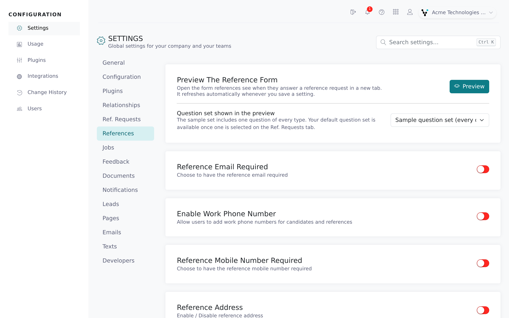
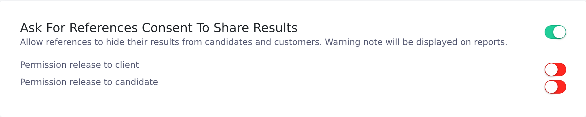

The **References** tab holds settings about the reference: which contact details they must have, what their form asks, and what they can do instead of answering (decline, ask for a call, limit who sees their answers). You can also preview the reference's form.

How the request reaches your candidate (number of references, candidate authorization, review before sending) is on the **Ref. Requests** tab. See [Reference request settings](/account-configuration/reference-request-settings).

<Note>
  You need the root recruiter role. Each switch and dropdown saves as soon as you change it and applies from then on. Forms already open pick up the change when they next load.
</Note>

## Open the tab

<Steps>
  <Step title="Open Settings">
    In the Configuration area, click **Settings**.
  </Step>
  <Step title="Select References">
    Click the **References** tab, below **Ref. Requests**.

    
  </Step>
</Steps>

## Preview the reference form

The **Preview the reference form** card opens the form a reference fills in, so you can check settings, questions and branding.

<Steps>
  <Step title="Choose the question set to show">
    Under **Question set shown in the preview**, pick **Sample question set (every question type)** to see one question of each type, or **Default question set: *name*** to see your firm's default. If you haven't set a default on the **Ref. Requests** tab, that option reads **Default question set (none selected)** and can't be picked.
  </Step>
  <Step title="Click Preview">
    Click **Preview**. The form opens in a new tab for a sample candidate and reference, in your account's default language.
  </Step>
  <Step title="Change settings">
    Keep the preview tab open. Each time you save a change in Settings, including question sets and page texts, the preview reloads. Clicking **Preview** again reuses the same tab.
  </Step>
  <Step title="Try the form">
    You can answer and submit the preview, including seeing the thank-you page. A banner says it's a preview: nothing is saved or sent. Click **Reset preview** to start again.
  </Step>
</Steps>

To preview the candidate's form, use **Preview the reference request form** on the **Ref. Requests** tab (see [Reference request settings](/account-configuration/reference-request-settings#preview-the-reference-request-form)).

## Contact details every reference must have

These apply wherever a reference is added: on the candidate's form and when a recruiter adds one.

| Setting | What it does | Default |
|---|---|---|
| **Reference email required** | Makes the reference's email mandatory. | Off |
| **Enable Work Phone Number** | Adds a work phone field for candidates and references, plus a **Phone number requirement** dropdown: **No phone required**, **Mobile number required**, **Work number required**, **Both mobile and work required** or **At least one (mobile or work)**. | Off |
| **Reference mobile number required** | Makes the reference's mobile number mandatory. Hidden while **Enable Work Phone Number** is on; use **Phone number requirement** instead. | Off |
| **Allow personal email addresses** | When off, addresses on Gmail, Yahoo, Hotmail and similar domains are rejected, and the candidate's form explains why. | On |
| **Prevent duplicate references** | Stops the same reference being added twice to a candidate for the same question set, matching on email, phone or ATS ID. The form shows "is already linked to an existing reference". | On |

You can also block personal emails for one relationship type only (see [Relationships and jobs](/account-configuration/relationships-and-jobs)).

## What the reference is asked

| Setting | What it does | Default |
|---|---|---|
| **Reference address** | Adds an address section to the reference form. Turn on **Reference address required** underneath to make it mandatory. | Off |
| **Specialty required** | Makes the specialty field on the reference form mandatory. | Off |
| **Candidate position held** | Asks the reference for the candidate's job title when they worked together. Shown on the reference and PDF reports. | Off |
| **Reference dates** | Asks the candidate for the dates they worked with each reference. The reference sees the dates and can correct them. | On |
| **Restrict reference end date** | Shown once **Reference dates** is on. Rejects end dates older than the **Maximum end date age** you pick: **6 months**, **1 year**, **2 years**, **3 years** (default) or **5 years**. | Off |
| **Reference authorization checkbox** | Adds a checkbox the reference must tick before submitting. Edit its wording in the **Reference authorization** card on the **Pages** tab. | Off |

## Consent, decline and call-back options

**Ask for references consent to share results** (off by default) has two switches underneath: **Permission release to client** and **Permission release to candidate**. Each adds a Yes/No question to the reference form, such as "Do we have your permission to release this information to our client?". If the reference answers No, a warning shows on the reference and on PDF reports. See [Share reference reports outside Vitay](/candidates-reference-requests/share-reports#when-a-reference-withholds-permission-to-share).

**References can decline the request** (off by default) adds a decline option to the reference form. The reference must leave a comment. The assigned recruiter gets a **Reference declined** email, and the reference shows "This reference has declined the reference request." with the comment. If webhooks are on, a `declined` event is sent.

**Call me instead** (off by default) lets the reference leave a phone number instead of filling in the form. The assigned recruiter is notified so they can call.

## Scores

**Show reference score** (on by default) shows the average score a reference gave the candidate on the candidate page and PDF reports. Turn it off to hide scores.

## Troubleshooting

<AccordionGroup>
  <Accordion title="Candidates can't enter a reference's email address">
    If **Allow personal email addresses** is off, Gmail, Yahoo, Hotmail and similar addresses are rejected. Turn it on or ask for a work address. A relationship type can also block personal emails; check the **Relationships** tab.
  </Accordion>
  <Accordion title="I can't find Reference mobile number required">
    It's hidden while **Enable Work Phone Number** is on. Use the **Phone number requirement** dropdown on that card instead.
  </Accordion>
  <Accordion title="I can't choose my default question set in the preview">
    Pick a **Default question set** on the **Ref. Requests** tab first.
  </Accordion>
  <Accordion title="The preview says Preview unavailable">
    The preview only works while you're signed in to the Configuration area. Sign in again and use the **Preview** button rather than a saved link. If nothing opens, allow pop-ups for the Configuration site.
  </Accordion>
  <Accordion title="The References tab is greyed out">
    The tab is disabled on demo accounts. Contact **hello@vitay.io** to upgrade.
  </Accordion>
</AccordionGroup>

## Related articles

<CardGroup cols={2}>
  <Card title="Reference request settings" icon="list-check" href="/account-configuration/reference-request-settings" />
  <Card title="Read a completed reference" icon="clipboard-check" href="/candidates-reference-requests/read-a-completed-reference" />
  <Card title="Share reference reports outside Vitay" icon="share-nodes" href="/candidates-reference-requests/share-reports" />
  <Card title="Relationships and jobs" icon="sitemap" href="/account-configuration/relationships-and-jobs" />
  <Card title="Question sets and templates" icon="list-check" href="/account-configuration/question-sets-and-templates" />
  <Card title="Customize emails, text messages, and pages" icon="envelope" href="/account-configuration/email-text-and-page-templates" />
</CardGroup>

{/* source: app projects/configuration protected/settings/references/settings.references.component.{ts,html}, shared/services/form-preview.service.ts; projects/references assets/i18n/en.json (REFERENCE.PREVIEW.*, PERSONAL_EMAIL_WARNING, CALLING_BACK, consent questions); api db/schema.rb + app/models/setting.rb (defaults), app/models/reference.rb (check_uniqueness, decline email), app/controllers/api/v1/references_controller.rb#preview */}
