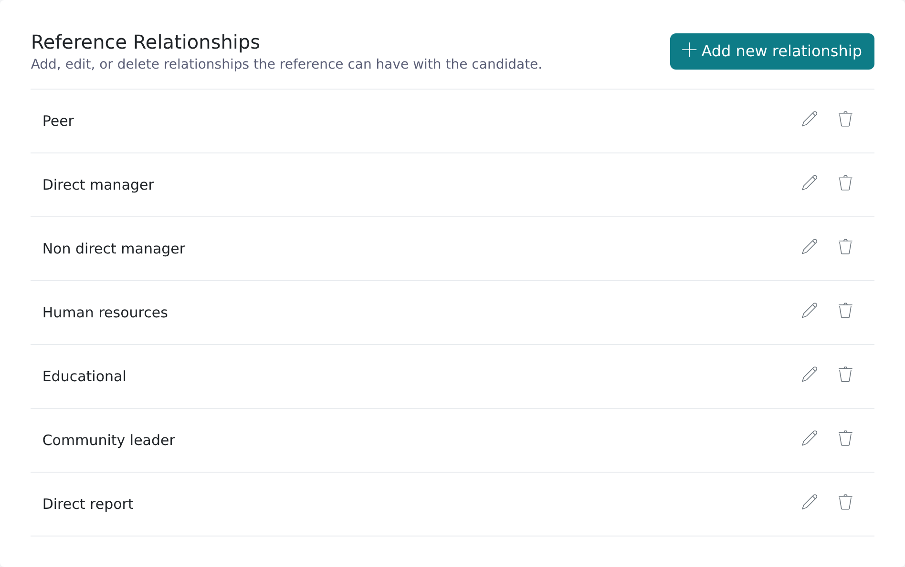
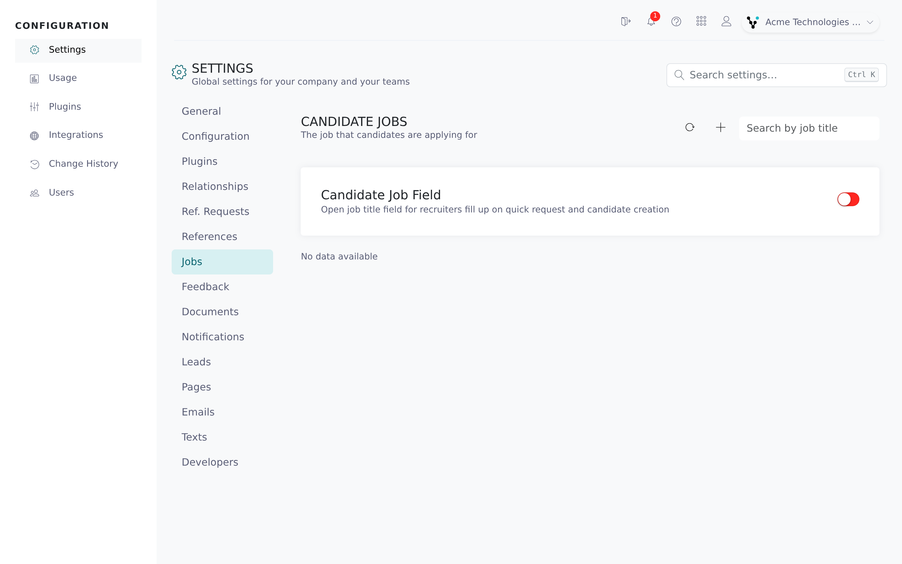

Two lists in Settings shape what candidates see and which questions references get: **Relationships** (how the reference knows the candidate) and **Jobs** (the role the candidate applied for). Attach a question set to either one and Vitay picks the questions for you.

<Note>
  You need the root recruiter role. The **Relationships** tab is disabled on demo accounts; the **Jobs** tab is available on every account.
</Note>

## Manage reference relationships

Candidates pick a relationship for each reference they add, for example **Manager**, **Colleague** or **Character**. Remove an option here and candidates can no longer pick it.

<Steps>
  <Step title="Open the tab">
    In the Configuration area, click **Settings**, then the **Relationships** tab. Each row shows the relationship name, its question set (if any) and a **No personal emails** badge where that option is on.

    
  </Step>
  <Step title="Add a relationship">
    Click **Add new relationship** and fill in **Relationship name**. If your account uses several languages, fill in the name for each one so candidates see it in their language.
  </Step>
  <Step title="Attach a question set (optional)">
    Pick one in **Question set**. References with this relationship then get that question set. Only reference question sets are listed.
  </Step>
  <Step title="Block personal emails (optional)">
    Tick **Prevent personal emails for these references (@gmail.com, @yahoo.com, etc.)** to require a work address for this relationship only, for example **Manager** but not **Character**.
  </Step>
  <Step title="Save">
    Click **Save**.
  </Step>
</Steps>

To change a relationship, click the pencil button on its row. Changes also apply to existing references with that relationship.

To remove one, click the trash button on its row and confirm with **Delete**. Candidates can no longer pick it; existing references keep it.

This per-relationship rule works alongside **Allow personal email addresses** on the **References** tab (see [Reference settings](/account-configuration/reference-settings)).

## Manage candidate jobs

Jobs are the roles your candidates applied for. Keeping them as a list lets you attach a default question set to each role.

<Steps>
  <Step title="Open the tab">
    In Settings, click the **Jobs** tab (**Candidate jobs**).

    
  </Step>
  <Step title="Turn on the job field">
    Turn on **Candidate job field** to add a job box to the add-candidate and Quick request forms. Turn on **Candidate job required**, which appears once the field is on, to make it mandatory.
  </Step>
  <Step title="Add a job">
    Click **+** (**Add new job**). Enter the **Job name** and, if you like, pick a **Question set** (choose **None** for no question set).
  </Step>
  <Step title="Edit or delete">
    Use the row buttons to edit a job or delete it. Edits also apply to every candidate with that job.
  </Step>
</Steps>

Use **Search by job title** to find a job in a long list. Recruiters can also create a job while adding a candidate: typing a new name in the job box offers **(Create new job)**.

## How Vitay picks the question set

Three things can set the question set a reference receives:

1. **The relationship's question set** wins. When the candidate submits their references, any reference whose relationship has a question set gets that set, whatever the request was sent with.
2. **The job's question set** fills in the **Question set** field when you pick an existing job on the **Quick request** form. You can still change it before sending.
3. **Your default question set** (the starred one) is pre-selected when you open the reference request form.

For example, a request sent with the **Nurse** question set still sends the **Character** question set to a reference marked **Character**, if that relationship has one. A relationship without a question set changes nothing.

The job's question set is only filled in on the **Quick request** form. If you add a candidate with a job and send a request from the candidate page later, pick the question set yourself.

## Troubleshooting

<AccordionGroup>
  <Accordion title="The question set list on a relationship is empty">
    The form says "No reference type question sets available. Please create one first." Create a reference question set first (see [Question sets and templates](/account-configuration/question-sets-and-templates)).
  </Accordion>
  <Accordion title="A reference got the wrong question set">
    Check the relationship the candidate chose. A relationship's question set overrides the request's. Remove the question set from that relationship if you don't want this.
  </Accordion>
  <Accordion title="Picking a job doesn't change the question set">
    This only happens on the **Quick request** form, and only when you pick an existing job rather than typing a new one. Check the job has a question set on the **Jobs** tab.
  </Accordion>
  <Accordion title="A relationship name shows in the wrong language">
    Edit the relationship and fill in the name for the missing language.
  </Accordion>
  <Accordion title="The Relationships tab is greyed out">
    The tab is disabled on demo accounts. Contact **hello@vitay.io** to upgrade.
  </Accordion>
</AccordionGroup>

## Related articles

<CardGroup cols={2}>
  <Card title="Reference settings" icon="sliders" href="/account-configuration/reference-settings" />
  <Card title="Question sets and templates" icon="list-check" href="/account-configuration/question-sets-and-templates" />
  <Card title="Send a reference request" icon="paper-plane" href="/candidates-reference-requests/send-a-reference-request" />
  <Card title="Add a candidate" icon="user-plus" href="/candidates-reference-requests/add-a-candidate" />
  <Card title="Firm configuration and security settings" icon="gear" href="/account-configuration/firm-configuration" />
</CardGroup>

{/* source: app projects/configuration protected/settings/relationships/settings.relationships.component.html, shared/components/modals/reference-relationship-edit/*, protected/settings/jobs/settings.jobs.component.{ts,html}, shared/components/modals/jobs/*, shared/settings-search/settings-search.registry.ts (tab gating); projects/references shared/components/modals/quick-request/modals.quick-request.component.ts (onJobSelect); api app/controllers/api/v1/reference_requests_controller.rb (relationship question set override) */}
