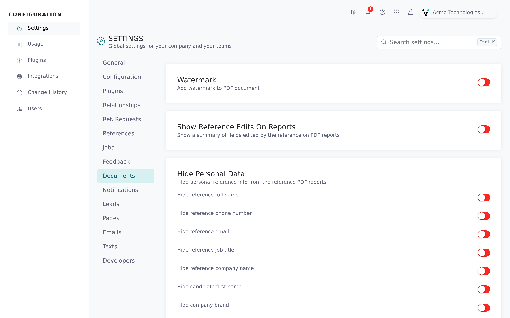
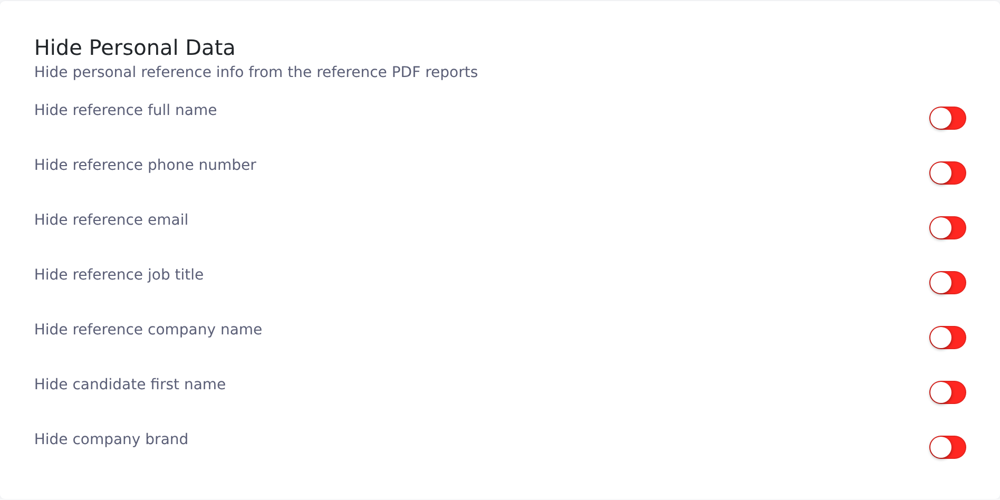

The **Documents** tab controls how your firm's reference reports look. The settings apply to every report generated afterwards: PDFs your recruiters download, PDFs attached to notification emails, and reports sent to your ATS.

<Note>
  You need the root recruiter role. Each switch saves as soon as you flip it.
</Note>

## Open the tab

<Steps>
  <Step title="Open Settings">
    In the Configuration area, click **Settings**.
  </Step>
  <Step title="Select Documents">
    Click the **Documents** tab in the list on the left.

    
  </Step>
</Steps>

## Report layout

Accounts use Vitay's compressed PDF layout, which fits the full report into fewer pages. Accounts that chose the older full-length **Default** layout keep it. On that layout the **Hide personal data** switches have no effect; contact [hello@vitay.io](mailto:hello@vitay.io) to move to the compressed layout.

## Watermark

**Watermark** (off by default) prints a watermark image behind every page of candidate, single-reference, feedback and pre-screening PDFs.

## Show reference edits on reports

**Show Reference Edits On Reports** (off by default) adds a **Reference Made Edits** banner to the PDF when a reference changed details the candidate supplied. It lists each changed field as *old value → new value*. References that changed nothing get no banner.

## Hide personal data

**Hide personal data** has seven switches, all off by default. They apply to candidate reports and single-reference reports on the compressed layout, not to feedback or pre-screening reports.

| Switch | What's removed from the PDF |
|---|---|
| **Hide reference full name** | The reference's name. |
| **Hide reference phone number** | The reference's phone number. |
| **Hide reference email** | The reference's email address. |
| **Hide reference job title** | The reference's job title. |
| **Hide reference company name** | The reference's company. |
| **Hide candidate first name** | Shortens the candidate's name to first name and last initial, for example *Jane D.* |
| **Hide company brand** | Your firm's logo. |

## Download formats

Every firm can download reports in every format. Wherever a report can be downloaded, the download button opens a menu:

| Where | Formats |
|---|---|
| A candidate's references list (per question set) | PDF, Word and CSV (one row per reference, one column per question) |
| The candidate page, a single reference, a feedback report and a pre-screening report | PDF and Word |

The Word version has its own simpler layout. The eye toggle next to the download button is a per-download choice that decides whether the candidate's email and phone number are printed.

## Troubleshooting

<AccordionGroup>
  <Accordion title="I turned on a Hide switch but the details still print">
    Your account is on the older full-length layout or a custom one, where the switches don't apply. Contact [hello@vitay.io](mailto:hello@vitay.io) to move to the compressed layout.
  </Accordion>
  <Accordion title="Where is the PDF template dropdown?">
    It was removed. The layout is now set by Vitay; contact [hello@vitay.io](mailto:hello@vitay.io) to change it.
  </Accordion>
  <Accordion title="Where are the Word and CSV download settings?">
    They were removed because every firm now has Word and CSV downloads. If a recruiter only sees a single download button, ask them to reload the app.
  </Accordion>
  <Accordion title="A recruiter can't see the CSV export button in the top bar">
    That's the firm-wide CSV export (see [Download reports](/reports-lead-generation/download-reports)), not a report download. Root recruiters always see it. For other recruiters it's a firm setting with no switch on this tab; contact [hello@vitay.io](mailto:hello@vitay.io).
  </Accordion>
  <Accordion title="A report won't generate">
    A report needs at least one completed reference. Without one, Vitay shows "The record does not have sufficient data to generate a pdf document".
  </Accordion>
</AccordionGroup>

## Related articles

<CardGroup cols={2}>
  <Card title="Read a completed reference" icon="file-lines" href="/candidates-reference-requests/read-a-completed-reference" />
  <Card title="Download reports" icon="download" href="/reports-lead-generation/download-reports" />
  <Card title="Share reports" icon="share-nodes" href="/candidates-reference-requests/share-reports" />
  <Card title="IP conflicts and reference edits" icon="triangle-exclamation" href="/candidates-reference-requests/ip-conflicts-and-reference-edits" />
  <Card title="Question sets and templates" icon="list-check" href="/account-configuration/question-sets-and-templates" />
  <Card title="Firm configuration and security settings" icon="gear" href="/account-configuration/firm-configuration" />
</CardGroup>

{/* source: app projects/configuration protected/settings/documents/settings.documents.component.{ts,html}; src/app/shared/helpers/array.helper.ts (reportFormats, csvReportFormat); projects/references protected/candidates/show/references/candidates.show.references.component.ts; api db/schema.rb (pdf_template default compressed), app/models/setting.rb, app/controllers/api/v3/documents/pdf_controller.rb, app/views/api/v3/documents/_reference_edits_summary.erb, app/views/api/v3/documents/en/compressed/*.erb */}
