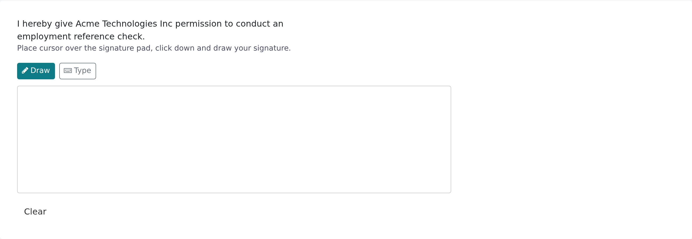

Vitay can ask candidates to sign the reference request form, and references to sign the reference form. Signatures are stored with the record and shown in the side panel and on PDF reports as evidence of consent.

<Note>
  The **Candidate signature** and **Reference signature** plugins are on by default. A root recruiter can see their state under **Plugins** in the Configuration area. To turn either one off or on, email **hello@vitay.io**.
</Note>

## What each plugin does

| Plugin | Where the signature pad appears | Who signs |
|---|---|---|
| **Candidate signature** | At the bottom of the candidate's reference request form. | The candidate, when submitting their references. |
| **Reference signature** | At the bottom of the reference form, after the questions. | The reference, when submitting their answers. |

While a plugin is on, the signature is required. Submitting without one shows **Signature is required**.

## What candidates and references see

On the reference request form, the card reads "I hereby give *your company* permission to conduct an employment reference check." *Your company* is the **Brand name** on the **General** tab in Settings, or the **Company name** when the brand name is blank. On the reference form the card is titled **Signature**.

The pad has two modes: **Draw** (mouse, trackpad or finger) and **Type** (type a full name, shown in a signature style). **Clear** empties the pad.

## Where signatures are shown

- **Candidate side panel**: a **Signature** section once the candidate has submitted.
- **Reference side panel**: a **Signature** section on the **About** tab.
- **PDF reports**: a **Candidate Signature** and/or **Reference Signature** block at the end, when the plugin is on and a signature was captured.

## Check or change the setting

<Steps>
  <Step title="Open Plugins">
    In the Configuration area, click **Plugins**.
  </Step>
  <Step title="Find the two cards">
    **Candidate signature** and **Reference signature** are under **Activated** or **Deactivated**.
  </Step>
  <Step title="Ask Vitay to change it">
    To turn one off, email **hello@vitay.io** naming the plugin. To turn one on, click **Request plugin** on its card.
  </Step>
</Steps>

Changes apply to forms opened afterwards. Signatures already captured are kept, but don't print on new PDF reports while the plugin is off.

## Troubleshooting

<AccordionGroup>
  <Accordion title="A candidate or reference can't submit">
    If they see **Signature is required**, the pad is empty. Ask them to draw a signature, or switch to **Type** and enter their full name.
  </Accordion>
  <Accordion title="The pad doesn't respond on a phone">
    Drawing works with a finger. If the page scrolls instead, ask them to use **Type**, or open the link on a computer.
  </Accordion>
  <Accordion title="A report has no signature block">
    Either the plugin was off when the report was generated, or no signature was captured. References your team added by hand have no signature.
  </Accordion>
</AccordionGroup>

## Related articles

<CardGroup cols={2}>
  <Card title="Plugins and the marketplace" icon="puzzle-piece" href="/account-configuration/plugins" />
  <Card title="Reference request settings" icon="sliders" href="/account-configuration/reference-request-settings" />
  <Card title="Report settings" icon="file-pdf" href="/account-configuration/report-settings" />
  <Card title="Read a completed reference" icon="clipboard-check" href="/candidates-reference-requests/read-a-completed-reference" />
</CardGroup>

{/* source: app projects/references public/reference-requests/reference-requests.component.html (signature card), public/references (reference signature card), assets/i18n/en.json (SIGNATURES.*, Signature is required); src/app/shared/components/signature-pad/signature-pad.component.ts; projects/configuration protected/plugins; api db/schema.rb (is_plugins_*_signature_enabled default true), app/controllers/api/v3/signatures_controller.rb, app/views/api/v3/documents (signature blocks) */}
