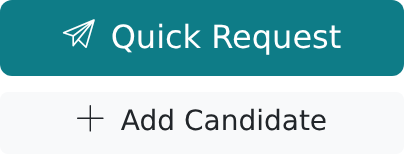
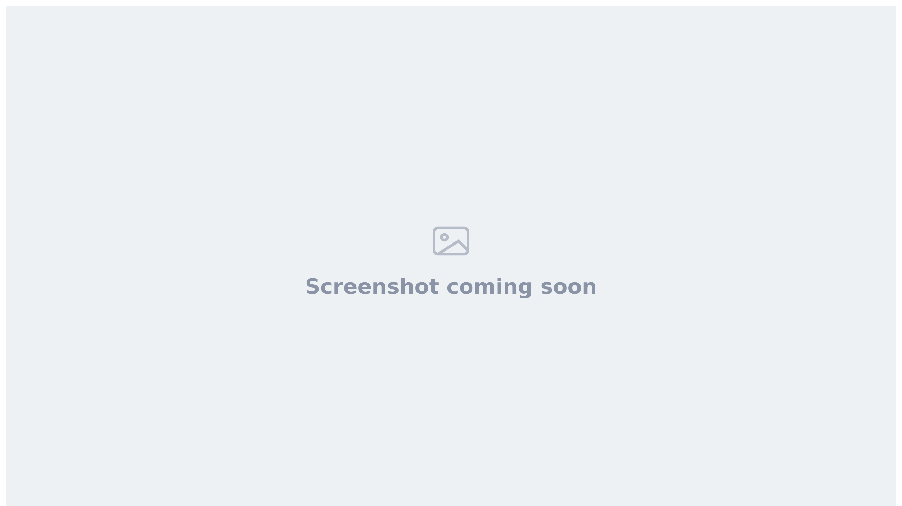

A candidate has to exist in Vitay before you can send them a reference request. You need a first name, a last name and an Internal ID to start; everything else can wait.

<Note>
  Any recruiter can add candidates. The add buttons are disabled on demo accounts.
</Note>

<Steps>
  <Step title="Open the Add Candidate form">
    Click **Add Candidate** in the left sidebar, under **Quick Request**. On the
    **Candidates** page, the plus icon in the toolbar opens the same form.

    
  </Step>
  <Step title="Fill in the candidate's details">
    - **First name** and **Last name** are required.
    - **Internal ID** is required. Type your own identifier (for example the ID from your ATS) or click the refresh icon to generate one.
    - **Email** is required by default. A root recruiter can turn off **Candidate email required** in Configuration.
    - **Mobile number** is optional. When it's filled in, the reference request is also sent by text message.
    - **Preferred Name**, **Internal notes about the candidate** and **Placement Date** are optional. Internal notes are never shown to the candidate.
    - **Assigned user**, at the bottom of the form, is the recruiter responsible for the candidate. It defaults to you. To change it, type a name or email in the field and pick someone. See Troubleshooting if you don't see it.

    **Secondary ID**, **Job title** and **Additional report recipients** appear only when your firm has those settings on.

    
  </Step>
  <Step title="Click Submit">
    A **Candidate added** message confirms it and Vitay opens the candidate's
    page, where you can send a reference request right away. To change details
    later, click the pencil (**Edit candidate**) in the candidate header.
  </Step>
</Steps>

Next: [Send a reference request](/candidates-reference-requests/send-a-reference-request).

## Assigned users

When an Admin turns on **Allow multiple assigned users** in Configuration, the field at the bottom of the Add Candidate and Edit Candidate forms is called **Assigned users** and holds up to 11 people.

- Type a name or email in **Add a user by name or email** and pick someone to add them.
- The first user listed, marked with an envelope, is the candidate's main assigned user. Emails to the candidate and their references are sent from this user.
- Click a user's **×** to remove them. If you remove the first user, the next one takes their place. A candidate always keeps at least one assigned user.
- Anyone who can edit the candidate can add or remove the other users. Changing the first user still needs the same permission as changing the assigned user (see Troubleshooting).

Every assigned user sees the candidate when they filter lists to **Myself**, receives the team notifications sent to the assigned user, and can edit the candidate's references. The candidates list shows the main user's name with **+N** for the others; hover it to see their names. Adding or removing assigned users is recorded on the candidate's **Activities** tab.

If your firm turns the setting off again, candidates keep the assigned users they already have. You can still remove them, but you can't add new ones.

## Troubleshooting

<AccordionGroup>
  <Accordion title="The email is already associated with a candidate">
    While candidate emails are required, each address can belong to only one
    active candidate in your account. Search the **Candidates** list for the
    address. If you add an email that belongs to a candidate in the Recycle Bin, Vitay
    restores that candidate with the details you entered instead of creating
    a new one.
  </Accordion>
  <Accordion title="Vitay says the candidate is deactivated">
    The Internal ID you entered belongs to a candidate in the **Recycle Bin**.
    Click **Open the Recycle Bin** in the error to find them and click
    **Restore**, or use a different Internal ID. See
    [Recycle Bin](/candidates-reference-requests/recycle-bin).
  </Accordion>
  <Accordion title="Some fields are missing from the form">
    Secondary ID and Job title are switched on in your firm's settings. Ask a
    Admin to turn them on. The **Position applied for** field has been
    removed; use **Job title** instead.
  </Accordion>
  <Accordion title="I can't assign the candidate to another recruiter">
    You can change the assigned user if you are an Admin, if your firm
    has turned on **Allow users to update the assigned user**, or if you manage
    the sub-account the candidate is in. Otherwise the field is hidden, or, when
    your firm allows multiple assigned users, the first user is locked and you
    can only add or remove the others. Ask an Admin to reassign the
    candidate.
  </Accordion>
</AccordionGroup>

## Related articles

<CardGroup cols={2}>
  <Card title="Send a reference request" icon="paper-plane" href="/candidates-reference-requests/send-a-reference-request" />
  <Card title="Manage in-flight requests" icon="sliders" href="/candidates-reference-requests/manage-in-flight-requests" />
  <Card title="Search for past references" icon="magnifying-glass" href="/candidates-reference-requests/search-past-references" />
  <Card title="Add a reference manually" icon="pen-to-square" href="/candidates-reference-requests/add-a-reference-manually" />
</CardGroup>

{/* source: app src/app/shared/components/modals/candidates/modals.candidates.component.{html,ts}; projects/references/src/app/shared/components/navbar/navbar.component.html; src/app/shared/components/assigned-users-input/assigned-users-input.component.{html,ts}; projects/references/src/assets/i18n/en.json (NAVBAR.CTA, MODALS.CANDIDATES incl. ASSIGNED_USERS.*, COMMON.*, TOASTS.CANDIDATE_ADDED, RECYCLE_BIN.OPEN_LINK); projects/configuration/src/assets/i18n/en.json (is_candidate_email_required, is_candidate_ownership_updatable, is_multiple_assigned_users_enabled); api app/controllers/api/v3/candidates_controller.rb#create + #render_candidate_deactivated; app/controllers/api/v1/candidates_controller.rb#render_candidate_already_exists_with_email; app/models/candidate.rb (validations, additional_assignees, assigned_to); app/services/candidate_assignees/sync.rb; app/models/candidate_additional_assignee.rb (MAX_PER_CANDIDATE); app/models/reference_request.rb#send_reference_requests; db/schema.rb settings.is_candidate_email_required */}
