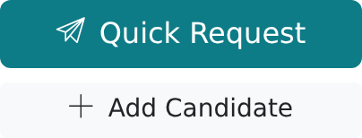
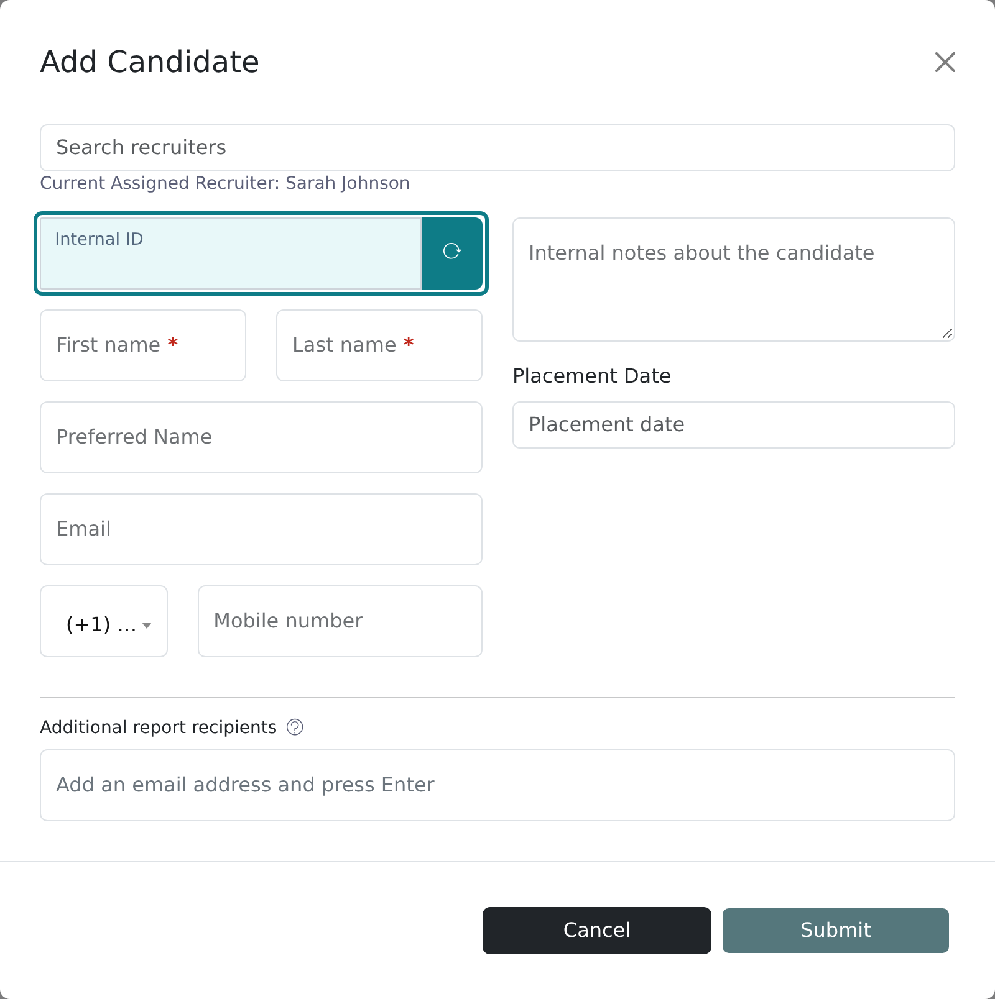

A candidate has to exist in Vitay before you can send them a reference request. You need a first name, a last name and an Internal ID to start; everything else can wait.

<Note>
  Any recruiter can add candidates. The add buttons are disabled on demo accounts.
</Note>

<Steps>
  <Step title="Open the Add Candidate form">
    Click **Add Candidate** in the left sidebar, under **Quick Request**. On the
    **Candidates** page, the plus icon in the toolbar opens the same form.

    
  </Step>
  <Step title="Fill in the candidate's details">
    - **First name** and **Last name** are required.
    - **Internal ID** is required. Type your own identifier (for example the ID from your ATS) or click the refresh icon to generate one.
    - **Email** is required by default. A root recruiter can turn off **Candidate email required** in Configuration.
    - **Mobile number** is optional. When it's filled in, the reference request is also sent by text message.
    - **Preferred Name**, **Internal notes about the candidate** and **Placement Date** are optional. Internal notes are never shown to the candidate.
    - **Assigned user** is the recruiter responsible for the candidate. It defaults to you. See Troubleshooting if you can't change it.

    **Secondary ID**, **Job title**, **Position applied for** and **Additional report recipients** appear only when your firm has those settings on.

    
  </Step>
  <Step title="Click Submit">
    A **Candidate added** message confirms it and Vitay opens the candidate's
    page, where you can send a reference request right away. To change details
    later, click the pencil (**Edit candidate**) in the candidate header.
  </Step>
</Steps>

Next: [Send a reference request](/candidates-reference-requests/send-a-reference-request).

## Troubleshooting

<AccordionGroup>
  <Accordion title="The email is already associated with a candidate">
    While candidate emails are required, each address can belong to only one
    active candidate in your account. Search the **Candidates** list for the
    address. If you add an email that belongs to a deactivated candidate, Vitay
    reactivates that candidate with the details you entered instead of creating
    a new one.
  </Accordion>
  <Accordion title="Vitay says the candidate is deactivated">
    The Internal ID you entered belongs to a candidate in the **Recycle Bin**.
    Click **Open the Recycle Bin** in the error to find them and reactivate
    them, or use a different Internal ID. See
    [Recycle Bin](/candidates-reference-requests/recycle-bin).
  </Accordion>
  <Accordion title="Some fields are missing from the form">
    Secondary ID, Job title and Position applied for are switched on in your
    firm's settings. Ask a root recruiter to turn them on.
  </Accordion>
  <Accordion title="I can't assign the candidate to another recruiter">
    The **Assigned user** field appears for root recruiters, for everyone when
    your firm has turned on **Allow users to update the assigned user**, and for
    recruiters who manage the sub-account the candidate is in. Otherwise ask a
    root recruiter to reassign the candidate.
  </Accordion>
</AccordionGroup>

## Related articles

<CardGroup cols={2}>
  <Card title="Send a reference request" icon="paper-plane" href="/candidates-reference-requests/send-a-reference-request" />
  <Card title="Manage in-flight requests" icon="sliders" href="/candidates-reference-requests/manage-in-flight-requests" />
  <Card title="Search for past references" icon="magnifying-glass" href="/candidates-reference-requests/search-past-references" />
  <Card title="Add a reference manually" icon="pen-to-square" href="/candidates-reference-requests/add-a-reference-manually" />
</CardGroup>

{/* source: app src/app/shared/components/modals/candidates/modals.candidates.component.{html,ts}; projects/references/src/app/shared/components/navbar/navbar.component.html; projects/references/src/assets/i18n/en.json (NAVBAR.CTA, MODALS.CANDIDATES, COMMON.*, TOASTS.CANDIDATE_ADDED, RECYCLE_BIN.OPEN_LINK); projects/configuration/src/assets/i18n/en.json (is_candidate_email_required, is_candidate_ownership_updatable); api app/controllers/api/v3/candidates_controller.rb#create + #render_candidate_deactivated; app/controllers/api/v1/candidates_controller.rb#render_candidate_already_exists_with_email; app/models/candidate.rb (validations); app/models/reference_request.rb#send_reference_requests; db/schema.rb settings.is_candidate_email_required */}
