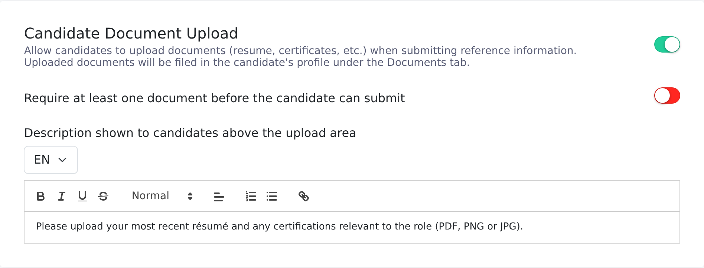
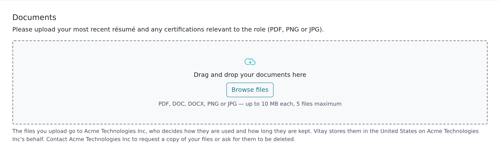
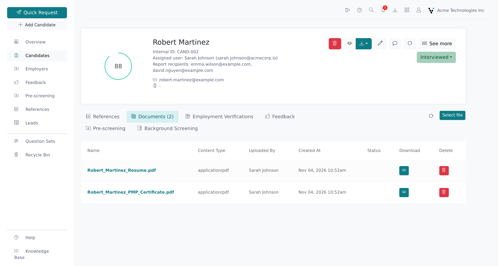

Candidate document upload adds a **Documents** section to the reference request form, so candidates can attach a résumé, certificates or a licence when they submit their references. You can make the upload optional or required.

<Note>
  You need a root recruiter role to turn candidate document upload on or off
  and change its settings. Any recruiter with access to the candidate can view
  and download the files.
</Note>

## Turn on candidate document upload

<Steps>
  <Step title="Open the request settings">
    In the Configuration area, go to **Settings** → **Ref. Requests**.
  </Step>
  <Step title="Enable the card">
    Switch on the **Candidate Document Upload** card. Changes on this card
    save automatically.

    
  </Step>
  <Step title="Decide whether a document is required">
    Switch on **Require at least one document before the candidate can
    submit** if candidates must attach something. Leave it off to make the
    upload optional.
  </Step>
  <Step title="Write the instructions candidates see">
    In **Description shown to candidates above the upload area**, tell
    candidates what to attach and what you'll use it for. If your account has
    several languages, write a version for each; candidates see the one that
    matches the language of their request.
  </Step>
</Steps>

## What candidates see

When the setting is on, the reference request form shows a **Documents** card below the references, with your description above it. Candidates drag files onto the card or click **Browse files**, and can remove a file before submitting. If you leave the description empty, they see a default text asking for documents such as a CV, certificates or licences.

Under the upload area, candidates also see a fixed privacy notice. It says the files go to your firm, that your firm decides how they're used and how long they're kept, which country Vitay stores them in (the United States, Canada or the United Kingdom, matching your Vitay region), and that the candidate should contact your firm for a copy or deletion. The notice doesn't say why you're collecting the documents, so use your description for that, and make sure whoever handles data requests at your firm knows the files are on the candidate's **Documents** tab.

Candidates can upload **PDF, DOC, DOCX, PNG** and **JPG** files, up to 10 MB each and 5 files per request. A file whose content doesn't match its extension is rejected, and so is a filename with more than one dot (`resume.pdf.exe`). If you made the upload required, the card shows an asterisk and the candidate can't submit without a file.

After submitting, the candidate can't add or remove documents. If they need to send something later, they can email it to you and you can upload it yourself.

## Upload a document yourself

<Steps>
  <Step title="Open the candidate's Documents tab">
    Go to **Candidates**, open the candidate, and click the **Documents** tab.
  </Step>
  <Step title="Add the file">
    Drag the file onto the toolbar at the top right of the tab, or click
    **Select file**. A **Document uploaded** message confirms it.

    
  </Step>
</Steps>

Recruiter uploads accept PDF, Word, Excel, PowerPoint, TXT, RTF, OpenDocument, Markdown, EPUB, Pages and Keynote files up to 15 MB. Images (PNG, JPG) aren't accepted here, and neither are filenames with more than one dot.

The tab lists every document on the candidate, whoever added it, with its name, type, who uploaded it, the date, a status, and download and delete buttons. On demo accounts **Select file** is hidden.

## Malware scanning

Every document, from the candidate's form or your own upload, is scanned for malware.

A flagged file shows a red **Quarantined** badge on the **Documents** tab and can't be downloaded by anyone. Vitay deletes it automatically after 7 days in quarantine and records the removal in the candidate's activity history. If you still need the document, ask the candidate for a clean copy and upload it yourself.

## Find the uploaded documents

- **Candidate page:** the **Documents** tab, with a count of the candidate's files. Download or delete them there.
- **Candidate side panel:** the **Documents** tab lists the same files with a download button, so you don't have to leave the list you're on.
- **Completion email:** the email your team gets when the candidate submits links to the candidate's page. It never attaches the files, so copies don't end up in mailboxes where they can't be deleted.

## Troubleshooting

<AccordionGroup>
  <Accordion title="A candidate says their file is rejected">
    Check the file against the rules above: PDF, DOC, DOCX, PNG or JPG, 10 MB
    or smaller, and no more than 5 files per request. A file saved with the
    wrong extension is also rejected. Ask the candidate to export a fresh copy
    in a supported format.
  </Accordion>
  <Accordion title="The Documents card isn't on the request form">
    The setting is off, or it was turned on after the candidate opened the
    form. Check **Settings → Ref. Requests**, then ask the candidate to reload
    the form. A request that has already been submitted never shows the card.
  </Accordion>
  <Accordion title="A document shows a Quarantined badge">
    Malware scanning flagged the file. See [Malware scanning](#malware-scanning).
  </Accordion>
  <Accordion title="My own upload was rejected as an invalid file type">
    Recruiter uploads don't accept images. Convert a PNG or JPG to PDF first.
    Filenames with more than one dot are also rejected, and the file must be
    15 MB or smaller.
  </Accordion>
  <Accordion title="The completion email doesn't include the documents">
    That's by design. Open the candidate's **Documents** tab to download them.
  </Accordion>
</AccordionGroup>

## Related articles

<CardGroup cols={2}>
  <Card title="Send a reference request" icon="paper-plane" href="/candidates-reference-requests/send-a-reference-request" />
  <Card title="Add a candidate" icon="user-plus" href="/candidates-reference-requests/add-a-candidate" />
  <Card title="Read a completed reference" icon="clipboard-check" href="/candidates-reference-requests/read-a-completed-reference" />
  <Card title="Notification settings" icon="bell" href="/account-configuration/notification-settings" />
</CardGroup>

{/* source: app projects/configuration protected/settings/requests (candidate_documents card), i18n SETTINGS.REQUESTS.candidate_documents.*; projects/references public/reference-requests/reference-requests.component.html, protected/candidates/show/candidates.show.component.{html,ts} (Select file, 15 MB), protected/candidates/show/documents/, i18n REFERENCE_REQUESTS.DOCUMENTS.* CANDIDATE_DOCUMENTS.*; api app/controllers/api/v1/reference_requests/documents_controller.rb (MAX_FILE_SIZE, MAX_FILE_COUNT), app/controllers/api/v3/candidates_controller.rb (ALLOWED_CONTENT_TYPES, create_document), app/services/quarantined_document_purge_service.rb */}
