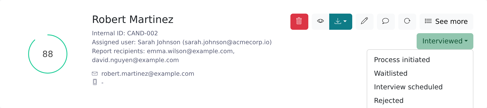
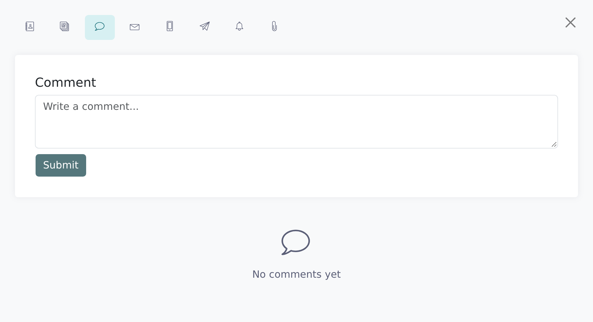

Each candidate has a status that you set to track where they are in your process. Vitay also shows a reference status for each reference, worked out from that reference's form. Comments let your team leave internal notes on a candidate or a reference.

<Note>
  Any recruiter can change the status of a candidate they can see, and can
  comment. Changing the **Candidate statuses** settings needs a root
  recruiter.
</Note>

## The candidate statuses

The status appears as a coloured button at the top of the candidate page and as a column in the candidate list. There are nine:

| Status | Meaning |
|---|---|
| **Process initiated** | The starting status for every new candidate. |
| **Waitlisted** | On hold, not currently progressing. |
| **Interview scheduled** | An interview is booked. |
| **Interviewed** | The interview has happened. |
| **Rejected** | Not proceeding. |
| **Completed** | Your process for this candidate is finished. |
| **Submitted** | Put forward to the client or hiring manager. |
| **Accepted** | Offer accepted or placed. |
| **Unresponsive** | Set by Vitay when the candidate stops responding to their reference request. See below. |

The list is fixed and can't be renamed or extended. Apart from the automatic Unresponsive flip, the statuses are labels for your team: changing one never sends an email, stops reminders, or changes a reference request.

If your firm doesn't use candidate statuses, a root recruiter can turn them off (see [Candidate statuses settings](#candidate-statuses-settings)). The status button, the status column, the candidate status filters and the bulk **Update status** action then disappear. Reference statuses stay.

## Change one candidate's status

<Steps>
  <Step title="Open the candidate">
    Go to **Candidates** and click the candidate.
  </Step>
  <Step title="Click the status button">
    Click the coloured button in the header that shows the current status.
  </Step>
  <Step title="Pick the new status">
    Select it. If **Status Change Comment** is off for your firm, the change
    saves right away.
  </Step>
  <Step title="Add a reason (when prompted)">
    With **Status Change Comment** on, the **Change Candidate Status** dialog
    opens. Type in **Add a comment (optional)** or leave it blank, then click
    **Submit**. When your firm has also turned on **Mandatory Comment**, the
    field is labelled **Add a comment** and **Submit** stays disabled until you
    type something.
  </Step>
</Steps>

If you type a comment, Vitay posts it to the candidate's **Comments** tab as `Status changed from "Process initiated" to "Interviewed": <your text>`. A blank comment changes the status without posting anything.

## Candidate statuses settings

A root recruiter manages statuses in the Configuration area: **Settings** → **Configuration** tab → **Candidate statuses** card.

<Steps>
  <Step title="Turn statuses on or off">
    Use the switch in the card header. It's on by default. Turning it off
    hides statuses for your whole team; the status each candidate had is kept
    and comes back if you turn statuses on again.
  </Step>
  <Step title="Choose the options (while statuses are on)">
    | Switch | What it does | Default |
    |---|---|---|
    | **Status Change Comment** | Asks for a comment whenever someone changes a candidate's status. | Off |
    | **Mandatory Comment** | Makes that comment required. Greyed out until **Status Change Comment** is on. | Off |
    | **Automatic Unresponsive Status** | Turns the [automatic Unresponsive flip](#the-automatic-unresponsive-flip) on or off. | On |

    While statuses are off, only the card header shows. These switches keep
    their values.
  </Step>
</Steps>

## Change status in bulk

<Steps>
  <Step title="Select candidates">
    On the **Candidates** list, tick the candidates you want. A bulk action
    bar appears.
  </Step>
  <Step title="Click Update status">
    Pick one of the nine statuses. The action isn't offered while candidate
    statuses are turned off.
  </Step>
  <Step title="Confirm">
    Every selected candidate moves to that status.
  </Step>
</Steps>

The bulk action never asks for a comment, even when **Status Change Comment** or **Mandatory Comment** is on. See [Bulk candidate actions](/candidates-reference-requests/bulk-candidate-actions) for the other bulk operations.

## Reference statuses

Each reference has its own status, which you can't set:

| Status | When it shows |
|---|---|
| **Pending** | The reference hasn't submitted the form yet. |
| **Completed** | They submitted the form. |
| **Unresponsive** | They have gone quiet (see the rule below). |

On the **Candidates** list, the filters include a **Reference status** group, which looks at all of a candidate's references together:

| Filter option | Matches candidates who |
|---|---|
| **No Reference req. sent** | Have no active reference request. |
| **Candidate req. pending** | Haven't submitted their list of references yet. |
| **Reference req. pending** | Have at least one reference that hasn't completed. |
| **Completed** | Have references, and all of them have completed. |
| **Unresponsive** | Have at least one unresponsive reference. |

## The automatic Unresponsive flip

Once a day, Vitay moves references and reference requests in and out of **Unresponsive**. This part always runs.

A reference or reference request becomes unresponsive when it hasn't been submitted, at least one reminder has been sent, the last reminder went out more than 24 hours ago, and no further reminder is scheduled. It stops being unresponsive when the form is submitted or a new reminder is scheduled.

The candidate's own status follows the reference request only. A candidate on **Process initiated** whose reference request is unresponsive flips to **Unresponsive**, and flips back to **Process initiated** when the request is no longer unresponsive. An unresponsive reference shows on the reference and in the filter but never changes the candidate's status. Candidates on any status other than **Process initiated** or **Unresponsive** are left alone. When your firm turns off **Automatic Unresponsive Status** (or turns statuses off), candidates are never moved; references and reference requests still are, and the notification below still goes out.

Vitay can also email your team the first time a record turns unresponsive. Choose who on the **Reference or request unresponsive** row of **Team notifications** under **Settings → Notifications** (the assigned user, for new accounts). It's sent once per record, and skipped if the last reminder went out more than two days ago. See [Notification settings](/account-configuration/notification-settings).

## Comments

Candidates and references each have a **Comments** tab in their side panel. Comments are internal and never shown to candidates or references.

<Steps>
  <Step title="Open the Comments tab">
    On the candidate page, click the speech-bubble button in the header, or
    click **See more** and pick the **Comments** tab (hover the icons to find
    it). For a reference, click the reference and pick its **Comments** tab.
  </Step>
  <Step title="Write the comment">
    Type in the **Comment** box and click **Submit**.
  </Step>
  <Step title="Edit or delete your own">
    The pencil and bin buttons appear only on comments you wrote. Other
    people's comments are read-only for you.
  </Step>
</Steps>

Adding, editing and deleting comments are all recorded in the [Activities log](/reports-lead-generation/activities-log), so a deleted comment still shows who removed it and when.

## Troubleshooting

<AccordionGroup>
  <Accordion title="A candidate keeps going back to Unresponsive">
    Their reference request is still unanswered, its last reminder is over 24
    hours old, and nothing else is scheduled. Send a reminder, or move the
    candidate to a status other than **Process initiated**. A root recruiter
    can stop these moves by turning off **Automatic Unresponsive Status**.
  </Accordion>
  <Accordion title="I wasn't asked for a comment when I changed a status">
    Either **Status Change Comment** is off for your firm, or you used
    the bulk **Update status** action, which never prompts.
  </Accordion>
  <Accordion title="The status button and status column are gone">
    A root recruiter has turned off **Candidate statuses** on the
    **Configuration** tab. Candidates keep their statuses, and they show
    again once it's turned back on.
  </Accordion>
  <Accordion title="I can't edit a colleague's comment">
    Only the author can edit or delete a comment. Add your own comment
    instead.
  </Accordion>
  <Accordion title="The status change didn't notify anyone">
    Statuses are internal labels. Changing one never emails the candidate,
    the references or your team.
  </Accordion>
  <Accordion title="A reference shows Pending but the candidate shows Completed">
    The candidate status is whatever someone last set. The reference status
    comes from that reference's own form.
  </Accordion>
</AccordionGroup>

## Related articles

<CardGroup cols={2}>
  <Card title="Bulk candidate actions" icon="list-check" href="/candidates-reference-requests/bulk-candidate-actions" />
  <Card title="Manage in-flight requests" icon="hourglass-half" href="/candidates-reference-requests/manage-in-flight-requests" />
  <Card title="Reminders and cadence" icon="bell" href="/candidates-reference-requests/reminders-and-cadence" />
  <Card title="The Activities log" icon="clock-rotate-left" href="/reports-lead-generation/activities-log" />
  <Card title="Notification settings" icon="envelope" href="/account-configuration/notification-settings" />
  <Card title="Fraud signals: IP conflicts and reference edits" icon="fingerprint" href="/candidates-reference-requests/ip-conflicts-and-reference-edits" />
</CardGroup>

{/* source: app src/app/shared/helpers/{candidate,reference}.helper.ts; projects/references protected/candidates/show/header/candidates.show.header.component.html, shared/components/sidebar/candidate/{sidebar.candidate.component.ts,comments/}, sidebar/reference/sidebar.reference.component.ts, assets/i18n/en.json STATUSES.* MODALS.STATUS_CHANGE_COMMENT COMMENTS.*; src/app/shared/helpers/candidate-status-settings.helper.ts; projects/configuration protected/settings/configuration (candidate_statuses card: is_candidate_status_enabled, is_status_change_comment_prompt_enabled, is_status_change_comment_required, is_candidate_auto_unresponsive_enabled), i18n TEAM_NOTIFICATIONS.ROWS.UNRESPONSIVE; api app/models/concerns/can_be_unresponsive.rb, app/workers/unresponsive_notification_worker.rb (auto_flip_candidates), app/models/setting.rb (defaults), app/controllers/api/v3/comments_controller.rb */}
