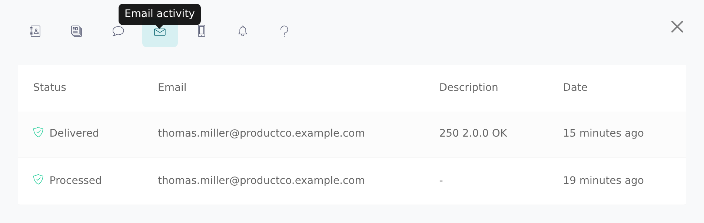
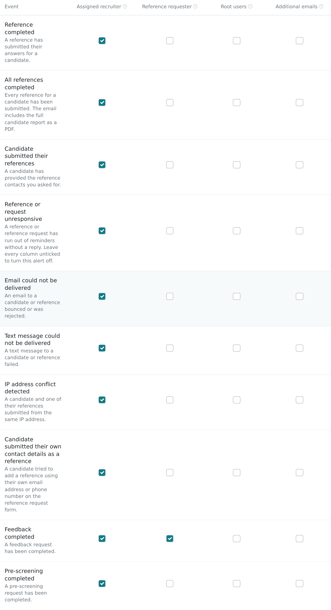

The **Email activity** and **Text activity** tabs show every email and text Vitay sent to a candidate or reference, whether it arrived, and why it failed.

<Note>
  Any recruiter with access to the candidate can see these tabs. Activity is
  tracked per email address and per mobile number, so a record without one
  has nothing on the matching tab. Texts are only sent when your firm has
  **Enable / Disable Text Messages** switched on under **Settings → Texts**.
</Note>

## Open the activity tabs

<Steps>
  <Step title="Open the side panel">
    Open the candidate. For a reference, click the reference on the
    **References** tab. For the candidate's own messages, click **See more**
    in the candidate header.
  </Step>
  <Step title="Pick the tab">
    The side panel tabs are icons. Hover to find **Email activity** (envelope)
    and **Text activity** (phone). The newest entry is at the top.

    
  </Step>
</Steps>

## Read the Email activity tab

Each row is one event from Vitay's email provider, with **Status**, **Email**, **Description** (the provider's reason, or `-`) and **Date**.

| Status | Meaning |
| --- | --- |
| **processed** / **delivered** | Accepted by the recipient's mail server. |
| **open** / **click** | The recipient opened the email or clicked a link. |
| **bounce** | The recipient's server rejected it, for example because the address doesn't exist. |
| **dropped** | Not attempted, usually because the address bounced before. |
| **spamreport** | The recipient marked it as spam. |
| **unsubscribe** / **group_unsubscribe** | The recipient unsubscribed. |
| **group_resubscribe** | The recipient subscribed again. |

Successful events have a green icon; **bounce**, **dropped**, **spamreport** and the unsubscribe events have a red warning icon. **delivered** means the mail server accepted the email, not that it reached the inbox: a spam filter can still catch it.

## Read the Text activity tab

Each row shows the carrier's **Status**, the **Mobile Number**, a **Description** of any error, the message **Body**, who it was **From**, and the **Date**. Errors have a red warning icon.

Outgoing texts show **sending**, **sent**, **delivered**, **undelivered**, **failed** or **canceled**. Replies from the person appear as **received**.

When a text fails, the Description says why:

| Description | What to do |
| --- | --- |
| Attempt to send to unsubscribed recipient | They replied STOP. Use email. |
| Destination not reachable from our sending number | The number's country or network can't be reached. Use email. |
| Unreachable destination handset | The phone was off or out of coverage. A later reminder may work. |
| Message blocked | The carrier or phone blocked it. Use email. |
| Message Delivery - Unknown destination handset | The number doesn't exist. Check it with the person. |
| Landline or unreachable carrier | It's a landline. Ask for a mobile number. |
| Message filtered | The carrier's spam filter stopped it. Use email. |
| Message Delivery - Unknown error | No reason given. Try again later or use email. |
| Unknown Error | An error Vitay doesn't recognise. Try again later or use email. |

Texts to UK (+44) numbers come from a UK sending number, so they arrive from a different number than texts to other countries.

### STOP and START replies

A reference's first text ends with "Reply *stop* to unsubscribe". If they reply **STOP** (or **STOPALL**), the Text activity tab shows *Unsubscribed from Vitay SMS communications* and the candidate page shows *One or more references have unsubscribed and will not receive texts*. Texts to that number then fail until the person replies **START**, **UNSTOP** or **YES**, shown as *Resubscribed from Vitay SMS communications*. You can't resubscribe someone yourself; email still works.

## Who is told when delivery fails

A root recruiter chooses who gets an email about failed deliveries in the Configuration area, under **Settings → Notifications**, in the **Team notifications** table:

- **Email could not be delivered:** sent when an email to a candidate or reference bounces, is dropped, is marked as spam, or the person unsubscribes. The subject is *&lt;address&gt; is invalid*, and the email gives the reason, the provider's details and the internal ID, with a button to open the record.
- **Text message could not be delivered:** the same for texts, subject *&lt;number&gt; is invalid*. This row only appears when text messages are on.

Each row can go to the **Assigned recruiter**, the **Reference requester**, **Root users**, **Additional emails** (such as a shared inbox), or any mix. New accounts start with **Assigned recruiter** on both.

Under **Candidate notifications** on the same tab, **Candidate: Notify Reference Contact Errors** (off by default) also emails the candidate when one of their references can't be reached, so they can send better details. It's only sent when at least one team member is notified about the same failure, and replies go to the candidate's assigned recruiter, or to your custom **Reply-To** address if you set one (see [Email sender settings](/account-configuration/email-sender-settings#where-replies-go)).

These emails are only sent for active candidates and references, and nobody is emailed about their own address. See [Notification settings](/account-configuration/notification-settings).

## Fix the problem

<Steps>
  <Step title="Confirm the details">
    Check the email address or mobile number with the person another way.
    Typos and old work addresses cause most bounces.
  </Step>
  <Step title="Update the record">
    Edit the candidate or reference (pencil icon), correct the **Email** or
    mobile number, and save. For a reference, this cancels their scheduled
    reminders.
  </Step>
  <Step title="Resend">
    Click **Send reminder** on the reference, or on the open request banner
    for a candidate. Vitay emails (and texts, if there's a mobile number) the
    details now on file. See
    [Reminders and how they work](/candidates-reference-requests/reminders-and-cadence)
    for the limits.
  </Step>
  <Step title="Check the tab again">
    A new **delivered** row confirms the new details work.
  </Step>
</Steps>

To stop contacting someone altogether, switch off reminders on the **Reminders** tab of their side panel. See [Reminders and how they work](/candidates-reference-requests/reminders-and-cadence#turn-reminders-off-for-one-person).

## Troubleshooting

<AccordionGroup>
  <Accordion title="The Email activity tab is empty after sending">
    Events arrive from the email provider a few minutes after sending. Reopen
    the tab later. Events are matched by address, so if you changed the
    address after sending, earlier events stay with the old address.
  </Accordion>
  <Accordion title="The Text activity tab shows nothing">
    The record has no mobile number, the number was added after the request
    went out (send a reminder to text it), or text messages are off under
    **Settings → Texts**.
  </Accordion>
  <Accordion title="The email shows delivered but they can't find it">
    Ask them to check spam, junk and promotions folders and add the sender to
    their safe senders. Company filters can quarantine an email after their
    server accepts it. See
    [A reference didn't receive the email](/candidates-reference-requests/reference-not-received).
  </Accordion>
  <Accordion title="I didn't get the 'is invalid' email">
    On **Settings → Notifications**, the **Email could not be delivered** row
    (or **Text message could not be delivered**) needs a column that includes
    you. If only **Assigned recruiter** is ticked, you only hear about your own
    candidates. Nothing is sent for deactivated records.
  </Accordion>
</AccordionGroup>

## Related articles

<CardGroup cols={2}>
  <Card title="A reference didn't receive the email" icon="triangle-exclamation" href="/candidates-reference-requests/reference-not-received" />
  <Card title="Manage in-flight requests" icon="sliders" href="/candidates-reference-requests/manage-in-flight-requests" />
  <Card title="Reminders and how they work" icon="bell" href="/candidates-reference-requests/reminders-and-cadence" />
  <Card title="Notification settings" icon="bell-on" href="/account-configuration/notification-settings" />
</CardGroup>

{/* source: app projects/references/src/app/shared/components/sidebar/{reference,candidate}/{emails,texts}, sidebar.reference.component.ts (tabs), src/app/shared/models/email-activity.model.ts, protected/candidates/show/header (BUTTONS.SIDEBAR); projects/configuration/src/app/protected/settings/notifications/settings.notifications.component.html, shared/components/notification-matrix/notification-matrix.rows.ts; api app/controllers/api/v3/webhooks/sendgrid_controller.rb, app/controllers/api/v3/webhooks/twilio_controller.rb, app/models/text_activity.rb, app/models/concerns/can_receive_texts.rb, app/models/recruiter_reference.rb (opt-out line), app/models/custom_notification.rb (DEFAULT_FLAGS), db/schema.rb */}
