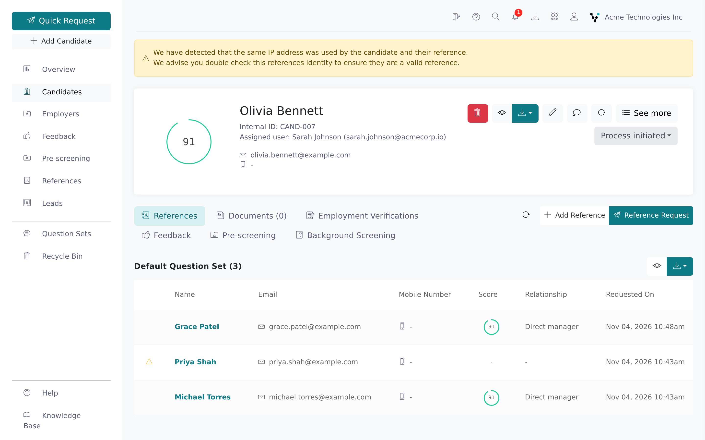
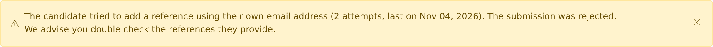
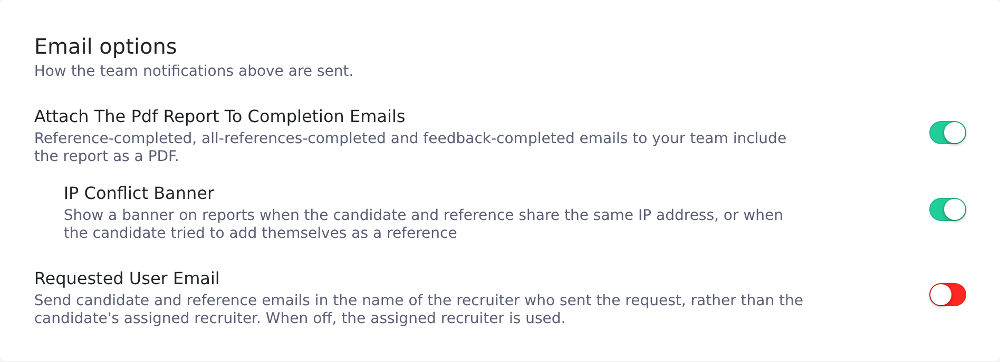

Vitay flags three signs that a reference may not be who they say they are: the reference and the candidate submitting their forms from the same IP address, the candidate trying to list themselves as a reference, and the reference changing the contact details the candidate gave for them. None of these proves anything on its own.

<Note>
  Any recruiter can see these signals on a candidate they can open. Changing
  who is notified, and putting the alerts on PDF reports, needs a root
  recruiter because those settings are in the Configuration area.
</Note>

## How the IP conflict check works

When a candidate submits their reference list, Vitay records the IP address, browser, device and operating system they used. It does the same when a reference submits the question form, then compares the reference's IP address with the candidate's. If they are exactly the same, Vitay raises a conflict for that reference and emails the people your firm chose to notify.

Only exact matches count. Vitay doesn't compare networks or locations, and doesn't compare references with each other. If either side has no IP address on file, no conflict is raised.

The check only runs while it's switched on for your firm (see [The IP and self-reference settings](#the-ip-and-self-reference-settings)). Submissions made while it was off are never checked, even after you turn it on.

### Why an innocent match happens

A shared IP address means both forms were sent from the same internet connection. That happens for legitimate reasons: the candidate and the reference work in the same office or use the same VPN, share a home network, or sit behind a mobile carrier or corporate proxy that puts many people behind one address.

Treat the alert as a prompt to verify the reference, for example by calling the number you have for them, not as a verdict.

## Where an IP conflict shows up

- **Candidate page:** a yellow banner saying the same IP address was used by the candidate and their reference.
- **References table:** a warning triangle at the left of the affected reference's row. Hover it to see **Same IP address**.
- **The reference:** a yellow banner saying the reference appears to share an IP address with the candidate.
- **PDF reports:** a red **IP Address Conflict Detected** box above the reference's answers, when the **IP Conflict Banner** setting is on.
- **Email:** an **IP address conflict detected** email to the team members your firm chose to notify.

To see the raw details for any submission, open the reference and go to its **About** tab, or the candidate's **Details** tab. Both list **IP Address**, browser, device, operating system and user agent.

### Two other IP banners

The candidate page can show two more banners that compare your own current IP address with what's on file:

- **Reference request submitted by the user:** your IP address matches the candidate's, which usually means you filled in the candidate's form yourself.
- **IP match between Recruiter and Referee:** your IP address matches one of the candidate's references.

These are worked out in your browser, aren't affected by the settings below, and are separate from the candidate-to-reference conflict.

## Clear an IP fraud alert

Once you've checked a reference and are satisfied it's genuine, you can remove the alert.

<Steps>
  <Step title="Open the reference">
    On the candidate page, click the reference with the banner.
  </Step>
  <Step title="Dismiss the banner">
    Click the **✕** at the right of the yellow banner (tooltip: **Clear IP
    fraud alert**).
  </Step>
  <Step title="Confirm">
    Click **Clear** in the confirmation dialog.
  </Step>
</Steps>

Clearing removes the banner, the warning triangle and the report box for that reference only. You can't undo it, but the IP addresses stay on the **About** tab.

## Self-reference attempts

The reference request form refuses a reference whose email address or phone number is the candidate's own, with the message *Email must be different from the candidate's* (or the phone equivalent). Differences in capitalisation, spaces or phone formatting don't get past the check, and the reference's work phone is checked too.

The reference is never created, but Vitay records the attempt:

- **Candidate page:** a yellow banner saying the candidate tried to add a reference using their own email address, phone number or both, with the number of attempts and the date of the last one.
- **Activities:** an entry on the candidate's **Activities** tab and in the firm-wide log.
- **PDF reports:** a **Self-Reference Attempt Detected** box on the candidate's report, when the **IP Conflict Banner** setting is on.
- **Email:** sent to the people ticked on the **Candidate submitted their own contact details as a reference** row of **Team notifications**. See [Notification settings](/account-configuration/notification-settings).

Repeated attempts before you clear the alert produce one banner, one activity entry and one email; the banner's attempt count and date update. Unlike the IP check, this check always runs.

### Clear a self-reference alert

<Steps>
  <Step title="Open the candidate">
    The banner is at the top of the candidate page.
  </Step>
  <Step title="Dismiss the banner">
    Click the **✕** at the right of the banner (tooltip: **Clear
    self-reference alert**).
  </Step>
  <Step title="Confirm">
    Click **Clear** in the confirmation dialog.
  </Step>
</Steps>

Clearing removes the banner and the report box and adds an entry to the Activities tab. If the candidate tries again later, a new alert and email go out.

## The IP and self-reference settings

These are in the Configuration area under **Settings → Notifications**:

- **IP address conflict detected** (a row of the **Team notifications** table): who is emailed when a conflict is found. New accounts notify the **Assigned recruiter**.
- **Candidate submitted their own contact details as a reference** (another row): who is emailed about self-reference attempts. New accounts notify the **Assigned recruiter**.
- **IP Conflict Banner** (under **Email options**): adds the **IP Address Conflict Detected** and **Self-Reference Attempt Detected** boxes to PDF reports. Off by default. It only appears once **Attach The PDF Report To Completion Emails** above it is switched on.

Vitay only checks IP addresses while at least one column is ticked on the **IP address conflict detected** row or the **IP Conflict Banner** is on. See [Notification settings](/account-configuration/notification-settings).

## Reference edits

When a reference opens their question form, the details the candidate gave for them are pre-filled. The reference can correct them before submitting, and Vitay keeps the original values so you can see what changed.

Vitay tracks these fields: first name, last name, email, phone, country code, title, company name, candidate position, relationship, specialty, start date and end date. Only changes the reference makes when submitting are recorded. Edits a recruiter makes later don't count.

### See what a reference changed

<Steps>
  <Step title="Open the completed reference">
    Go to the candidate and click the reference.
  </Step>
  <Step title="Click Show reference edits">
    The **Show reference edits (n)** button appears only when the reference
    changed at least one field; *n* is the number of fields.
  </Step>
  <Step title="Read the list">
    The **Reference edits** card lists each field with the original value
    struck through and the new value next to it. Click **Hide reference
    edits** to close it.
  </Step>
</Steps>

A big change is worth confirming, such as a company email replaced with a personal one, or rewritten employment dates. Small corrections like a misspelled surname are routine.

### Put edits on the report

A root recruiter can add the same summary to PDF reports: **Settings** → **Documents** tab → **Show Reference Edits On Reports**. It's off by default. When on, a **Reference Made Edits** box lists each changed field above that reference's answers. See [Report settings](/account-configuration/report-settings).

## Troubleshooting

<AccordionGroup>
  <Accordion title="I never get IP conflict emails">
    On **Settings → Notifications**, a column that includes you must be
    ticked on the **IP address conflict detected** row. If only **Assigned
    recruiter** is ticked, you only hear about your own candidates.
  </Accordion>
  <Accordion title="The banner is on screen but not on the PDF report">
    Switch on **IP Conflict Banner** under **Email options** on the
    **Notifications** tab (turn on **Attach The PDF Report To Completion
    Emails** first to see it), then download the report again.
  </Accordion>
  <Accordion title="I cleared the alert by mistake">
    There's no undo. You can still compare the **IP Address** on the
    reference's **About** tab with the one on the candidate's **Details** tab.
  </Accordion>
  <Accordion title="I never get self-reference emails">
    Check the **Candidate submitted their own contact details as a
    reference** row on **Settings → Notifications**. The banner on the
    candidate page appears whatever the row says.
  </Accordion>
  <Accordion title="The self-reference banner came back after I cleared it">
    The candidate tried again after you cleared it. Check which details were
    reused and consider contacting the candidate about their references.
  </Accordion>
  <Accordion title="Can I list every candidate with an IP conflict?">
    Not from the candidate list. On the **References** page in the left
    sidebar, the **Types** filter has a **Duplicated IP** option that lists
    references flagged for sharing an IP address with their candidate.
  </Accordion>
  <Accordion title="A reference edited a field that isn't in the list">
    Only the fields listed above are tracked. Answers to the questions are
    the reference's answers, not edits.
  </Accordion>
</AccordionGroup>

## Related articles

<CardGroup cols={2}>
  <Card title="Read a completed reference" icon="file-lines" href="/candidates-reference-requests/read-a-completed-reference" />
  <Card title="Report settings" icon="file-pdf" href="/account-configuration/report-settings" />
  <Card title="Reference settings" icon="sliders" href="/account-configuration/reference-settings" />
  <Card title="Notification settings" icon="bell" href="/account-configuration/notification-settings" />
  <Card title="Candidate statuses and comments" icon="tags" href="/candidates-reference-requests/candidate-statuses-and-comments" />
  <Card title="Share reports" icon="share-nodes" href="/candidates-reference-requests/share-reports" />
</CardGroup>

{/* source: app projects/references protected/candidates/show/alerts/candidates.show.alerts.component.html, protected/candidates/show/references (hasSameIPAddress column), shared/components/sidebar/reference/question-set/alerts/sidebar.reference.question-set.alerts.component.html, protected/leads/list (Types: Duplicated IP), i18n CANDIDATE.IP_ADDRESS.* CANDIDATE.SELF_REFERENCE.* REFERENCE.IP_ADDRESS.* REFERENCE.EDITS.*; projects/configuration protected/settings/notifications/settings.notifications.component.html, i18n TEAM_NOTIFICATIONS.ROWS.{IP_CONFLICT,SELF_REFERENCE_ATTEMPT}, is_ip_conflict_banner_enabled, SETTINGS.DOCUMENTS.is_show_reference_edits_on_report; api app/services/ip_conflict_service.rb, app/services/self_reference_check.rb, app/services/candidate_self_reference_attempts/record.rb, app/models/reference.rb CANDIDATE_EDITABLE_FIELDS, app/views/api/v3/documents/en/default/{references,candidates}.erb */}
