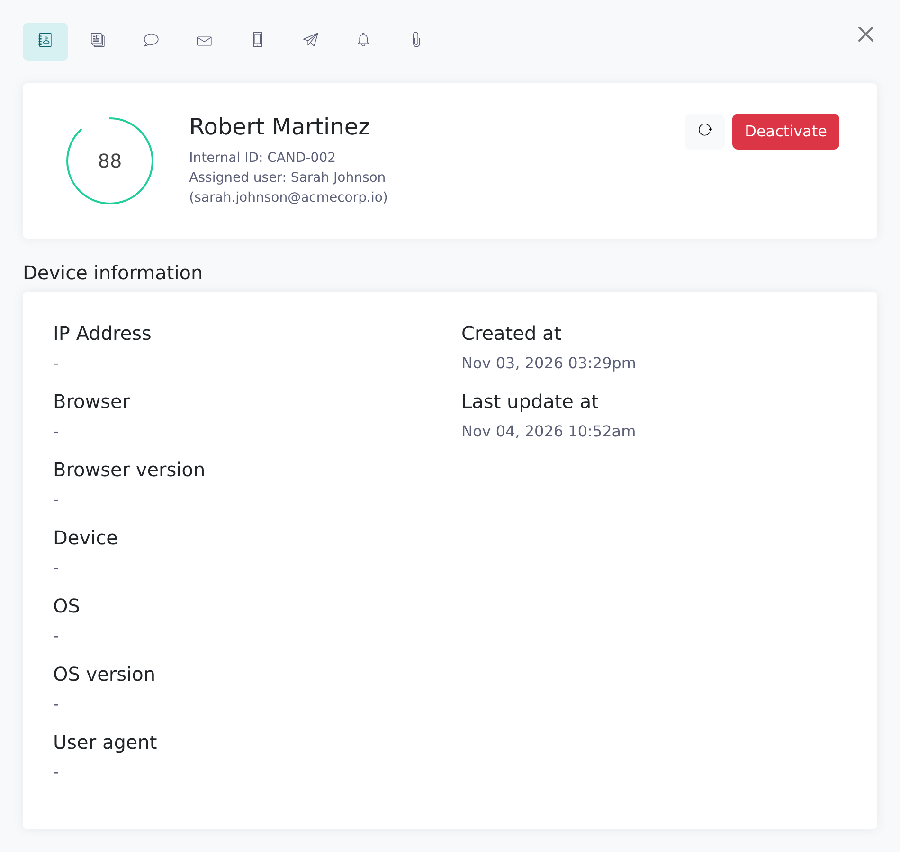
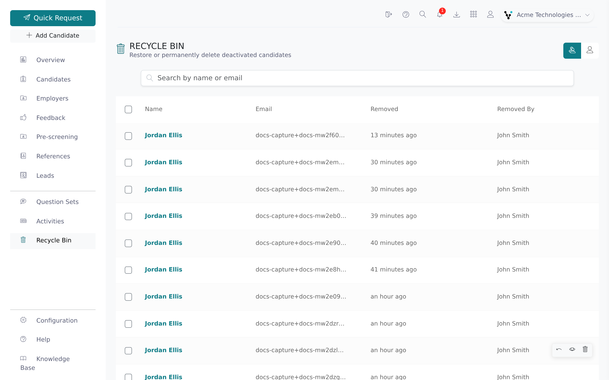

Deactivating a candidate removes them from your active candidate list without deleting anything. They wait in the **Recycle Bin** until someone restores them or a root recruiter deletes them for good.

<Note>
  Any recruiter can deactivate and reactivate their own candidates. Only root
  recruiters can use **Delete permanently**. Recruiters see only their own
  candidates in the bin; root recruiters see the whole firm's, and so does
  everyone when your firm has turned on the **Display Everyone / Myself
  toggle** setting.
</Note>

## What deactivating does

You can deactivate a candidate in three places: the red bin button in the candidate page header, the **Deactivate** button in the **Details** tab of the candidate's side panel (click **See more**), or the **Deactivate** bulk action on the **Candidates** list.

When you deactivate a candidate, Vitay:

- hides them from the candidates list, searches and reports;
- records who deactivated them and when, and adds an entry to the activity log;
- keeps every reference, answer, document, comment and activity as it was.

The single-candidate confirmation is titled **Delete Candidate?**, but it only deactivates. The bulk confirmation says so: *"Deactivated candidates are moved to the recycle bin and can be reactivated later."*

## Adding a deactivated candidate again

A deactivated candidate still counts as existing on your account:

- If you add a candidate with the same **Internal ID** as a deactivated one, or a CSV import row matches a deactivated candidate's email or internal ID, Vitay refuses and tells you the candidate is deactivated. An **Open the Recycle Bin** link opens the bin with that candidate already in the search box, so you can reactivate them with their references and history.
- If your firm requires candidate emails and you add a candidate with the email of a deactivated one, Vitay reactivates that record with the details you entered instead of creating a new candidate.

## Open the Recycle Bin

<Steps>
  <Step title="Open the Recycle Bin">
    Click **Recycle Bin** in the left sidebar. The list shows the most
    recently removed candidate first, with a count of how many are in the bin.

    
  </Step>
  <Step title="Find the candidate">
    Type in the **Search by name or email** box. If the scope buttons are
    shown, choose **Everyone** for the whole firm or **Myself** for your own
    candidates. Each row shows **Name**, **Email**, **Removed** (how long ago)
    and **Removed by**.
  </Step>
  <Step title="View details (optional)">
    Click the eye icon (**View details**) to see the candidate's name, job
    title, when they were removed and by whom. You can't open the full
    candidate page while they are in the bin.
  </Step>
</Steps>

## Restore a candidate

<Steps>
  <Step title="Click Reactivate">
    Click the undo-arrow icon (**Reactivate**) on the row. To restore several,
    tick their checkboxes (or select all matching candidates) and click
    **Reactivate** in the bulk action bar.
  </Step>
  <Step title="Check the candidates list">
    A **Candidate reactivated** message confirms it. The candidate is back in
    your candidates list, along with any of their references that had been
    deactivated.
  </Step>
</Steps>

## Permanently delete a candidate

<Warning>
  Permanent deletion cannot be undone. It removes the candidate and their
  references, reference requests, pre-screenings, background checks,
  feedback, comments, uploaded documents and signature, IP-conflict records
  and report recipients.
</Warning>

<Steps>
  <Step title="Click Delete permanently">
    Click the bin icon (**Delete permanently**) on the row, or tick several
    candidates and click **Delete permanently** in the bulk action bar. Only
    root recruiters see this option.
  </Step>
  <Step title="Confirm">
    The confirmation reads *"This cannot be undone. The candidate's
    references will also be permanently deleted."* Click **Delete**. A
    **Candidate permanently deleted** message confirms it.
  </Step>
</Steps>

## Nothing expires on its own

Candidates stay in the Recycle Bin until someone reactivates them or a root recruiter deletes them. Vitay never empties the bin automatically.

## Recycle Bin vs. anonymization

| | Recycle Bin | Anonymization |
|---|---|---|
| What it does | Hides the candidate and keeps all data | Replaces personal data with placeholders |
| Reversible? | Yes, with **Reactivate** | No |
| Who can do it | Any recruiter deactivates; root recruiters delete permanently | Root and supervisor recruiters, with **Purge data** in the candidate side panel, or the automatic [data retention policy](/security-it/data-retention) |
| Use it when | A candidate was added by mistake or is no longer active | You must erase personal data |

To erase personal data on a schedule instead of case by case, see [Set up automatic data retention](/security-it/data-retention).

## Troubleshooting

<AccordionGroup>
  <Accordion title="I can't see the Delete permanently option">
    Only root recruiters of the account (or of its parent account) can
    delete permanently. Ask a root recruiter, or see
    [Manage users](/account-configuration/manage-users).
  </Accordion>
  <Accordion title="A candidate I deactivated isn't in the bin">
    Clear the search box, and if you see the scope buttons, choose
    **Everyone**. If you are not a root recruiter and the Everyone / Myself
    toggle setting is off, you only see candidates assigned to you. A
    candidate a root recruiter deleted permanently can't be recovered.
  </Accordion>
  <Accordion title="The bulk action reported some failures">
    The message shows how many succeeded and failed (for example *2
    succeeded, 1 failed*). Reload the page and retry the rest one at a time.
    If one keeps failing, contact [hello@vitay.io](mailto:hello@vitay.io)
    with the candidate's name.
  </Accordion>
</AccordionGroup>

## Related articles

<CardGroup cols={2}>
  <Card title="Bulk candidate actions" icon="layer-group" href="/candidates-reference-requests/bulk-candidate-actions" />
  <Card title="Set up automatic data retention" icon="clock-rotate-left" href="/security-it/data-retention" />
  <Card title="Data and privacy" icon="shield-halved" href="/security-it/data-and-privacy" />
  <Card title="Activities log" icon="list-timeline" href="/reports-lead-generation/activities-log" />
</CardGroup>

{/* source: app projects/references protected/recycle-bin/{recycle-bin.component.{html,ts},details/}, protected/candidates/show/header/candidates.show.header.component.html, shared/components/sidebar/candidate/details/sidebar.candidate.details.component.{html,ts}, assets/i18n/en.json RECYCLE_BIN.* CANDIDATE.CONFIRM CANDIDATES.BULK_ACTIONS.DEACTIVATE_*; api app/controllers/api/v3/recycle_bin/candidates_controller.rb (inactive_scope, SOFT_DELETED_CHILD_MODELS), app/controllers/api/v3/candidates_controller.rb (#create email reactivation, deactivated_candidate_with_internal_id, #destroy), app/controllers/api/v3/documents/csv_controller.rb#set_duplicate_candidate_error, app/models/candidate.rb#reactivate, app/models/user.rb#all_toggle_or_root_recruiter? */}
