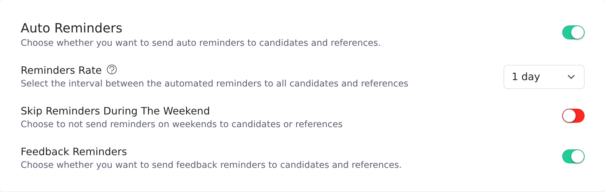
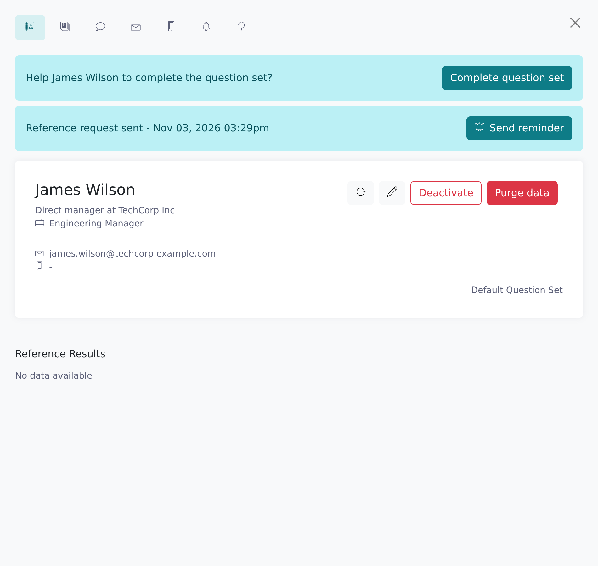
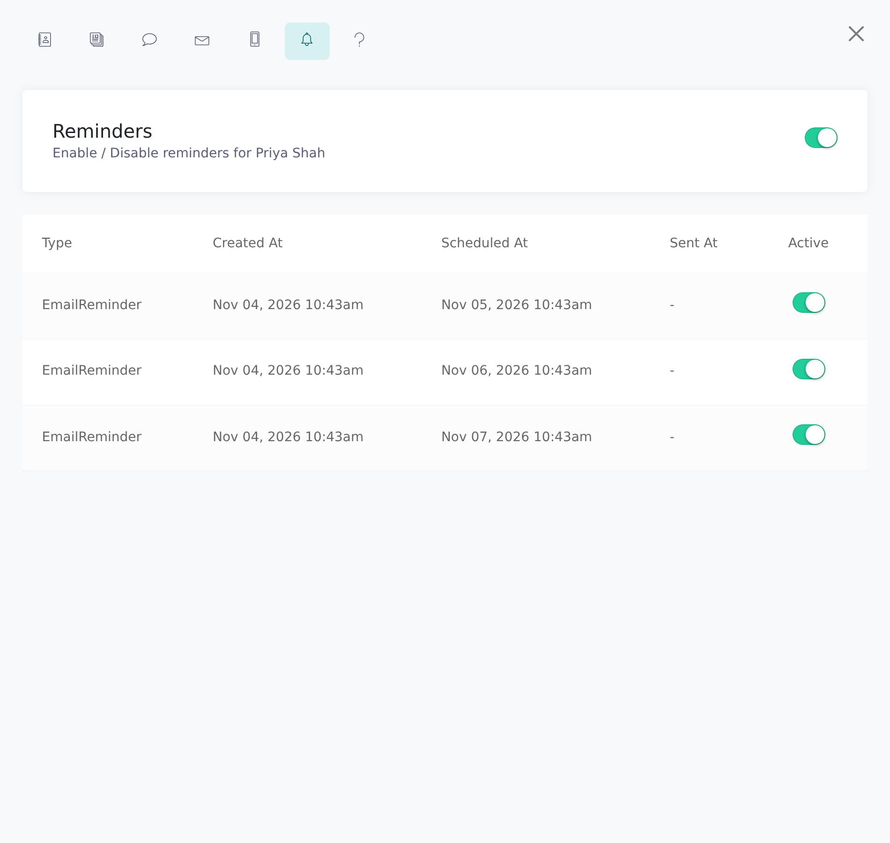

Vitay follows up automatically with references and candidates who haven't responded, and you can send extra reminders yourself.

<Note>
  Any recruiter can send manual reminders and turn reminders off for one
  candidate or reference. Only a root recruiter can change the firm-wide
  schedule, in the Configuration area under **Settings → Notifications**.
</Note>

## How automatic reminders work

When a reference request or a reference is sent, Vitay schedules **3 automatic reminders**, as long as **Auto Reminders** is on for your firm (it is by default).

- **Spacing:** the reminders are spaced by your firm's **Reminders Rate**: 1 day by default, or 2, 3 or 4 days.
- **Timing is fixed at send time:** all three dates are set the moment the request goes out. Changing the rate or the weekend setting later only affects requests sent after the change.
- **Weekends:** **Skip Reminders During The Weekend** is off by default. When it's on, a reminder that would land on a Saturday or Sunday moves to the Monday.
- **Feedback requests:** they have their own switch, **Feedback Reminders** (on by default). It only appears when a feedback plugin is active.
- **Channels:** reminders go by email, and also by text when the person has a mobile number and text messages are on for your firm.
- **References held for review:** when **Reference review configuration** is on, the three reminders are scheduled when you first approve the reference. Approving it again doesn't add more.

## Send a manual reminder

A reference can receive at most **10 reminders** in total, at least **12 hours** apart. The 10 counts every reminder already sent plus the automatic ones still scheduled; an email and its matching text count as one.

<Steps>
  <Step title="Open the candidate">
    Go to **Candidates** and open the candidate.
  </Step>
  <Step title="Open the reference">
    On the **References** tab, click the reference who hasn't responded. Their
    side panel opens.
  </Step>
  <Step title="Click Send reminder">
    Click **Send reminder**. Vitay sends the email (and a text, if they have a
    mobile number) right away and logs it on the **Activities** tab of the
    candidate and the reference.

    
  </Step>
</Steps>

You can also click **Send reminder** in the **Completed At** column of the References tab, or on the open request banner at the top of the candidate page to remind the candidate.

Instead of **Send reminder** you may see:

| Button | Why |
|---|---|
| **Reminder sent** | A reminder went out in the last 12 hours. Hover it to see when. |
| **Reminder limit reached** | The reference already has 10 reminders. |
| **Reminders disabled** | Reminders are off for this candidate or reference. |

The bulk **Send reminder** action on the Candidates list follows the same rules. It reminds every pending reference of the selected candidates and skips references that hit the limit, were reminded in the last 12 hours, have reminders off, or have a bounced email address. That's why it often reports fewer reminders than the number of candidates you picked.

## Turn reminders off for one person

Both switches save as soon as you flip them.

- **A whole candidate:** on the candidate page, click **See more** to open the side panel, then open the **Reminders** tab (alarm-clock icon) and switch it off. This stops reminders for that candidate's requests and references.
- **One reference:** click the reference, open the **Reminders** tab in its side panel and switch it off.

The tab also lists each reminder with its **Type**, **Created At**, **Scheduled At** and **Sent At** dates and an **Active** switch. A yellow *Auto-reminders are disabled* notice means automatic reminders are off for the whole firm.

## What stops reminders

- **The person responds.** Submitting the form cancels every reminder still scheduled.
- **You turn reminders off** with the **Reminders** switch above.
- **You correct their contact details.** Changing a reference's email address or mobile number cancels their scheduled reminders. Vitay doesn't resend the request on its own, so use **Send reminder** to reach the new address.
- **Their email bounces.** When the last email to an address bounced, was dropped or was reported as spam, Vitay stops emailing reminders to it. Scheduled email reminders are skipped, **Send reminder** shows *The last email to this reference bounced. Update the email address before sending another reminder*, and the bulk action skips the reference. Texts still go out. Correct the address and send a reminder; a later successful delivery to the same address also lifts the block.

Vitay's emails have no unsubscribe link, so if a reference asks to stop being contacted, switch their reminders off yourself. For texts, a reference can reply **STOP** to opt out and **START** to opt back in; this only affects texts.

## Troubleshooting

<AccordionGroup>
  <Accordion title="Send reminder is greyed out">
    The reference has already completed the form, reminders are off for the
    candidate or the reference, they already have 10 reminders, or one went
    out in the last 12 hours. The button's label tells you which.
  </Accordion>
  <Accordion title="Send reminder says the last email bounced">
    Open the reference's **Email activity** tab to see the reason, confirm the
    right address with the reference or the candidate, update the record,
    then click **Send reminder**. See
    [A reference didn't receive the email](/candidates-reference-requests/reference-not-received).
  </Accordion>
  <Accordion title="A reference says they're getting too many emails">
    Switch off reminders on that reference's side panel. A root recruiter can
    also lengthen the **Reminders Rate** (up to 4 days) or turn on
    **Skip Reminders During The Weekend**, but those changes only apply to
    requests sent afterwards.
  </Accordion>
  <Accordion title="No automatic reminders are going out">
    **Auto Reminders** may be off for your firm. A root recruiter can check it
    under **Settings → Notifications**. Manual reminders still work while it's
    off.
  </Accordion>
</AccordionGroup>

## Related articles

<CardGroup cols={2}>
  <Card title="Send a reference request" icon="paper-plane" href="/candidates-reference-requests/send-a-reference-request" />
  <Card title="Manage in-flight requests" icon="sliders" href="/candidates-reference-requests/manage-in-flight-requests" />
  <Card title="A reference didn't receive the email" icon="triangle-exclamation" href="/candidates-reference-requests/reference-not-received" />
</CardGroup>

{/* source: api app/models/reminder.rb (next_reminder_dates, send_count), app/models/reference.rb (add_reminders, reminder_count, all_reminders), app/models/email_reminder.rb, app/models/concerns/reminder_email_bounce.rb, app/models/setting.rb (SETTINGS auto_reminders), config/application.rb (config.reminders), app/controllers/api/v1/references_controller.rb (approve, update reset_reminders), app/controllers/api/v3/candidates/bulk_controller.rb#send_candidate_reminders, app/controllers/api/v3/webhooks/twilio_controller.rb; app projects/configuration/src/app/protected/settings/notifications/settings.notifications.component.{html,ts}, projects/references/src/app/shared/components/sidebar/reference/{reminders,question-set/alerts}, src/app/shared/components/table/table.component.{html,ts}, protected/candidates/show/alerts, protected/candidates/show/header (BUTTONS.SIDEBAR) */}
