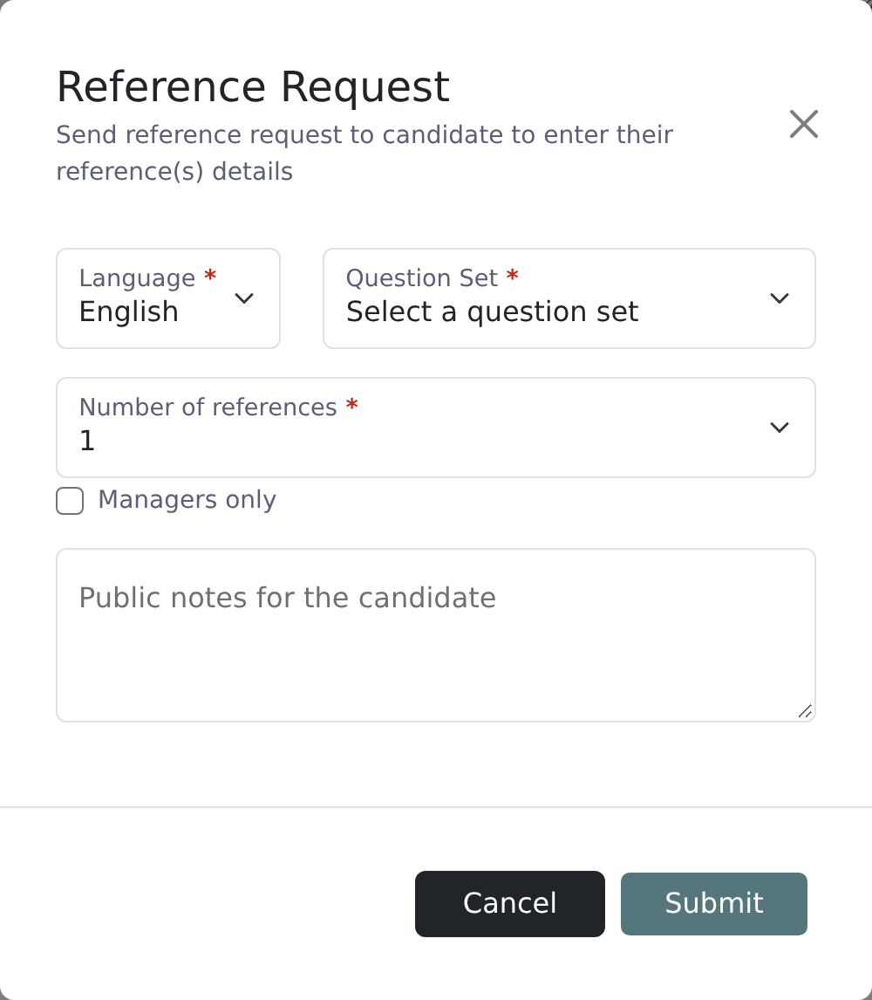
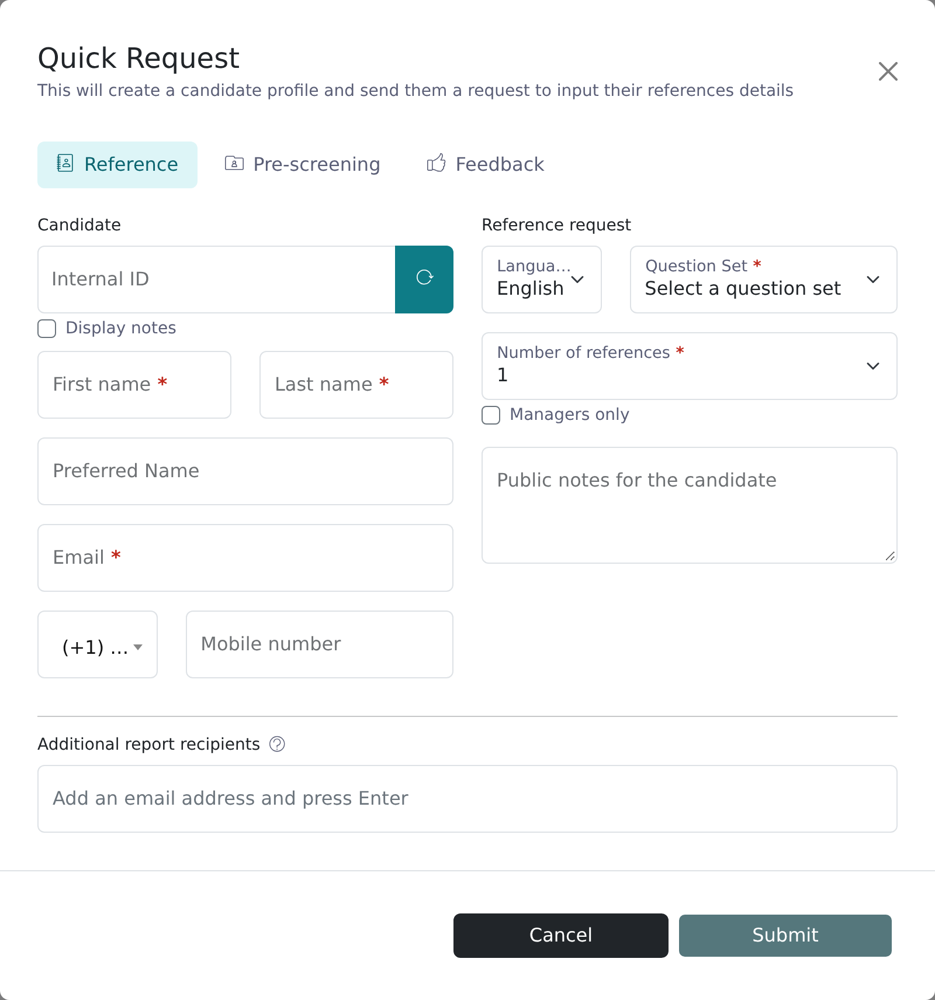

A reference request asks your candidate to list their references. The candidate gets an email (and a text message, if they have a mobile number on file) with a link to a form where they enter each reference's contact details. Vitay then sends each reference the questions to answer.

<Note>
  The candidate must already exist in Vitay with an email address or a mobile
  number. See [Add a candidate](/candidates-reference-requests/add-a-candidate).
</Note>

<Steps>
  <Step title="Open the candidate">
    Go to **Candidates** and click the candidate.
  </Step>
  <Step title="Click Reference Request">
    The button is on the **References** tab, next to **Add Reference**. It
    only appears when the candidate has an email address or mobile number.

    
  </Step>
  <Step title="Choose the question set">
    Pick the set the references will answer in **Question Set**. Your firm's
    default set is pre-selected. Sets with no questions are greyed out.
  </Step>
  <Step title="Choose the candidate questions (optional)">
    **Candidate questions** appears when your account has a **Candidate**
    question set with questions in the request's language. The candidate
    answers these questions before submitting their references. Your firm's
    default is pre-selected; pick another set, or **None** to send the request
    without them. See
    [Ask candidates questions](/candidates-reference-requests/candidate-questions).
  </Step>
  <Step title="Set the number of references">
    **Number of references** is how many references the candidate must provide
    before they can submit. Tick **Managers only** if every reference must be a
    manager.

    The list starts at your firm's default and offers the next four values, so
    with a default of 2 you can pick 2 to 6. If the candidate has had a
    reference request before, the list offers 1 to 5 and starts at 1. A root
    recruiter sets the firm default; see
    [Reference request settings](/account-configuration/reference-request-settings).
  </Step>
  <Step title="Check the required relationships">
    If your firm has **Required relationships** switched on, the form shows
    them as one line under **Managers only**, for example "1 × Direct manager
    or Non-direct manager, 1 × Any non-professional relationship". Click
    **Change** to edit them for this request only. **Number of references**
    can't go below the total the rows ask for.

    The line is hidden while **Managers only** is ticked, because a managers-only
    request asks for no specific relationships. If the candidate has had a
    reference request before, it starts with no required relationships.

    
  </Step>
  <Step title="Add optional details">
    **Public notes for the candidate** are shown to the candidate on the form.
    Depending on your firm's settings you may also see:

    - **Language**, the language the request is sent in.
    - **Set yourself as the assigned user**.

    
  </Step>
  <Step title="Click Submit">
    The request goes out immediately.
  </Step>
</Steps>

## Use Quick Request instead

**Quick Request**, at the top of the left sidebar, creates the candidate and
sends the reference request from one form. Tick **Search existing candidate**
to send a request to someone who's already in Vitay.

When you pick a language in Quick Request, question sets that aren't fully
translated into it are hidden, and a hint under the dropdown says how many were
hidden.

The **Reference** tab of Quick Request also shows **Candidate questions** and
**Required relationships**, pre-filled with your firm's defaults.

If your firm allows multiple assigned users, Quick Request has an **Assigned
users** field at the bottom. It starts with you; search by name or email to add
up to 11 users. Everyone listed sees the candidate under **Myself** and gets
its notifications. The first user listed is the primary assigned user: emails
to the candidate and references are sent from them.

## What happens next

- The candidate enters their references on the form. If your firm collects
  documents, they can attach them there too; see
  [Collect documents from candidates](/candidates-reference-requests/candidate-documents).
- Each reference gets the question set by email, or by text message when only
  a mobile number was given.
- Vitay sends reminders automatically; see
  [Reminders and how they work](/candidates-reference-requests/reminders-and-cadence).
- You can remind, cancel or fix a request later; see
  [Manage in-flight requests](/candidates-reference-requests/manage-in-flight-requests).

## Troubleshooting

<AccordionGroup>
  <Accordion title="The candidate says they didn't get the email">
    See [A reference didn't receive the email](/candidates-reference-requests/reference-not-received).
    The same checks (correct address, spam folder, resend) apply to candidates.
  </Accordion>
  <Accordion title="You have already sent a reference request to this candidate">
    A candidate can have only one open request per question set. Either pick a
    different question set, which creates a second, separate request, or wait
    until the candidate submits the open one or you cancel it. See
    [Manage in-flight requests](/candidates-reference-requests/manage-in-flight-requests).
  </Accordion>
  <Accordion title="The question set list is empty">
    No question set is available to your account. Ask a root recruiter to set
    one up; see
    [Question sets and templates](/account-configuration/question-sets-and-templates).
    In Quick Request, also try another language: sets that aren't fully
    translated into the chosen language are hidden.
  </Accordion>
  <Accordion title="The Candidate questions field is missing">
    It only appears when your account has an active **Candidate** question set
    with questions in the request's language. Create one, or add questions in
    that language; see
    [Ask candidates questions](/candidates-reference-requests/candidate-questions).
  </Accordion>
  <Accordion title="I can't lower the Number of references">
    Your firm's **Required relationships** add up to that number. Click
    **Change** next to the required relationships to remove or reduce a row,
    or tick **Managers only**.
  </Accordion>
  <Accordion title="The Reference Request button is missing or greyed out">
    The button is hidden when the candidate has neither an email address nor a
    mobile number. It's greyed out on demo accounts and on candidates that
    belong to a different sub-account than the one you're viewing.
  </Accordion>
</AccordionGroup>

## Related articles

<CardGroup cols={2}>
  <Card title="Add a candidate" icon="user-plus" href="/candidates-reference-requests/add-a-candidate" />
  <Card title="Reminders and how they work" icon="bell" href="/candidates-reference-requests/reminders-and-cadence" />
  <Card title="Manage in-flight requests" icon="paper-plane" href="/candidates-reference-requests/manage-in-flight-requests" />
  <Card title="Read a completed reference" icon="clipboard-check" href="/candidates-reference-requests/read-a-completed-reference" />
  <Card title="Reference request settings" icon="sliders" href="/account-configuration/reference-request-settings" />
  <Card title="Ask candidates questions" icon="clipboard-list" href="/candidates-reference-requests/candidate-questions" />
</CardGroup>

{/* source: app src/app/shared/components/modals/reference-requests/modals.reference-requests.component.{html,ts}; projects/references/src/app/protected/candidates/show/candidates.show.component.{html,ts}; projects/references/src/app/shared/components/modals/quick-request/modals.quick-request.component.{html,ts}; src/app/shared/services/candidate-access.service.ts; src/app/shared/helpers/{candidate-question-sets,relationship-requirements}.helper.ts; src/app/shared/components/relationship-requirements-editor/*; app-assigned-users-input (MODALS.CANDIDATES.ASSIGNED_USERS); projects/references/src/assets/i18n/en.json (MODALS.REFERENCE_REQUESTS, MODALS.QUICK_REQUEST, CANDIDATES.BUTTONS.REQUEST_REFERENCE); api app/controllers/api/v1/reference_requests_controller.rb (#create, #check_reference_request); app/models/reference_request.rb (#send_reference_requests, min_references, candidate_question_set, relationship_requirements); app/models/question_set_base.rb#selectable; lib/tasks/reference_requests.rake */}
