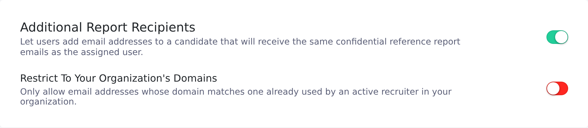
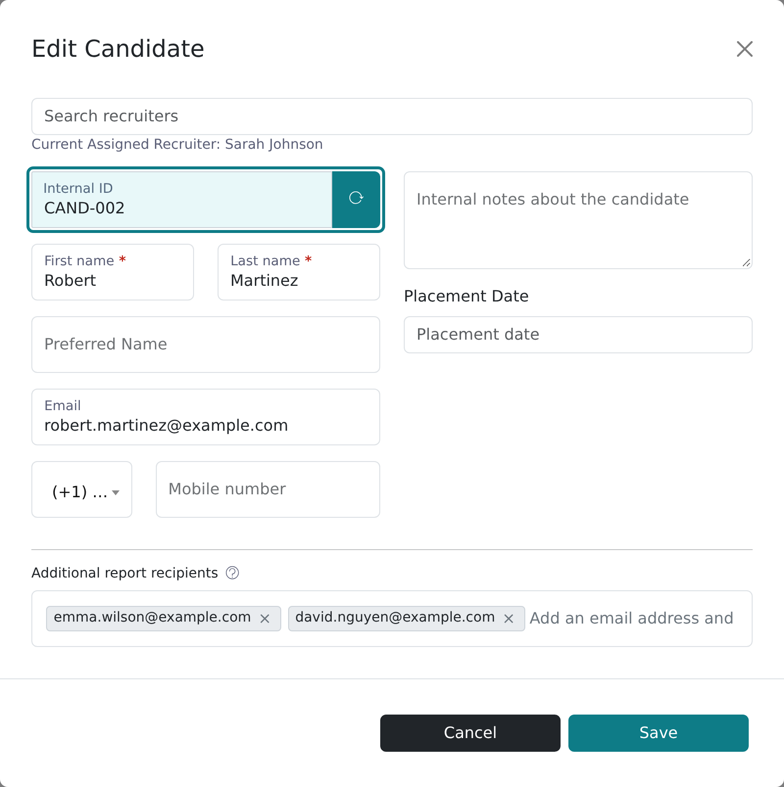
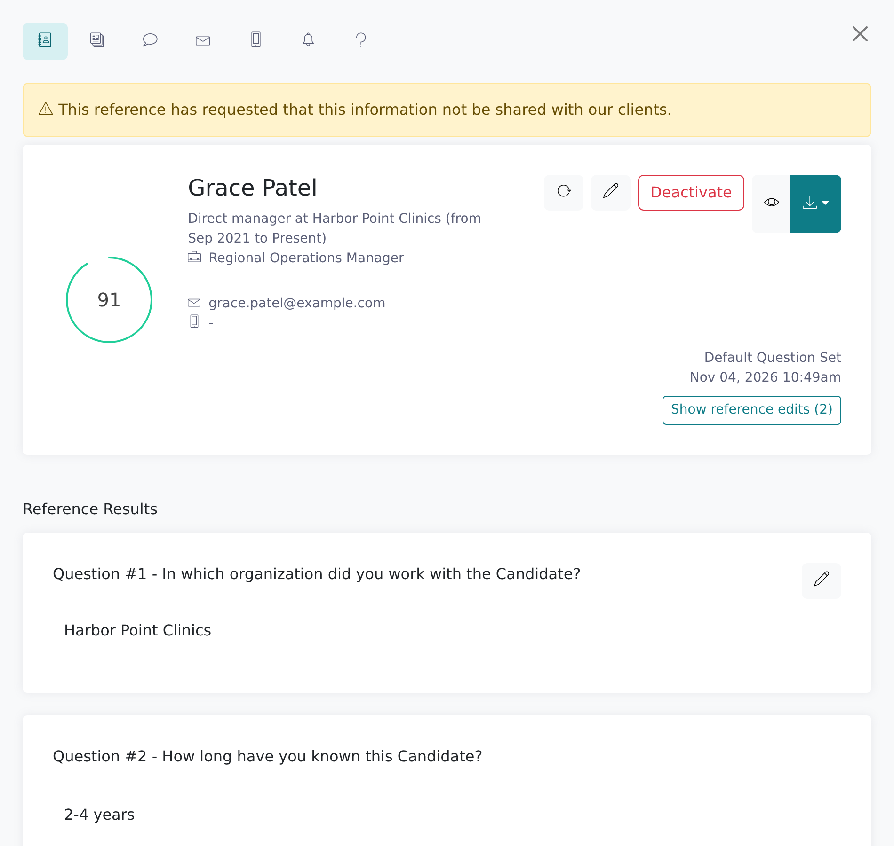

Vitay can email completed reference reports, as PDF attachments, to addresses you add to a candidate, such as a hiring manager or a client contact. They don't need a Vitay login.

<Note>
  A root recruiter has to turn the feature on first, in the Configuration
  area. After that, any recruiter can add report recipients to a candidate.
</Note>

## Turn the feature on

<Steps>
  <Step title="Open the Notifications settings">
    In the Configuration area, go to **Settings → Notifications** and find the
    **Additional Report Recipients** card.
  </Step>
  <Step title="Switch it on">
    Flip the switch. It saves straight away. Every candidate form now has an
    **Additional report recipients** field.
  </Step>
  <Step title="Decide whether to restrict domains">
    A second switch appears: **Restrict To Your Organization's Domains**. When
    it's on, only addresses whose domain is already used by an active
    recruiter in your firm are accepted. Leave it off to send reports to
    client domains.

    
  </Step>
</Steps>

## Add report recipients to a candidate

<Steps>
  <Step title="Edit the candidate">
    Open the candidate and click the pencil (**Edit candidate**) in the
    header. You can also add recipients when you create the candidate or in
    the **Quick Request** form.
  </Step>
  <Step title="Add the addresses">
    At the bottom of the form, under **Additional report recipients**, type an
    address and press **Enter**. Each address becomes a chip. A candidate can
    have up to 5.

    
  </Step>
  <Step title="Save">
    Click **Save**. The candidate header now shows a **Report recipients**
    line with the addresses.
  </Step>
</Steps>

To remove someone, edit the candidate, delete their chip and save.

If an address is refused, the reason shows in red under the field:

| Message | What to do |
| --- | --- |
| *&lt;address&gt; is not a valid email address* | Fix the typo. |
| *&lt;domain&gt; is not a domain used by a recruiter in your organization* | The domain restriction is on. Use an internal address, or ask a root recruiter to turn the restriction off. |
| *A candidate can have at most 5 report recipients* | Remove an address first. |

## What recipients receive

Each recipient gets an email with the report attached as a PDF. There's no link into Vitay.

| When | Subject | Attachment |
| --- | --- | --- |
| A reference completes their form | *A reference has been completed for &lt;candidate&gt;* | That reference's report |
| The last reference completes | *All references have been completed for &lt;candidate&gt;* | The full candidate report |

The email names your firm, says the address was added as a report recipient, and invites questions by reply. It comes from your firm's **Team notification sender** (or Vitay's address for your region when that is blank), and replies go there too. See [Email sender settings](/account-configuration/email-sender-settings#which-sender-your-team-sees).

Report recipients are separate from the **Team notifications** table on **Settings → Notifications**, which only decides who on your team is emailed.

## Copy the same people on every candidate

If someone should get reports for every candidate, use the team notifications instead:

<Steps>
  <Step title="Open Team notifications">
    In the Configuration area, go to **Settings → Notifications**. The first
    card is **Team notifications**.
  </Step>
  <Step title="Tick Additional emails">
    On the **Reference completed** and **All references completed** rows, tick
    **Additional emails**. An **Additional emails for this event** field opens
    under the row.
  </Step>
  <Step title="Add the addresses">
    Type each address and press **Enter**. Each row keeps its own list, and
    changes save as you make them.
  </Step>
</Steps>

These lists apply to every candidate in the firm. The 5-address limit and the domain restriction don't apply to them. See [Notification settings](/account-configuration/notification-settings).

## When a reference withholds permission to share

If your firm turns on **Ask For References Consent To Share Results** (**Settings → References**), the reference form can ask:

- *Do we have your permission to release this information to our client?* (switch: **Permission release to client**)
- *Do we have your permission to release this information to the candidate?* (switch: **Permission release to candidate**)

If the reference answers **No**, a yellow warning appears on the reference in Vitay:

| They declined | Warning |
| --- | --- |
| Client only | *This reference has requested that this information not be shared with our clients.* |
| Candidate only | *This reference has requested that this information not be shared with the candidate.* |
| Both | *This reference has requested that this information not be shared with either our clients or the candidate.* |

The warning is advisory. Vitay doesn't block or redact anything: report recipients still get their copy and the report can still be downloaded. The standard report layout doesn't print the warning (only the older default layout does, on single-reference reports), so check the reference in Vitay before you forward any report.

## Troubleshooting

<AccordionGroup>
  <Accordion title="There's no Additional report recipients field">
    The feature is off. A root recruiter needs to switch on **Additional
    Report Recipients** under **Settings → Notifications**.
  </Accordion>
  <Accordion title="A recipient never got the report">
    Check that the address is still listed under **Report recipients** on the
    candidate, that the feature is still on, and that the reference is
    actually complete. Then ask them to check spam: emails with PDF
    attachments are often filtered.
  </Accordion>
  <Accordion title="Recipient emails aren't on the Email activity tab">
    That tab only lists emails sent to the candidate's own address. See
    [Check email and text delivery](/candidates-reference-requests/email-and-text-delivery).
  </Accordion>
  <Accordion title="I added someone by mistake">
    Edit the candidate, remove the chip and save. This stops future emails but
    can't recall a PDF already sent. If that's a problem, contact
    [hello@vitay.io](mailto:hello@vitay.io).
  </Accordion>
  <Accordion title="Can a recipient log in to see more?">
    No. Recipients only see the PDF attached to their email. If someone needs
    ongoing access, add them as a user; see
    [Manage users](/account-configuration/manage-users).
  </Accordion>
</AccordionGroup>

## Related articles

<CardGroup cols={2}>
  <Card title="Read a completed reference" icon="clipboard-check" href="/candidates-reference-requests/read-a-completed-reference" />
  <Card title="Notification settings" icon="bell-on" href="/account-configuration/notification-settings" />
  <Card title="Reference settings" icon="sliders" href="/account-configuration/reference-settings" />
  <Card title="Manage users" icon="users" href="/account-configuration/manage-users" />
</CardGroup>

{/* source: api app/models/candidate_report_recipient.rb, app/models/recruiter_reference.rb (send_*_to_report_recipients, send_report_email_to_report_recipients), app/models/reference.rb#permission_warning_message, app/views/api/v3/documents/en/{default,compressed}/references.erb, db/schema.rb (pdf_template default compressed, consent defaults); app src/app/shared/components/report-recipients-input/report-recipients-input.component.ts, src/app/shared/components/modals/candidates/modals.candidates.component.html, projects/references/src/app/shared/components/modals/quick-request/modals.quick-request.component.html, protected/candidates/show/header/candidates.show.header.component.html, shared/components/sidebar/reference/question-set/alerts/sidebar.reference.question-set.alerts.component.ts; projects/configuration/src/app/protected/settings/{notifications,references}, shared/components/notification-matrix */}
