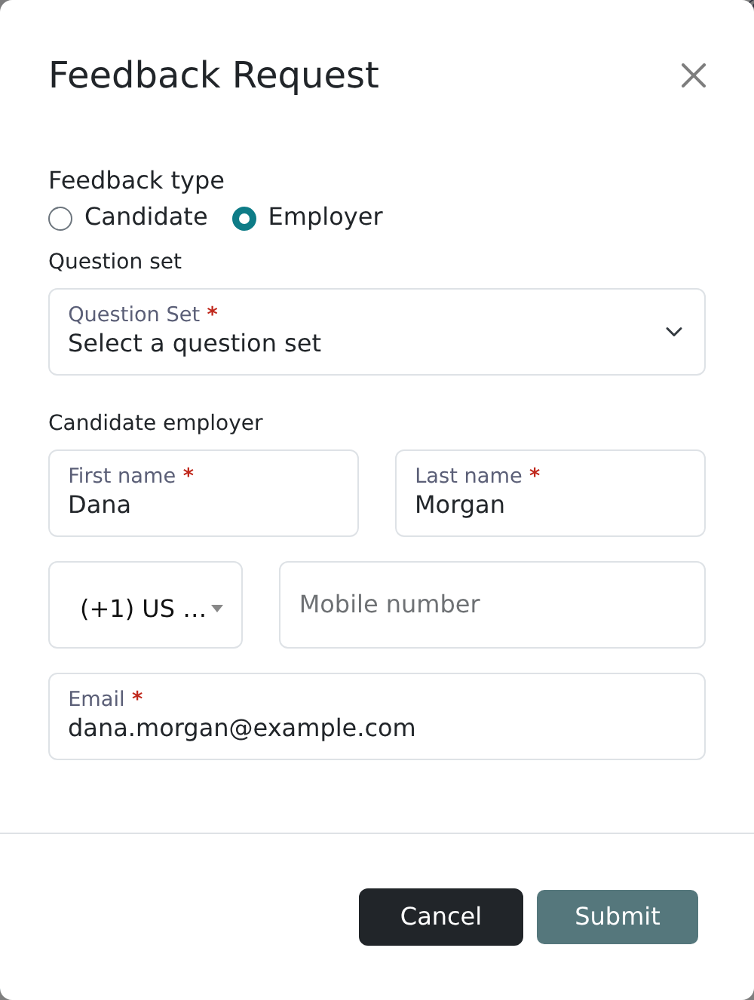
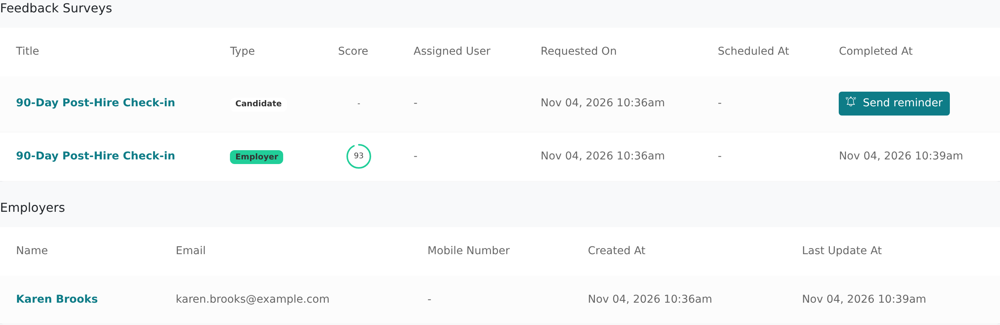

Post-hire feedback asks the employer (the hiring manager or client contact) how a placed candidate
is doing. The employer answers a feedback question set, and the answers appear on the candidate's
**Feedback** tab.

<Note>
  Post-hire feedback uses the **Employer** feedback type, which Vitay turns on together with
  Candidate feedback. Contact [hello@vitay.io](mailto:hello@vitay.io) if you don't see it. You
  also need a question set whose **Type** is **Feedback**; see
  [Candidate feedback](/feedback/candidate-feedback) to create one.
</Note>

## Send a post-hire feedback request

<Steps>
  <Step title="Open the candidate's Feedback tab">
    Go to **Candidates**, open the placed candidate, and click the **Feedback** tab.
  </Step>
  <Step title="Click Feedback request">
    The button is at the top right of the tab.
  </Step>
  <Step title="Select Employer">
    Under **Feedback type**, select **Employer**. The employer contact fields appear.
  </Step>
  <Step title="Enter the employer's details">
    Fill in their first name, last name and email. Add a phone number to also send the request by
    text message.

    
  </Step>
  <Step title="Choose a Question set">
    Only Feedback question sets are listed.
  </Step>
  <Step title="Pick a Scheduled date (optional)">
    If your firm has scheduled feedback, pick a date to send it later, or leave it blank to send
    now.
  </Step>
  <Step title="Click Submit">
    Vitay emails the employer a link to the form, and texts it too if you added a phone number.
  </Step>
</Steps>

## What happens next

- If the employer doesn't answer, Vitay sends reminders on your firm's reminder schedule, by text
  too if they have a phone number and your firm uses text messages.
- When they submit, the answers and a score (from rating and matrix questions) appear on the
  candidate's **Feedback** tab.
- An email goes to the people chosen in the **Feedback completed** row of **Team notifications**
  (**Settings → Notifications** in Configuration). For new accounts, that's the candidate's
  assigned recruiter and the person who sent the request.

To stop feedback reminders, a root recruiter can turn off **Feedback reminders** on the same
Notifications tab. See [Notification settings](/account-configuration/notification-settings).

## View completed feedback

The candidate's **Feedback** tab lists their pending and completed requests. Click one to read the
answers. Below it, the **employers** table lists the candidate's employers; click a row to correct
the name, email, phone, position or employment dates.

To see employer feedback across all candidates, open **Feedback** in the left sidebar and filter
the type to **Employer**. See [Candidate feedback](/feedback/candidate-feedback).

If the employer gives you their answers by phone, open the pending request and click **Complete
feedback** to fill in the form yourself. The answers are saved as if the employer submitted them,
so only use it to record what they told you.

To have the candidate rate your recruiter instead, use the **Recruiter** feedback type; see
[Candidate feedback](/feedback/candidate-feedback).

## Troubleshooting

<AccordionGroup>
  <Accordion title="I don't see the Employer option">
    Employer feedback comes with Candidate feedback. Contact
    [hello@vitay.io](mailto:hello@vitay.io) to turn it on.
  </Accordion>
  <Accordion title="The employer didn't get the email">
    Check the email in the candidate's **employers** table and ask the employer to look in spam. To
    send a reminder now, open the request from the **Feedback** page and click **Send reminder**.
  </Accordion>
  <Accordion title="The request went to the wrong email">
    On the candidate's **Feedback** tab, click the employer in the **employers** table and correct
    the address. The next reminder goes to the new address.
  </Accordion>
</AccordionGroup>

## Related articles

<CardGroup cols={2}>
  <Card title="Candidate feedback" icon="comment-dots" href="/feedback/candidate-feedback" />
  <Card title="Read a completed reference" icon="clipboard-check" href="/candidates-reference-requests/read-a-completed-reference" />
  <Card title="Reminders and how they work" icon="bell" href="/candidates-reference-requests/reminders-and-cadence" />
  <Card title="Question sets and templates" icon="list-check" href="/account-configuration/question-sets-and-templates" />
</CardGroup>

{/* source: app src/app/shared/components/modals/feedback-requests/modals.feedback-requests.component.{html,ts} (Employer fields, is_employer_feedbacks_scheduled_enabled), projects/references/src/app/protected/candidates/show/candidates.show.component.html (Feedback tab button), protected/candidates/show/feedbacks/candidates.show.feedbacks.component.{html,ts}, src/app/shared/components/modals/employers, protected/feedbacks/list + show (Send reminder, Complete feedback); api app/models/feedback.rb, app/models/employer.rb, app/models/custom_notification.rb */}
