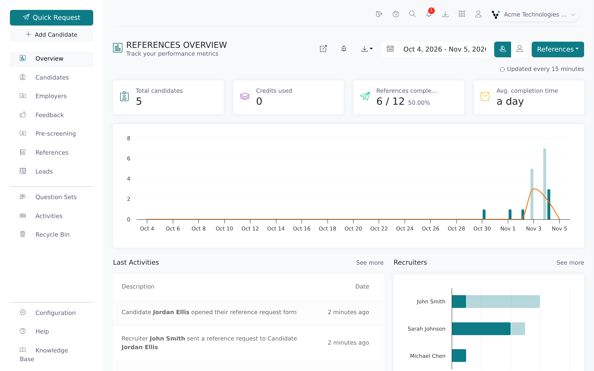

Vitay runs your reference checks. You add a candidate and send a reference request, and Vitay
sends the emails and reminders and collects the answers into a report.

This help center is for recruiters and admins with a Vitay login. If you received a reference
request and need help completing it, contact the recruiter who sent it. Their email address is in
the message you received.

## What you can do in Vitay

- Add candidates and send reference requests.
- Read and score completed references.
- Send feedback surveys to candidates and employers, if your firm has feedback turned on.
- Turn references into leads.
- Manage users, branding, question sets and integrations (root recruiters).

## Find your way around

The left sidebar takes you to each part of the app. What you see depends on your role and on what's
turned on for your firm:

- **Overview**: the dashboard.
- **Candidates**: everyone you've added, and their reference requests.
- **References** and **Leads**: completed references and the contacts they bring in.
- **Question sets**: the questions references answer.
- **Activities**: what people did in your account (root recruiters and supervisors).
- **Recycle Bin**: deactivated candidates.
- **Configuration**: settings, users, integrations and usage (root recruiters).

The top bar holds search, notifications, export (download icon), your account (person icon) and,
if you work across several firms, the firm switcher.

CSV exports are open to every user by default. A root recruiter can limit them to root recruiters
by turning off **Allow users to download the CSV reports**.

## Notifications and announcements

The bell icon in the top bar carries product announcements from Vitay, with a count of unread
ones. Click one to read it, click **Mark all as read** to clear the count, or click **View all
notifications** for the full history. This is separate from the
[activities log](/reports-lead-generation/activities-log), which records what people did in your
account.

## Trial and demo accounts

Accounts that haven't been upgraded run in demo mode, with this banner across the top of the app:

> You currently have access to limited features. Please upgrade your plan to gain full access or
> contact our team to book a demo for a guided tour.

In demo mode, anything that would send real messages or change your firm's setup is switched off:
adding and importing candidates, sending reference requests, editing question sets, adding users,
connecting integrations, and most settings tabs. You can still look around and read the sample
data.

The **upgrade your plan** link opens the **Usage** page in Configuration (see
[Usage and billing](/account-configuration/billing-and-usage)). To upgrade, contact
[hello@vitay.io](mailto:hello@vitay.io).

<Warning>
  Demo accounts are deactivated automatically about 35 days after they're created. If you need more
  time, contact [hello@vitay.io](mailto:hello@vitay.io) before then.
</Warning>

## Help center sections

<CardGroup cols={2}>
  <Card
    title="Candidates & Reference Requests"
    icon="address-card"
    href="/candidates-reference-requests/overview"
  >
    Add candidates, send requests, read completed references, and manage reminders.
  </Card>
  <Card
    title="Account & Configuration"
    icon="gear"
    href="/account-configuration/manage-users"
  >
    Invite users, set up question sets, configure branding, and manage email settings.
  </Card>
  <Card
    title="Firm settings"
    icon="sliders"
    href="/account-configuration/firm-configuration"
  >
    Firm configuration, request and reference settings, report settings, templates, plugins, usage
    and change history.
  </Card>
  <Card
    title="Reports & Lead Generation"
    icon="chart-line"
    href="/reports-lead-generation/overview-dashboard"
  >
    The overview dashboard, exports, the activities log, and leads.
  </Card>
  <Card
    title="Integrations"
    icon="plug"
    href="/integrations/overview"
  >
    Connect Vitay to your ATS (Bullhorn, eRecruit, JobAdder, Greenhouse).
  </Card>
  <Card
    title="Security & IT"
    icon="shield-halved"
    href="/security-it/sso-saml"
  >
    SSO, SCIM provisioning, and data and privacy.
  </Card>
</CardGroup>

Settings are spread over several pages. If you know a setting's name, use **Search settings…** at
the top of **Settings** in Configuration (or press **Ctrl K** / **⌘K**). See
[Find and change settings](/account-configuration/find-and-change-settings).

- [Firm configuration](/account-configuration/firm-configuration): company details, branding,
  language, default list timeframes and session settings.
- [Reference request settings](/account-configuration/reference-request-settings): how many
  references you ask for and what candidates must do.
- [Reference settings](/account-configuration/reference-settings): which contact details each
  reference needs and what references are asked.
- [Notification settings](/account-configuration/notification-settings): who gets told what, and
  when.
- [Report settings](/account-configuration/report-settings): PDF layout, watermark and redaction.
- [Email, text and page templates](/account-configuration/email-text-and-page-templates): the
  wording of every message Vitay sends.
- [Plugins](/account-configuration/plugins): optional features such as feedback and pre-screening.
- [Usage and billing](/account-configuration/billing-and-usage): usage against your contract.
- [Change history](/account-configuration/change-history): who changed which setting, and when.

## Related articles

<CardGroup cols={2}>
  <Card title="Logging in" icon="arrow-right-to-bracket" href="/getting-started/logging-in" />
  <Card title="User roles explained" icon="users" href="/getting-started/roles-explained" />
  <Card title="Multi-factor authentication & login options" icon="shield-check" href="/getting-started/mfa-and-login-options" />
  <Card title="Your profile" icon="user" href="/getting-started/your-profile" />
  <Card title="Switch firms" icon="arrows-rotate" href="/getting-started/switch-firms" />
</CardGroup>

{/* source: app projects/references/src/app/shared/components/navbar/navbar.component.ts (sidebar items + role/plugin gating), projects/references/src/app/shared/components/topbar/topbar.component.{html,ts} (DEMO banner, billingUrl → /settings/billing → /usage, export icon gated on is_reports_downloadable || root), projects/references/src/assets/i18n/en.json (NAVBAR.LINKS, TOPBAR, ANNOUNCEMENTS), src/app/shared/components/announcements/, projects/configuration/src/app/shared/settings-search/settings-search.registry.ts (demo-disabled tabs), projects/configuration/src/app/protected/settings/settings.component.ts (Ctrl/⌘K); api db/schema.rb (settings.is_reports_downloadable default true, is_demo_enabled default true), lib/tasks/accounts.rake (demo_deactivate 35 days) */}
