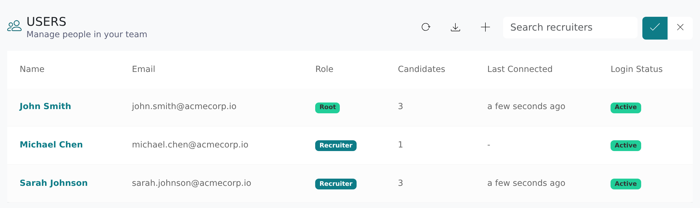

Each Vitay user has one role that decides what they can see and change. An Admin picks the role when they add the user and can change it later.

<Note>
  Only users whose role includes **Manage roles** (Admins, by default) can change roles. If you need a different role, ask an Admin at your firm or contact [hello@vitay.io](mailto:hello@vitay.io).
</Note>

## Role overview

| Role | Who it's for | What they can do |
|------|--------------|-----------------|
| **Recruiter** | Team members | Add candidates and send requests; see their own candidates |
| **Supervisor** | Team leads | See the whole team's work, reassign candidates, manage question sets and export reports |
| **View only** | Hiring managers and observers | See everyone's candidates and references without changing anything |
| **Admin** | Account owners | Full access, including users, roles, settings and integrations |

Admin is the role earlier versions of Vitay called root recruiter. Your firm can also create custom roles with its own mix of permissions (see [Roles and permissions](/account-configuration/roles-and-permissions)).

The Vitay staff admin role is separate and is never given to customer users.

## Recruiter

A recruiter can:

- add candidates and send reference requests;
- read the references on their own candidates;
- update their own profile, password and MFA settings.

By default a recruiter only sees candidates they added. Your Admins decide on the **Roles** page whether recruiters can also see everyone's candidates, change the assigned user or download reports.

## Supervisor

A supervisor can also:

- see every candidate and reference in the account, whoever added them;
- reassign candidates and export reports;
- create and edit question sets;
- open the **Activities** log and the team-wide dashboard views.

Supervisors can't open **Configuration**.

## View only

A View only user sees every candidate and reference in the account but can't add, edit or export anything. It suits hiring managers who need to read references.

## Admin

An Admin has full control of the account, including permissions Vitay adds later. On top of everything a supervisor can do, an Admin can:

- open **Configuration** to change settings, branding, notifications and templates;
- add, edit and deactivate users, and give them roles;
- create and edit custom roles;
- connect integrations such as Bullhorn and JobAdder;
- see analytics across sub-accounts, if your firm has them.

Every account has at least one Admin, and your main point of contact is always one. Roles are shared across your main account and its sub-accounts; an Admin of the main account is also an Admin in every sub-account.

## Troubleshooting

<AccordionGroup>
  <Accordion title="I can't see another recruiter's candidates">
    Your role only lets you see your own candidates. Ask an Admin to give you a role that includes **See everyone's candidates and references**.
  </Accordion>
  <Accordion title="I don't see Configuration in the sidebar">
    Your role doesn't include **Open Configuration**. Admins have it; ask one to change your role if you need it.
  </Accordion>
</AccordionGroup>

## Related articles

<CardGroup cols={2}>
  <Card title="Roles and permissions" icon="id-badge" href="/account-configuration/roles-and-permissions" />
  <Card title="Manage users" icon="users-gear" href="/account-configuration/manage-users" />
  <Card title="Logging in" icon="arrow-right-to-bracket" href="/getting-started/logging-in" />
  <Card title="SCIM provisioning" icon="server" href="/security-it/scim-provisioning" />
</CardGroup>

{/* source: api app/models/access_role.rb (FIRM_PRESETS account_admin / supervisor / recruiter / view_only), app/services/firm_roles/backfill.rb (Recruiter preset from is_all_toogle_enabled / is_candidate_ownership_updatable / is_reports_downloadable), app/services/firm_permissions.rb; app projects/configuration protected/roles, shared/components/navbar (Roles + Configuration access by permission), projects/references navbar (Activities root|supervisor), configuration users/list (pillsRole from role) */}
