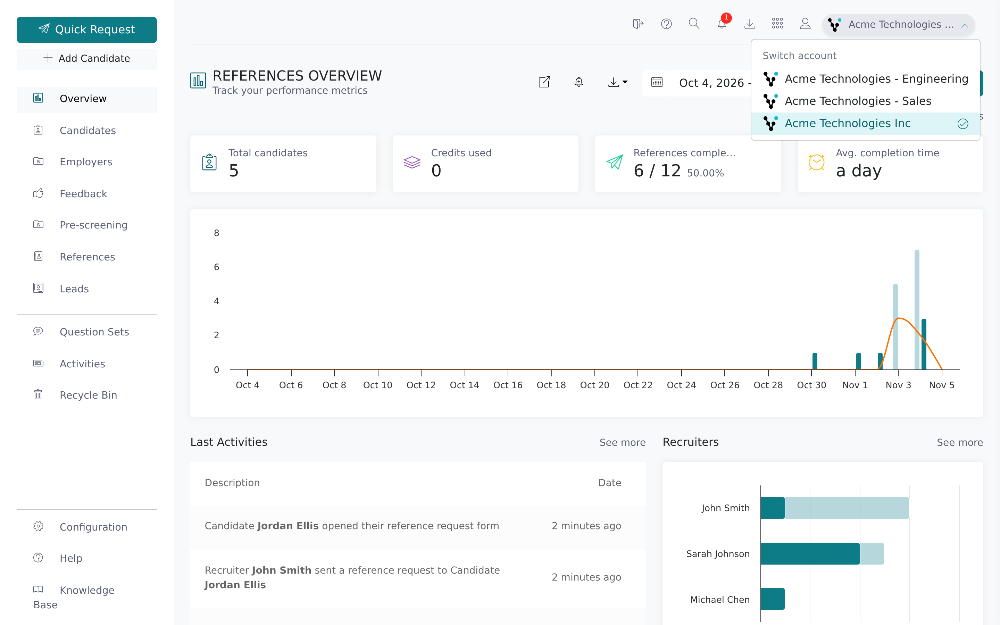
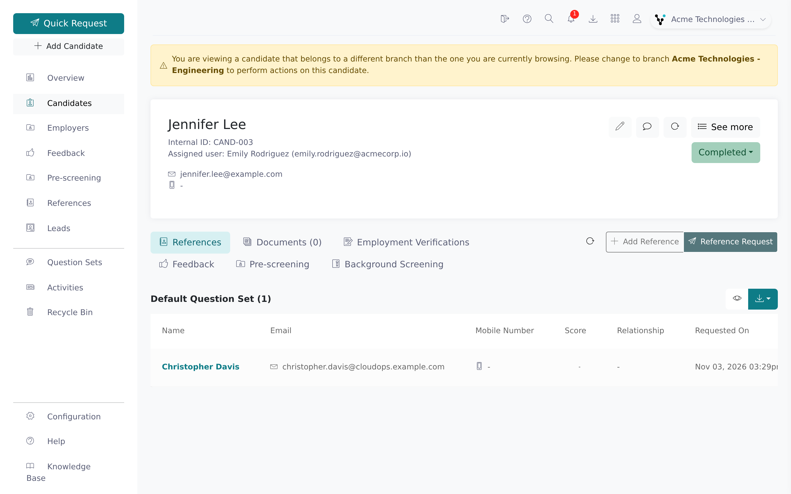

If you work across more than one firm, such as a head office and its branches, the company switcher
in the top bar shows which firm you're in and lets you move to another. It works the same in the
main app and in Configuration.

<Note>
  The switcher only appears when you have access to more than one firm. Otherwise the top bar shows
  your firm's logo and name as a plain label. A root recruiter grants access per firm; see
  [Manage users](/account-configuration/manage-users).
</Note>

## Switch firms

<Steps>
  <Step title="Click the firm name in the top bar">
    At the far right of the top bar, next to the person icon, is a pill with your current firm's
    logo and name. Hover it to see a long name in full. Click it to open the **Switch account**
    menu.

    
  </Step>
  <Step title="Choose a firm">
    The menu lists every firm you can work in, alphabetically, with a tick next to the current one.
    Click the firm you want. Vitay reloads the data for that firm; you don't need to sign in again.
  </Step>
</Steps>

## Which firms are listed

- Every firm where you're an active user.
- If you're a root recruiter of a parent firm, that firm's sub-accounts too. From inside a
  sub-account, you also see the parent and the other sub-accounts.

## What changes when you switch

- **Candidates and references**: lists, search and the dashboard show the selected firm's records.
- **Settings**: each firm has its own settings, templates, question sets and relationship lists.
  Root recruiters can switch firms from the same pill in Configuration.
- **Exports**: CSV exports from the download icon cover the selected firm only.
- **Your role**: roles are set per firm, so what you can do may differ between firms.

To choose the firm you start in after signing in, set **Default Sub Account** on your Account page.
See [Your profile, language, and password](/getting-started/your-profile).

## The "different branch" banner on a candidate

If you open a candidate that belongs to another firm than the one you're in (from a link or a
search result, for example), a yellow banner appears at the top:

> You are viewing a candidate that belongs to a different branch than the one you are currently
> browsing. Please change to branch **&lt;branch name&gt;** to perform actions on this candidate.

You can read the candidate, but **Edit**, **Delete**, **Add reference** and **Request reference**
are disabled until you switch to the branch named in the banner.

## Troubleshooting

<AccordionGroup>
  <Accordion title="I don't see a company switcher">
    You only have access to one firm. A root recruiter can give you access to another; see
    [Manage users](/account-configuration/manage-users).
  </Accordion>
  <Accordion title="A firm I expect is missing from the list">
    You need an active user on that firm, or root recruiter access over its parent. Ask a root
    recruiter to check that your user on that firm is active.
  </Accordion>
  <Accordion title="I got a 'Company switch failed' message">
    The switch didn't complete and you're still in the original firm. Try again. If it keeps
    failing, sign out and back in, then contact [hello@vitay.io](mailto:hello@vitay.io).
  </Accordion>
  <Accordion title="A candidate I know exists isn't in the list">
    They probably belong to another branch. Switch to it, or find them with the top-bar search and
    read the banner to see which branch to switch to.
  </Accordion>
  <Accordion title="My export is missing another branch's records">
    Exports cover the selected firm only. Run one export per firm.
  </Accordion>
</AccordionGroup>

## Related articles

<CardGroup cols={2}>
  <Card title="Your profile, language, and password" icon="user" href="/getting-started/your-profile" />
  <Card title="User roles explained" icon="users" href="/getting-started/roles-explained" />
  <Card title="Manage users" icon="users-gear" href="/account-configuration/manage-users" />
  <Card title="Firm configuration" icon="sliders" href="/account-configuration/firm-configuration" />
</CardGroup>

{/* source: app projects/references/src/app/shared/components/topbar/topbar.component.{html,ts} + projects/configuration/src/app/shared/components/topbar/topbar.component.html (company-switcher, TOPBAR.ACCOUNTS.SWITCH, TOASTS.COMPANY_SWITCH_FAILED), projects/references/src/app/protected/candidates/show/{alerts,header}, candidates.show.component.html (isFromDifferentBranch), projects/references/src/assets/i18n/en.json (CANDIDATE.DIFFERENT_BRANCH, COMMON.DEFAULT_BRANCH); api app/controllers/api/v3/users/hiring_firms_controller.rb, app/controllers/api/v3/oauth_controller.rb (create_refresh), app/controllers/api/v3/documents/csv_controller.rb */}
