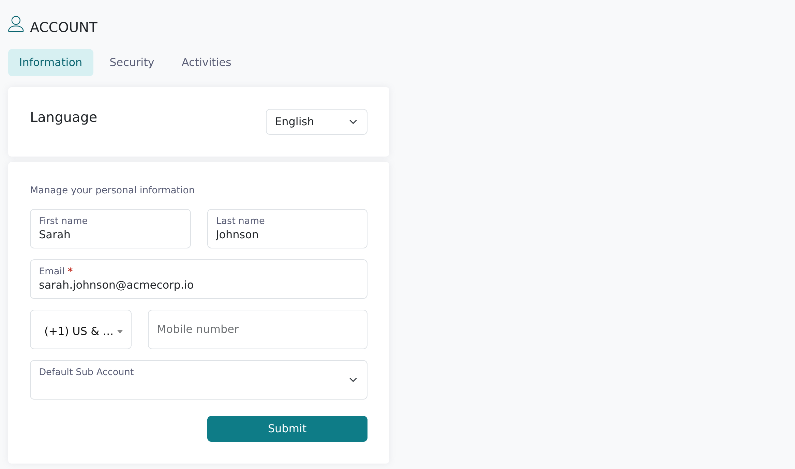
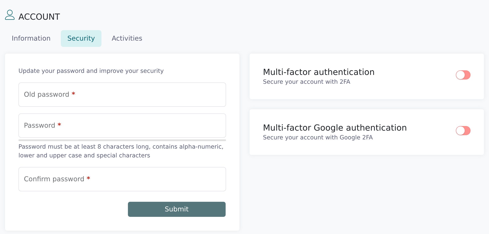

Your **Account** page holds your contact details, the language Vitay is shown in, your password and
MFA settings, and a log of your own activity.

<Note>
  Every user can edit their own Account page. Changing another user's details is done by a root
  recruiter; see [Manage users](/account-configuration/manage-users).
</Note>

## Open your Account page

<Steps>
  <Step title="Click the person icon">
    In the top bar, click the person icon (**My account**). It opens the **Information** tab.
  </Step>
  <Step title="Pick a tab">
    The page has three tabs: **Information**, **Security** and **Activities**.

    
  </Step>
</Steps>

## Information tab

### Language

The **Language** card changes the language of the Vitay screens for you only. It doesn't change
your firm's default or what candidates and references see. Choose **English**, **Español**,
**Français** or **Français (Canada)**. Vitay saves the choice and reloads the page.

### Your details

| Field | Notes |
| --- | --- |
| **First name** / **Last name** | Optional. |
| **Email** | Required. This is the address you sign in with. |
| **Phone** | Optional. Needed for text-message MFA. |
| **Default Sub Account** | Only if you work across several firms: the one you land in after signing in. See [Switch between firms, branches, and sub-accounts](/getting-started/switch-firms). |

Click **Submit** to save. A **Profile updated** message confirms it.

## Security tab

### Change your password

<Steps>
  <Step title="Enter your current password">
    Fill in **Old password**.
  </Step>
  <Step title="Enter the new password twice">
    Type it in **Password** and again in **Confirm password**. It needs at least 8 characters with
    an uppercase letter, a lowercase letter, a number and a special character, and can't match
    your current password or your previous five.
  </Step>
  <Step title="Click Submit">
    A **Profile updated** message confirms the change.

    
  </Step>
</Steps>

### Multi-factor authentication

Beside the password form are two switches:

- **Multi-factor authentication**: a code by text message. It needs a phone number on the
  Information tab, and it's locked if your firm requires MFA.
- **Multi-factor Google authentication**: a code from an authenticator app. Vitay support turns it
  on; the QR code then appears under the card.

Setup and recovery steps are in
[Multi-factor authentication & login options](/getting-started/mfa-and-login-options).

## Activities tab

A read-only list of your own account activity, newest first, with **Date** and **Description**
columns. For activity on candidates and references, see the
[Activities log](/reports-lead-generation/activities-log).

## The Update password screen at sign-in

Sometimes Vitay opens a full-page **Update password** screen after you sign in. Fill in **Old
password**, **Password** and **Confirm password** to continue. It appears in two cases:

- your first sign-in, to replace the password you were given;
- your password has expired, when your firm has turned on **Require passwords update** (30 days by
  default, adjustable from 1 to 365; see
  [Firm configuration](/account-configuration/firm-configuration)).

SSO sign-ins never get this screen.

## Troubleshooting

<AccordionGroup>
  <Accordion title="The Submit button on Security stays greyed out">
    All three fields must be filled, the new password must meet the rules, and **Password** and
    **Confirm password** must match.
  </Accordion>
  <Accordion title="Vitay rejects my new password">
    Check the strength rules above, and that you haven't used it in your last five passwords.
  </Accordion>
  <Accordion title="Vitay rejects my new email address">
    Tutanota and Proton addresses can't be used for Vitay user accounts. Use your work address.
  </Accordion>
  <Accordion title="The MFA switch won't turn on">
    Save a phone number on the **Information** tab first. If it's still locked, your firm requires
    MFA.
  </Accordion>
  <Accordion title="Part of the app is still in English after I changed language">
    That text hasn't been translated yet. Tell us at [hello@vitay.io](mailto:hello@vitay.io).
  </Accordion>
  <Accordion title="I keep being sent back to the Update password screen">
    Your password has expired and must be replaced before you can continue. If it keeps
    reappearing after you submit, contact [hello@vitay.io](mailto:hello@vitay.io).
  </Accordion>
</AccordionGroup>

## Related articles

<CardGroup cols={2}>
  <Card title="Logging in" icon="right-to-bracket" href="/getting-started/logging-in" />
  <Card title="Multi-factor authentication & login options" icon="shield-check" href="/getting-started/mfa-and-login-options" />
  <Card title="Switch between firms, branches, and sub-accounts" icon="building" href="/getting-started/switch-firms" />
  <Card title="Firm configuration" icon="sliders" href="/account-configuration/firm-configuration" />
  <Card title="Manage users" icon="users" href="/account-configuration/manage-users" />
</CardGroup>

{/* source: app src/app/shared/routing/account/account.component.ts, account/information/account.information.component.{html,ts}, account/security/account.security.component.{html,ts}, account/activities/account.activities.component.ts, src/app/shared/routing/password/password.component.html, src/app/shared/helpers/languages.helper.ts, src/app/shared/helpers/login-routing.helper.ts, projects/references/src/assets/i18n/en.json (ACCOUNT.*, COMMON.DEFAULT_BRANCH, PASSWORD.TITLE, TOASTS.PROFILE_UPDATED); api app/models/user.rb (PASSWORD_REQUIREMENTS, BLACKLIST_EMAILS), app/validators/unique_password_validator.rb, app/models/setting.rb, app/models/concerns/has_secure_tokens.rb */}
