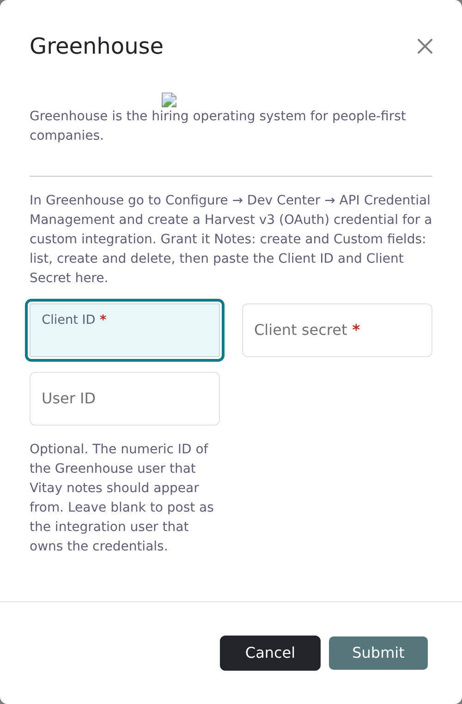

Flag a candidate in Greenhouse and Vitay imports them, sends them a reference request, and posts progress notes back to their Greenhouse activity feed.

<Note>
  Connecting or disconnecting Greenhouse requires the root recruiter role in Vitay. You also need access to Greenhouse's Dev Center to create an API credential and a web hook.
</Note>

## What the integration does

- Adds Vitay fields to Greenhouse. Connecting creates three custom fields on your Greenhouse candidates: **Vitay Sync** (yes/no), **Vitay Question Set** (a dropdown of your Vitay question sets), and **Vitay Recruiter Email** (a dropdown of your Vitay users' emails).
- Imports flagged candidates. When a candidate with **Vitay Sync** set to *Yes* is updated in Greenhouse, Vitay creates or updates them with their name, email, phone number, and Greenhouse ID.
- Sends reference requests. If **Vitay Question Set** is filled in and the candidate has no reference request in Vitay yet, Vitay sends one with that question set.
- Posts progress notes. A note with a link to the results in Vitay appears on the candidate's activity feed when they submit their references and as each reference is completed.

## Connect Greenhouse

Vitay uses Greenhouse's Harvest v3 API, which authenticates with an OAuth Client ID and Client Secret.

<Steps>
  <Step title="Create the credential in Greenhouse">
    In Greenhouse, go to **Configure → Dev Center → API Credential Management** and create a **Harvest v3 (OAuth)** credential for a custom integration. Grant it **Notes: create** and **Custom fields: list, create and delete**. Copy the Client ID and Client Secret. Greenhouse shows the secret only once.
  </Step>
  <Step title="Open the Greenhouse card in Vitay">
    In the **Configuration** area, select **Integrations** and click the **Greenhouse** card.
  </Step>
  <Step title="Enter the credential">
    Paste the **Client ID** and **Client secret**. **User ID** is optional: enter the numeric ID of the Greenhouse user the notes should come from, or leave it blank to post them as the integration user that owns the credential. Click **Submit**.

    Vitay checks the credential with Greenhouse before saving it. If Greenhouse rejects it, you see Greenhouse's reason and nothing is saved.

    
  </Step>
  <Step title="Copy the webhook URL">
    Click the **Greenhouse** card again. The dialog now shows a **Webhook URL**. Copy it.

    
  </Step>
  <Step title="Add the web hook in Greenhouse">
    In Greenhouse's Dev Center, add a web hook for candidate updates that points at the URL you copied. This is how Greenhouse tells Vitay a candidate changed. Contact [hello@vitay.io](mailto:hello@vitay.io) if you'd like help with this step.
  </Step>
</Steps>

<Note>
  Connected with a Greenhouse API key before the Harvest v3 change? Greenhouse is retiring those keys, and once yours stops working, progress notes stop reaching the activity feed. Disconnect, then connect again with a Harvest v3 (OAuth) credential as above. The Vitay custom fields are recreated.
</Note>

## Use the integration

<Steps>
  <Step title="Fill in the Vitay fields in Greenhouse">
    On the candidate's record, set **Vitay Sync** to *Yes*, pick a question set in **Vitay Question Set**, and optionally pick the recruiter in **Vitay Recruiter Email**.
  </Step>
  <Step title="Save the candidate">
    Greenhouse notifies Vitay. The candidate is imported and the reference request goes out within moments.
  </Step>
  <Step title="Follow progress from Greenhouse">
    Notes appear on the candidate's activity feed as references come in, each with a link to the results in Vitay.
  </Step>
</Steps>

Completed reports aren't uploaded to Greenhouse as files. Open the link in the note and download the report from Vitay.

## Disconnect Greenhouse

A root recruiter clicks the **Greenhouse** card and chooses **Delete Integration**. Vitay also removes the Vitay custom fields from Greenhouse.

## Troubleshooting

<AccordionGroup>
  <Accordion title="A candidate I flagged never appeared in Vitay">
    Check that **Vitay Sync** is *Yes* and that the candidate has an email address in Greenhouse. Candidates without one are skipped. Vitay only hears about a candidate when Greenhouse sends the web hook, so re-save the candidate to send a fresh update.
  </Accordion>
  <Accordion title="No reference request was sent for an imported candidate">
    A request is only sent when **Vitay Question Set** is filled in and the candidate has no reference request in Vitay yet. Check both, then re-save the candidate in Greenhouse.
  </Accordion>
  <Accordion title="A new question set or recruiter is missing from the Vitay dropdowns">
    The dropdown options are created when you connect. To pick up question sets or users added since, disconnect and connect Greenhouse again.
  </Accordion>
  <Accordion title="The candidate was assigned to the wrong recruiter">
    Vitay assigns the candidate to the user picked in **Vitay Recruiter Email**. If it's empty, the candidate goes to the root recruiter who copied the webhook URL.
  </Accordion>
  <Accordion title="Progress notes stopped appearing in Greenhouse">
    Your connection most likely still uses a retired Greenhouse API key. Connect again with a **Harvest v3 (OAuth)** credential as described in [Connect Greenhouse](#connect-greenhouse). Candidates keep importing in the meantime.
  </Accordion>
  <Accordion title="Connecting fails with an error from Greenhouse">
    Check that you copied the Client ID and Client Secret exactly, that the credential is a **Harvest v3 (OAuth)** credential, and that it has **Notes: create** and **Custom fields: list, create and delete**. A **User ID** must be the numeric ID of an active Greenhouse user.
  </Accordion>
</AccordionGroup>

## Related articles

<CardGroup cols={2}>
  <Card title="Integrations overview" icon="plug" href="/integrations/overview" />
  <Card title="Question sets & templates" icon="list-check" href="/account-configuration/question-sets-and-templates" />
  <Card title="Send a reference request" icon="paper-plane" href="/candidates-reference-requests/send-a-reference-request" />
  <Card title="Add a candidate" icon="user-plus" href="/candidates-reference-requests/add-a-candidate" />
</CardGroup>

{/* source: api app/controllers/api/services/greenhouse_controller.rb (authorize/get_webhook/destroy, root only); api app/services/external_services/greenhouse/{authorize,client,set_custom_fields,update_candidate}.rb; api app/models/external_authorisations/greenhouse.rb; api app/controllers/api/services/greenhouse/candidates_controller.rb (webhook receiver); api app/controllers/api/v1/{references,reference_requests}_controller.rb (note triggers); app projects/configuration/src/app/shared/components/modals/integrations/modals.integrations.component.{html,ts}; app projects/configuration/src/assets/i18n/en.json (INTEGRATIONS.*, MODALS.INTEGRATIONS.GREENHOUSE.*) */}
