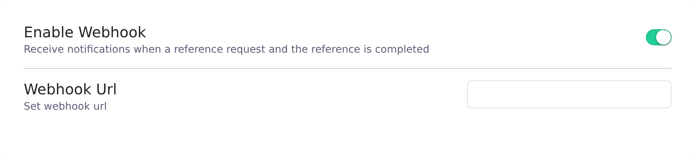

Give Vitay one URL on the **Developers** tab and it sends a JSON `POST` to that URL as each reference event happens, so your systems can react without polling the Vitay API.

<Note>
  You need the root recruiter role to open the Configuration area. Each account has one webhook URL, and every event type goes to it.
</Note>

## Turn webhooks on

<Steps>
  <Step title="Open the Developers tab">
    In the **Configuration** area, select **Settings**, then the **Developers** tab.

    
  </Step>
  <Step title="Switch on Enable Webhook">
    The **Webhook Url** field stays greyed out until the switch is on.
  </Step>
  <Step title="Enter your endpoint">
    Type your endpoint into **Webhook Url**. It saves when you stop typing or click away, and **Saved** appears under the field. The URL must start with `http://` or `https://`. Anything else is skipped and nothing is sent.
  </Step>
</Steps>

## Events

| `event` | `type` | Sent when |
|---|---|---|
| `created` | `Reference` | A reference is added to a candidate by a recruiter, or through the API or an integration. |
| `completed` | `ReferenceRequest` | The candidate submits their list of references on the public form. |
| `completed` | `Reference` | A reference provider submits the reference form. |
| `declined` | `Decline` | A reference provider declines. Only possible if declining is enabled in [Reference settings](/account-configuration/reference-settings). |

Both completion events use `completed`, so check `type` to tell them apart. References the candidate adds on the public form don't produce `created` events; that submission sends the `completed` `ReferenceRequest` event instead.

## Payload

Every delivery has the same envelope:

```json
{
  "event": "completed",
  "type": "Reference",
  "id": "8f6b2f2e-1f1f-4c62-9a1b-4a8f6b0d5e21",
  "data": { }
}
```

- `event`: `created`, `completed`, or `declined`.
- `type`: `Reference`, `ReferenceRequest`, or `Decline`.
- `id`: the record's UUID, repeated at the top level so you can route without reading `data`.
- `data`: the record and its stored fields.

| `type` | Fields in `data` include |
|---|---|
| `Reference` | `id`, `first_name`, `last_name`, `email`, `phone`, `title`, `company_name`, `relationship`, `status`, `filled_at`, `candidate_id`, `question_set_id`, `requested_by_id`, `created_at`, `updated_at` |
| `ReferenceRequest` | `id`, `request_type`, `language`, `filled_at`, `is_active`, `candidate_id`, `question_set_id`, `requested_by_id`, `created_at`, `updated_at` |
| `Decline` | `id`, `comment`, `is_declined`, `identifiable_type`, `identifiable_id` (the declined reference), `created_at`, `updated_at` |

Answers aren't included. Treat the webhook as a signal and fetch the completed report from the Vitay API when you need the content.

## Delivery and security

- One attempt. Vitay sends a single `POST`. If your endpoint is down, returns an error, or times out, that event isn't retried or replayed.
- 10-second timeout. Acknowledge quickly and do the real work afterwards. Delivery happens while the triggering action runs, so a slow endpoint also slows the person submitting the form.
- Headers. Requests carry `Content-Type: application/json` and `Accept: application/json`. If your account has a webhook secret, every request also carries it in an `X-Vitay-Webhook-Secret` header. There's no field for the secret in the app; contact [hello@vitay.io](mailto:hello@vitay.io) to set one.

To protect your endpoint:

- Check the `X-Vitay-Webhook-Secret` header if you have a secret, and use an unguessable HTTPS URL.
- Re-fetch the record from the Vitay API before acting on anything important.
- Make your handler idempotent, so processing the same `id` twice has no side effects.

The **DMARC Protection** card on the same tab is about email authentication, not webhooks. See [Email sender settings](/account-configuration/email-sender-settings).

## Troubleshooting

<AccordionGroup>
  <Accordion title="The Webhook Url field is greyed out">
    Switch **Enable Webhook** on first.
  </Accordion>
  <Accordion title="I saved a URL but nothing arrives">
    Check that the switch is on, that the field said **Saved** after you typed, and that the URL starts with `http://` or `https://`. Then confirm the event you're waiting for: adding a reference yourself sends `created`, not `completed`.
  </Accordion>
  <Accordion title="We missed some events">
    Deliveries aren't retried, so events sent while your endpoint was unavailable are gone. Read the affected records from the API to catch up.
  </Accordion>
  <Accordion title="Can we send different events to different URLs?">
    No. One URL receives every event type. Route on `event` and `type` in your handler.
  </Accordion>
  <Accordion title="Can we verify a request came from Vitay?">
    Yes, if your account has a webhook secret: compare the `X-Vitay-Webhook-Secret` header with it. Requests aren't signed, so also re-fetch the record from the Vitay API before acting on it.
  </Accordion>
</AccordionGroup>

## Related articles

<CardGroup cols={2}>
  <Card title="Integrations overview" icon="plug" href="/integrations/overview" />
  <Card title="Email sender settings" icon="envelope" href="/account-configuration/email-sender-settings" />
  <Card title="Reference settings" icon="list-check" href="/account-configuration/reference-settings" />
  <Card title="Firm configuration and security settings" icon="gear" href="/account-configuration/firm-configuration" />
</CardGroup>

{/* source: app projects/configuration/src/app/protected/settings/developers/settings.developers.component.html + i18n SETTINGS.DEVELOPERS.*; api app/services/external_services/webhooks/events.rb (envelope, 10 s timeout, X-Vitay-Webhook-Secret, no retry); api app/models/setting.rb + app/controllers/api/v3/settings_controller.rb (webhook_secret, API-only); api app/controllers/api/v1/references_controller.rb, api/v3/references_controller.rb, api/v1/reference_requests_controller.rb, api/v1/references/declines_controller.rb (event call sites) */}
