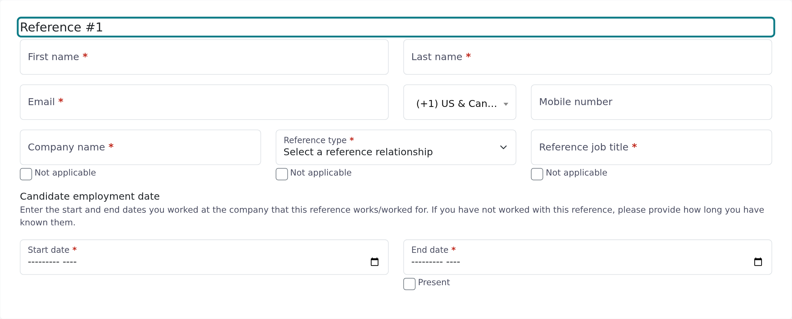

<Note>
  This article is for both candidates and people asked to give a reference. Date fields work the same way on the reference request form and on the reference form.
</Note>

Vitay uses your browser's own date picker, so the fields look a little different in each browser and on phones. They behave the same everywhere.

## Employment dates (Start date and End date)

Many forms have a **Candidate employment date** section with a **Start date** and an **End date**. These ask for a month and year only.

<Steps>
  <Step title="Pick the start month and year">
    Click or tap **Start date**. Depending on your browser you get a month picker or a field you can type into. If you see a plain text box, type the year and month, for example `2023-04`.
  </Step>
  <Step title="Pick the end month and year, or tick Present">
    Fill in **End date** the same way. If the job is still ongoing, tick **Present** under it instead. The end date is then no longer needed.
  </Step>
</Steps>

The end date can't be earlier than the start date. If you pick one that is, the field goes back to what it was before.

Some recruiting teams only accept references who worked with the candidate recently, for example within the last 3 years. When that rule is on, the form says so above the dates, and an end date that's too old shows **This end date is too far in the past for the firm's policy.** If you haven't worked together in that time, contact the recruiter. Their email is in the message you received.

## Date questions on the reference form

The reference form can also include date questions:

- A single date, labelled **Select a date**. This asks for a full date (day, month and year).
- A date range, labelled **From** and **To**. It asks for either full dates or month and year, depending on the question. Both dates are required, and **To** can't be before **From**.

## Troubleshooting

<AccordionGroup>
  <Accordion title="I can't find the month or year I need in the picker">
    Pickers usually open on the current month. Use the arrows or the month and year headings in the picker to go back, or click into the field and type the date if your browser allows it.
  </Accordion>
  <Accordion title="The end date keeps jumping back">
    The date you picked is before the start date, or older than the recruiting team allows. Change the start date first, then set the end date again.
  </Accordion>
  <Accordion title="The form says a date is required but I filled it in">
    Click into the field, pick the month and year again, then click somewhere else on the page. On a **From** and **To** question, moving **From** to after **To** clears **To**, so check it again.
  </Accordion>
  <Accordion title="The picker won't open">
    Try another browser, such as Google Chrome or Microsoft Edge, or open the link on your phone. If that doesn't help, contact the recruiter who sent the request. Their email is in the message you received.
  </Accordion>
</AccordionGroup>

## Related articles

<CardGroup cols={2}>
  <Card title="Help for candidates and references" icon="house" href="/reference-providers/start-here" />
  <Card title="I can't type, select, or submit on the form" icon="triangle-exclamation" href="/reference-providers/trouble-submitting" />
  <Card title="The link in my email isn't working" icon="link-slash" href="/reference-providers/link-not-working" />
</CardGroup>

{/* source: app projects/references/src/app/public/reference-requests/reference-requests.component.{html,ts} and public/references/references.component.{html,ts} (type="month" start/end with [min], isCurrent COMMON.CURRENT "Present", setDateInputValue revert, endDateRestrictionValidator, END_DATE_RESTRICTION.*; type="date" FORMS.LABELS.SELECT_DATE; DateRange FORMS.LABELS.FROM/TO, month_only, setDateRangeValue, DateRangeValidator.Complete) */}
