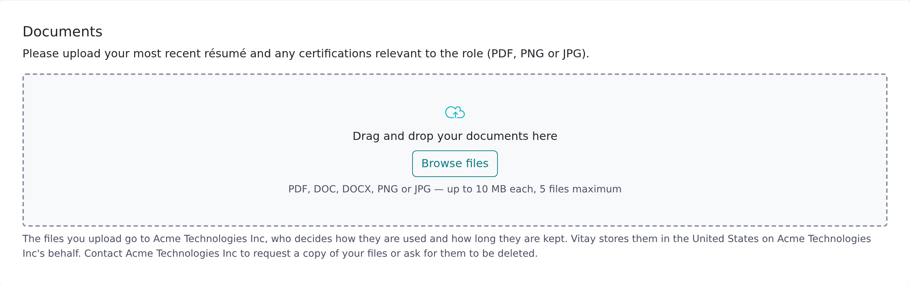

<Note>
  This article is for candidates who received a reference request. If you were asked to *give* a reference, see [Help for candidates and references](/reference-providers/start-here).
</Note>

Some recruiting teams ask you to attach documents, such as a résumé or a licence, along with your references. If so, the form has a **Documents** section below your references with a note about what to attach. If you don't see it, there's nothing to upload.

## Upload your documents

<Steps>
  <Step title="Read the instructions">
    The text at the top of the **Documents** section says what to attach. A red asterisk after **Documents** means at least one file is required.
  </Step>
  <Step title="Add your files">
    Drag files onto the upload area, or click **Browse files**. You can attach up to 5 files. Each must be a PDF, DOC, DOCX, PNG or JPG file of 10 MB or less.
  </Step>
  <Step title="Check the list">
    Each file appears in a list under the upload area. To remove one, click the trash icon next to it.
  </Step>
  <Step title="Submit the form">
    Finish the rest of the form and click **Submit**. Your documents go to the recruiter with your references.
  </Step>
</Steps>

## Troubleshooting

<AccordionGroup>
  <Accordion title="My file is rejected">
    Read the message under the upload area:
    - **This file type is not supported.** Save the document as PDF, DOC, DOCX, PNG or JPG. Renaming a file to a different extension doesn't work. A file name with more than one dot, such as `my.cv.pdf`, is also rejected, so rename it to `my-cv.pdf`.
    - **This file is larger than 10 MB.** Compress the file or export a smaller version.
    - **You can upload at most 5 documents.** Remove a file before adding another.
  </Accordion>
  <Accordion title="I can't submit because a document is missing">
    The recruiter has made documents required. Attach at least one file in the **Documents** section.
  </Accordion>
  <Accordion title="I already submitted and forgot a document">
    You can't add files to the form after submitting. Reply to the email that asked you for your references and attach the file. Replies go to the recruiting team that sent it.
  </Accordion>
</AccordionGroup>

## Related articles

<CardGroup cols={2}>
  <Card title="Help for candidates and references" icon="house" href="/reference-providers/start-here" />
  <Card title="Adding another reference after submitting" icon="user-plus" href="/reference-providers/add-another-reference" />
  <Card title="The link in my email isn't working" icon="link-slash" href="/reference-providers/link-not-working" />
</CardGroup>

{/* source: app projects/references/src/app/public/reference-requests/reference-requests.component.{html,ts} (candidate_documents enabled/required, REFERENCE_REQUESTS.DOCUMENTS.*, documentExtensions, maxDocumentBytes 10 MB, maxDocumentCount 5, multi-dot filenames rejected); api app/controllers/api/v1/reference_requests/documents_controller.rb (Marcel sniffing ALLOWED_TYPES, MAX_FILE_SIZE, MAX_FILE_COUNT, multiple extensions, 409 once filled) */}
