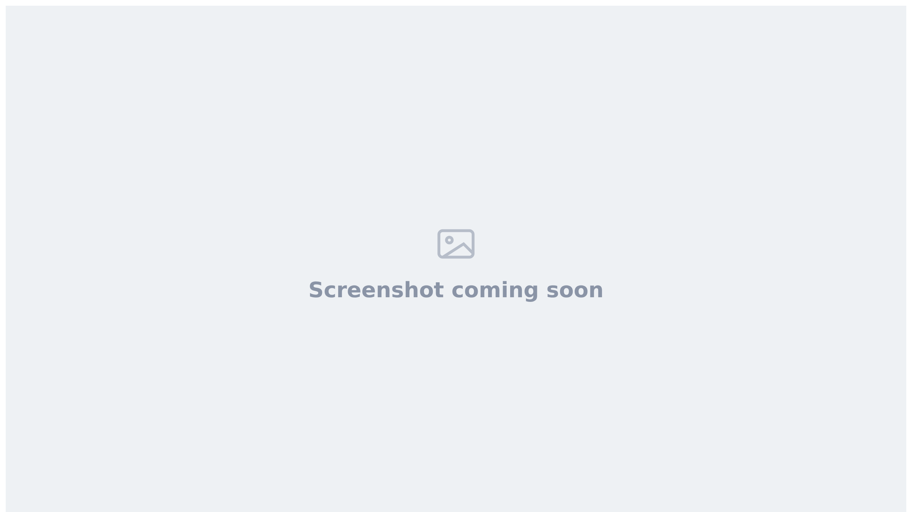

Upload a CSV file to add many candidates in one go, and optionally send each of them a reference request at the same time.

<Note>
  You need a recruiter (or higher) role. Vitay reads the first 50 rows of the file, or 100 if Vitay has raised the limit for your account (ask hello@vitay.io). Rows past the limit are ignored without a warning, so split larger files.
</Note>

## Prepare your CSV file

<Steps>
  <Step title="Download the template">
    Go to **Candidates** and click the upload icon (**Import candidates**) in the toolbar. In the window that opens, click **Download the CSV template**.

    
  </Step>
  <Step title="Fill in one row per candidate">
    Vitay reads the columns by position, so keep the template's column order.

    | Column | Required | Notes |
    |--------|----------|-------|
    | `internal_id` | No | Your ATS or CRM ID. Generated if blank |
    | `first_name` | Yes | |
    | `last_name` | Yes | |
    | `email` | Yes | Can't be the email of a recruiter |
    | `country_code` | No | Dialing code digits, e.g. `1`. Defaults to `1` |
    | `phone_number` | No | Spaces, dashes and `+` are removed |
    | `public_notes` | No | Note shown to the candidate on their reference request |
    | `internal_notes` | No | Visible to recruiters only |
    | `min_manager_references` | No | Minimum number of references |
    | `assigned_recruiter_email` | No | A recruiter on your account or on the `branch_id` account. Blank means you |
    | `branch_id` | No | Sub-account ID from the **ID** column in **Configuration → Accounts** |
    | `question_set_id` | No | Leave blank. You pick the question set in the import window |
    | `is_manager_only` | No | `true` or `yes` to require manager references only |
    | `job_title` | No | Only in the template when the job title feature is on |
  </Step>
  <Step title="Save as CSV">
    Save the file as `.csv` with UTF-8 encoding and remove blank rows at the end. The file can be up to 15 MB.
  </Step>
</Steps>

## Upload the file

<Steps>
  <Step title="Drop the file in the import window">
    Open **Import candidates** again and drag your CSV onto the drop area, or click the browse button. Vitay checks the file right away. Nothing is created yet.
  </Step>
  <Step title="Fix any errors">
    If a row has a problem, the window lists every error: a missing field, an invalid email, an unknown recruiter email, or a candidate that already exists on your account (same email or internal ID). You can't continue until there are none. Fix the rows in your spreadsheet and drop the file again.
  </Step>
  <Step title="Choose a question set (optional)">
    When the file passes, the window shows how many candidates will be added and a **Question set** dropdown. Pick a question set to send every new candidate a reference request, or leave it on **Select a question set** to add them without one.
  </Step>
  <Step title="Submit">
    Click **Submit**. When it's done, you'll see **Candidates added** and the window closes. Reference requests go out straight away if you chose a question set.
  </Step>
</Steps>

Each candidate is added to your account, or to the sub-account in `branch_id`, and assigned to the recruiter in `assigned_recruiter_email`. If that column is blank, they're assigned to you and any reference request is sent in your name.

## Troubleshooting

<AccordionGroup>
  <Accordion title="The recruiter email wasn't found">
    The email in `assigned_recruiter_email` must belong to a recruiter on your account, or on the `branch_id` account if you set one. Correct it, or clear it to assign the candidate to yourself.
  </Accordion>
  <Accordion title="Where do I find the branch ID?">
    In **Configuration**, open **Accounts**. Use the short number in the **ID** column, not the long ID from the browser address bar. Leave `branch_id` blank to add the candidate to your own account.
  </Accordion>
  <Accordion title="A row says Deactivated candidate">
    That candidate is in the Recycle Bin, so they don't show in your candidates list. Click **Open the Recycle Bin**, find them, and click **Reactivate** to restore them with their history. Then remove the row from your file and upload it again. See [Recycle Bin](/candidates-reference-requests/recycle-bin#adding-a-deactivated-candidate-again).
  </Accordion>
  <Accordion title="Rows could not be added after I clicked Submit">
    A row can still fail at this point, for example if a colleague added the same candidate in the meantime. If any row fails, nothing from the file is imported and the window lists the rows with errors. Fix them and upload the whole file again.
  </Accordion>
  <Accordion title="My file has more than 50 rows">
    Only the first 50 rows are read (100 if Vitay raised your limit). Split the file and upload it in batches.
  </Accordion>
  <Accordion title="I get a phone number error but the number looks right">
    Formatting is removed automatically, so the digits themselves aren't valid for that country. Check the number and set `country_code` to the right dialing code, such as `1` for North America or `44` for the UK.
  </Accordion>
</AccordionGroup>

## Related articles

<CardGroup cols={2}>
  <Card title="Add a candidate" icon="user-plus" href="/candidates-reference-requests/add-a-candidate" />
  <Card title="Send a reference request" icon="paper-plane" href="/candidates-reference-requests/send-a-reference-request" />
  <Card title="Download reports" icon="download" href="/reports-lead-generation/download-reports" />
  <Card title="Question sets and templates" icon="list-check" href="/account-configuration/question-sets-and-templates" />
</CardGroup>

{/* source: app projects/references/src/app/protected/candidates/list/candidates.list.component.html (import button lnr-upload2, BUTTONS.IMPORT); shared/components/modals/import/modals.import.component.{ts,html} (check on drop is_check, 15 MB, question set select after check, synchronous submit, TOASTS.CANDIDATES_ADDED / IMPORT_PARTIAL, DEACTIVATED_HINT + RECYCLE_BIN.OPEN_LINK → /recycle-bin); api app/controllers/api/v3/documents/csv_controller.rb (#check, #upload all-or-nothing transaction, first(50)/first(100) break_rows_limit_feature_flag, existing_candidate_for, set_duplicate_candidate_error); app/services/documents/csv/candidates_handler.rb (template fields, positional to_params, validate!) */}
