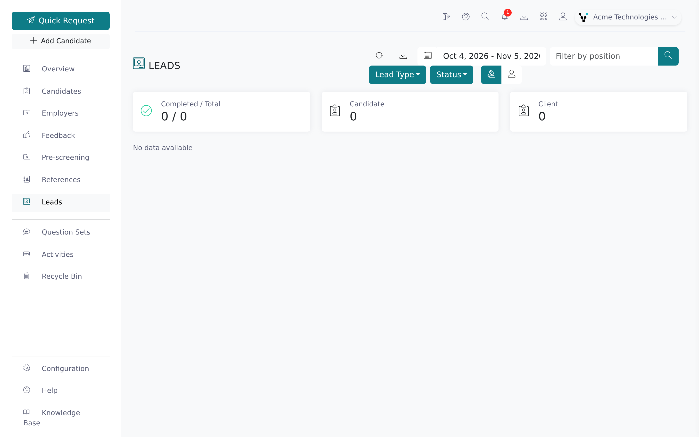
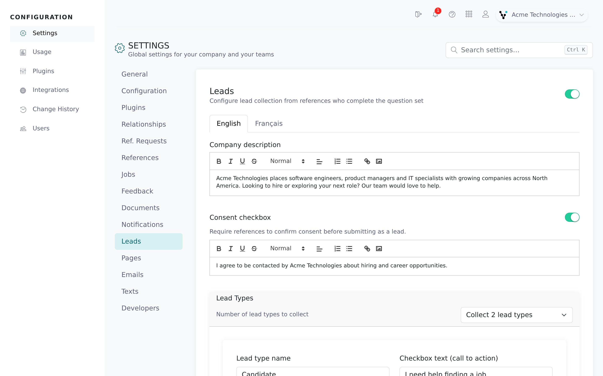

References who complete a reference check may be future candidates or clients. With lead generation on, the thank-you page after the reference form shows your company description and lets references ask to be contacted. Those requests become leads in Vitay.

<Note>
  A root recruiter turns lead generation on in **Configuration → Settings → Leads**. You need a recruiter (or higher) role to view leads. The Leads settings tab isn't available on demo accounts.
</Note>

## How it works

After submitting a reference, the reference sees a card with your **Company description**, a short rich-text introduction that can link to your careers site. What else the card shows depends on how many lead types you collect:

- **Don't collect any lead types:** only the description (and its links). No leads are recorded.
- **Collect 1, 2, or 3 lead types:** the reference picks one option, enters the email address to contact them at, and clicks **Contact me**, or clicks **No thanks** to skip. Vitay records them as a lead of that type.

Each lead type has:

- A **Lead type name**, used in Vitay and on the lead's page.
- **Checkbox text (call to action)**, the option the reference sees, for example "I need help hiring".
- An optional **Thank you message** shown after they click **Contact me**.
- An optional button (**Button text** and **Button link (URL)**) shown with the thank-you message.

If your firm used the older lead-generation setup, it was converted automatically: a "Careers" setup became description-only with an **Explore Job Openings** link, and a "Staffing" setup became two lead types, **Candidate** and **Client**.

## Consent

You can add a consent checkbox to the card with your own wording. When it's on, a reference must tick it before **Contact me** works, and Vitay stores two extra fields on the lead:

| Field | What it holds |
|-------|---------------|
| **Consent Given At** | When the reference ticked the box and submitted |
| **Consent Text** | The consent wording at that moment |

Both columns are in the leads CSV export. When consent is off, leads are still recorded, without these fields.

## View your leads

<Steps>
  <Step title="Go to Leads">
    Click **Leads** in the main navigation. It's only there when lead generation is on.

    
  </Step>
  <Step title="Filter the list">
    Cards at the top show **Completed / Total** and a count per lead type. Use the toolbar to narrow the list: the date range (with **Last 7 days**, **Month to date**, **Last month**, and **Year to date**), **Filter by position**, **Lead Type**, **Status**, and the **Everyone** / **Myself** toggle if your role or firm allows it.
  </Step>
  <Step title="Open a lead">
    Click a row to see the lead's contact details, the candidate they gave a reference for, and the **Lead type** they picked.
  </Step>
  <Step title="Track your follow-up">
    Use the status dropdown at the top of the lead's page. It saves as soon as you pick a value.

    | Status | Meaning |
    |--------|---------|
    | **Process initiated** | Received, not acted on yet |
    | **Contacted** | You've reached out |
    | **Completed** | Follow-up finished |
  </Step>
</Steps>

Leads are references, so they also appear on the **References** page. With lead generation on, that page's **Types** filter lists your lead types.

## Export leads

On the **Leads** page, click the download icon to export your leads as CSV, including lead type and consent columns. Root recruiters and supervisors always see the icon; other users see it unless Vitay has turned report downloads off for your firm. For other exports, see [Download reports](/reports-lead-generation/download-reports).

## Set up lead generation

There's no Save button on the Leads settings page. Each field saves a moment after you stop typing, and **Saving...** shows next to it.

<Steps>
  <Step title="Turn it on">
    Go to **Configuration → Settings → Leads** and turn on the switch at the top of the **Leads** card. The rest of the page appears.

    
  </Step>
  <Step title="Write the company description">
    Fill in **Company description**. Every reference sees it, so add any links you want them to follow, such as your careers page.
  </Step>
  <Step title="Set up consent (optional)">
    Turn on **Consent checkbox** and enter the wording references agree to.
  </Step>
  <Step title="Choose how many lead types to collect">
    Under **Lead Types**, pick from **Number of lead types to collect**. A card appears for each type, pre-filled with Candidate, Client, and Other, which you can rename.
  </Step>
  <Step title="Fill in each lead type">
    Fill in **Lead type name** and **Checkbox text (call to action)**. Optionally add a **Thank you message** (up to 150 characters) and a **Button text** and **Button link (URL)**. The button only appears when both are filled in. Include `https://` in the link.
  </Step>
  <Step title="Choose who gets notified">
    Click **Notifications** on a lead-type card. In the window that opens, choose who is emailed when a lead of that type comes in: the root email, the assigned recruiter, and any other addresses you add.
  </Step>
  <Step title="Add translations (multi-language firms)">
    If your firm uses more than one language, the card has a tab per language. Enter the description, consent text, and lead-type fields in each one. References see the version for the language they used.
  </Step>
  <Step title="Check the preview">
    **Interactive Preview** at the bottom shows what references see in the selected language. Pick a lead type and click **Contact me** to see its thank-you message and button, then **Reset preview**.
  </Step>
</Steps>

Changes apply to the next reference completed on your account.

## Troubleshooting

<AccordionGroup>
  <Accordion title="A reference completed the form but there's no lead">
    A lead is only recorded when the reference picks an option, enters an email, and clicks **Contact me**. If consent is required, they also have to tick the checkbox. You can't add a lead on someone's behalf.
  </Accordion>
  <Accordion title="Leads isn't in the navigation">
    Lead generation is off. Ask a root recruiter to turn on the switch in **Configuration → Settings → Leads**.
  </Accordion>
  <Accordion title="References see the description but no options">
    **Number of lead types to collect** is set to **Don't collect any lead types**. Choose **Collect 1 lead type** or more.
  </Accordion>
  <Accordion title="My edits don't show in another language">
    Each language has its own fields. Open that language's tab and fill them in. Blank lead-type names and checkbox text fall back to English.
  </Accordion>
  <Accordion title="The consent columns are blank in the export">
    Consent wasn't turned on when that lead came in.
  </Accordion>
  <Accordion title="I need more than three lead types">
    Three is the maximum. Contact hello@vitay.io if you need something different.
  </Accordion>
</AccordionGroup>

## Related articles

<CardGroup cols={2}>
  <Card title="Download reports" icon="download" href="/reports-lead-generation/download-reports" />
  <Card title="Send a reference request" icon="paper-plane" href="/candidates-reference-requests/send-a-reference-request" />
  <Card title="Notification settings" icon="gear" href="/account-configuration/notification-settings" />
  <Card title="Bulk candidate upload" icon="upload" href="/reports-lead-generation/bulk-candidate-upload" />
</CardGroup>

{/* source: app projects/configuration/src/app/protected/settings/leads/settings.leads.component.{ts,html} (SETTINGS.PAGES.LEADS.*, createDefaultLeadType); shared/components/modals/lead-type-notifications; src/app/shared/components/lead-gen-card (radio shows checkbox_text, email, consent, Contact me / No thanks); projects/references/src/app/public/references/references.component.html (lead card after submit); protected/lead-generation/list (stats, filters, custom_leads download when isRoot || is_reports_downloadable, row → /leads/:id); protected/leads/show (status from src/app/shared/helpers/lead.helper.ts, LEADS.SHOW.LEAD_TYPE); protected/leads/list (Types filter lists lead types when lead_generation.enabled); shared/components/navbar (LEADS_LIST); api app/controllers/api/v1/references_controller.rb apply_lead_consent; app/models/lead_type.rb; app/controllers/api/v3/documents/csv_controller.rb custom_leads; lib/tasks/migrate_lead_generation.rake */}
