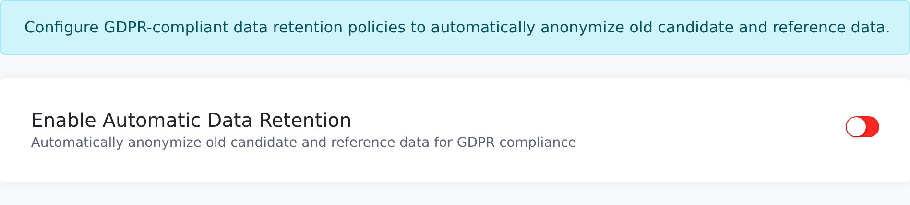

A retention policy anonymizes candidates (and their references) that have had no new reference
activity for longer than the period you choose. Root recruiters get an email before it happens, so
you can keep anything you still need.

<Note>
  Vitay has to enable the **Data Retention** feature for your firm first; if you don't see the tab,
  contact [hello@vitay.io](mailto:hello@vitay.io). You also need the root recruiter role.
</Note>

## Turn on a retention policy

<Steps>
  <Step title="Open the Data Retention tab">
    In **Configuration**, click **Settings**, then the **Data Retention** tab.

    
  </Step>
  <Step title="Switch on Enable Automatic Data Retention">
    The rest of the settings appear once it's on.
  </Step>
  <Step title="Choose a Retention Period">
    Pick **3**, **6**, **12**, **18**, **24**, **36**, **48** or **60** months. It starts at 24
    months, and 3 months is the minimum.
  </Step>
  <Step title="Decide whether sub-accounts are covered">
    On a parent account, **Apply to Sub-Accounts** applies the same policy to every sub-account that
    hasn't switched on its own. Standalone accounts don't see this option.
  </Step>
  <Step title="Check the status">
    **Last Anonymization Run** shows when the policy last ran for your firm, or **Never**.
  </Step>
</Steps>

## How inactivity is measured

The period counts from the last time a reference, feedback request or pre-screening was added to
the candidate. Adding a new one restarts the clock. On the review page this date is the **Last
Used** column.

Candidates already anonymized, and candidates marked **Keep Record**, are never picked up again.

## What anonymization does

Anonymization keeps the record but permanently removes the personal data in it. For each candidate
past the retention period, Vitay:

- renames the candidate *Anonymized Candidate* and clears their contact details;
- renames each of their references *Anonymized Reference* and clears their contact and job details;
- deletes the references' answers and the answers on the candidate's feedback and pre-screening
  forms;
- deletes uploaded documents and signatures;
- deletes email and text history, and strips details from activity log entries;
- deletes stored browser, device and IP address records;
- marks the candidate and their references inactive.

Feedback records that aren't attached to a candidate are anonymized on the same schedule.

<Warning>
  Anonymization can't be undone, and the Recycle Bin can't bring the data back. See
  [Recycle Bin](/candidates-reference-requests/recycle-bin) for how deactivating differs from
  erasing.
</Warning>

## The warning emails

While a policy is on, your firm's root recruiters get these emails:

| Email | Subject | When |
|---|---|---|
| Upcoming anonymization | *Data Retention Notice: N records scheduled for anonymization* | Records are due within 30 days. Repeated at most once every 7 days. |
| Run summary | *Data Retention Summary: N records anonymized* | After a run that anonymized something. |

The notice lists how many candidates and feedback records are due and has a **Review Scheduled
Records** button. If nothing is due in the next 30 days, no notice is sent.

## Review what's scheduled

<Steps>
  <Step title="Open Scheduled for Anonymization">
    Click **View Scheduled Records** at the bottom of the Data Retention tab. When records are due
    within 30 days, a **Scheduled Deletion** link with a count also appears in the Configuration
    sidebar.

    
  </Step>
  <Step title="Choose how far ahead to look">
    **Preview period** offers **7**, **14**, **30**, **60** or **90** days and starts at 30. Records
    already past the retention period are always listed.
  </Step>
  <Step title="Find a record">
    Type in **Search by name or email...**. Each row shows **Name**, **Email**, **Last Used**,
    **Scheduled For** and **Days Remaining**. Feedback records aren't listed one by one; a note under
    the table gives their count.
  </Step>
  <Step title="Keep a record">
    Click **Keep Record** on the row, then **Keep Record** again in the **Keep This Record?** dialog.
    To keep several, tick their checkboxes and click **Keep Selected**.
  </Step>
</Steps>

A kept record is excluded for good: future runs skip it however long it stays inactive.

## When the policy runs

The policy runs automatically on a schedule managed by Vitay. **Last Anonymization Run** on the Data
Retention tab tells you when it last ran. Because notices start 30 days ahead, you get at least one
email before anything is erased.

## Troubleshooting

<AccordionGroup>
  <Accordion title="I don't see a Data Retention tab">
    Vitay enables data retention per firm. Contact [hello@vitay.io](mailto:hello@vitay.io).
  </Accordion>
  <Accordion title="I don't see Scheduled Deletion in the sidebar">
    The link only appears when records are due within the next 30 days. Use **View Scheduled
    Records** on the Data Retention tab instead.
  </Accordion>
  <Accordion title="The Scheduled for Anonymization page is empty">
    Nothing is due in the preview period, and the page says *"All your records are within the
    retention period"*. Set **Preview period** to 60 or 90 days to look further ahead.
  </Accordion>
  <Accordion title="Our sub-account isn't being anonymized">
    Check **Apply to Sub-Accounts** on the parent account. A sub-account with its own policy
    switched on uses its own retention period.
  </Accordion>
  <Accordion title="We anonymized someone by mistake">
    It can't be reversed. Turn the policy off or lengthen the period to stop further runs, and
    contact [hello@vitay.io](mailto:hello@vitay.io) if you need help working out what was affected.
  </Accordion>
</AccordionGroup>

## Related articles

<CardGroup cols={2}>
  <Card title="Data and privacy" icon="shield-halved" href="/security-it/data-and-privacy" />
  <Card title="Recycle Bin" icon="trash-arrow-up" href="/candidates-reference-requests/recycle-bin" />
  <Card title="Firm configuration and security settings" icon="gear" href="/account-configuration/firm-configuration" />
  <Card title="Manage users" icon="users" href="/account-configuration/manage-users" />
</CardGroup>

{/* source: app projects/configuration/src/app/protected/settings/data-retention/settings.data-retention.component.{ts,html}, protected/scheduled-entities/scheduled-entities.component.{ts,html}, shared/components/navbar/navbar.component.ts (Scheduled Deletion link only when count > 0), shared/settings-search/settings-search.registry.ts (tab hidden without data_retention_plugin), projects/configuration/src/assets/i18n/en.json (SETTINGS.DATA_RETENTION, SCHEDULED_ENTITIES); api app/services/data_retention_policy_service.rb, app/jobs/data_retention_anonymization_job.rb, app/mailers/data_retention_mailer.rb, app/services/candidate_anonymizer_service.rb, app/services/reference_anonymizer_service.rb, app/services/feedback_anonymizer_service.rb, app/models/candidate.rb */}
